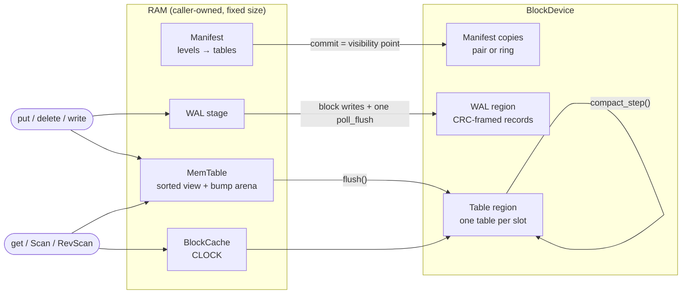

# horton

A log-structured merge-tree key-value store for places where `malloc`
doesn't exist: firmware, kernels, bootloaders. It runs in a browser as
WebAssembly too, and on a desktop or server
[`examples/kvstore`](#host-key-value-store) wraps it as a LevelDB-style
store over one file.

- **`#![no_std]`, no `alloc`, no dependencies.** The `[dependencies]`
  table is empty; the library uses only `core`. Loom is a test-only
  dependency behind `--cfg horton_loom`.
- **`#![forbid(unsafe_code)]`.** The ESP32-S3 flash driver's register
  logic is safe too. The volatile MMIO half lives in the board crate.
- **Every byte is caller-owned and sized at compile time.** The database,
  a scan and the compaction scratch are fixed-size values. Put them in
  `static`s and you know the RAM bill before you flash the board. A
  measured ESP32-S3 shape and its CI gate are under [RAM](#ram).
- **No panics.** Every failure is an [`Error`](src/error.rs) variant,
  including `BufferTooSmall { need }` instead of truncation. The one
  exception is `FlashBlockDevice::new`, which rejects a wrong board
  configuration; in a `static` that check runs at compile time.
- **Async from the bottom.** The only I/O boundary is the poll-based
  [`BlockDevice`](src/device.rs) trait. The API is `async fn`s that
  allocate nothing. horton ships no executor: use embassy, RTIC or a
  poll loop. The NOR stack horton ships is synchronous, though: see
  [Porting](#porting-the-blockdevice-trait).
- **A write is durable when its call returns**: horton has synced it
  with your `BlockDevice::poll_flush`. A batch lands whole or not at
  all, even when power is cut in the middle of it.

> **Status: pre-1.0 (v0.20), experimental.** The on-disk format changes
> between minor versions, and an image of another version is rejected,
> never misread. So a firmware update to a new horton minor version
> cannot open the data already on the device: `open()` returns
> `CorruptManifest`. Read the data out first (see
> [Format changes](#format-changes)). Every finding of
> [the architecture review](docs/ARCHITECTURE_REVIEW.md) (F1-F22) is
> fixed and has a regression test. **horton is not yet verified on
> ESP32-S3 silicon:** the flash driver is tested against a mock NOR
> chip, because QEMU does not emulate the SPI user-command path.

Rust 1.88 or later (edition 2024).

## How it works

New writes go to two places: a log on the device (the **WAL**, so they
survive a crash) and a sorted buffer in RAM (the **memtable**, so they can
be read back). When the memtable fills, `flush()` writes it to the device
as one sorted, read-only **table** (an SSTable). Tables are grouped into
**levels**: new tables land in level 0, and **compaction** merges them
into deeper levels, which keeps reads short and frees the space of
overwritten and deleted data. The **manifest** records which tables exist
and where.

The table region is split into fixed, equal **slots**, one table each.
When the WAL region is used up, `flush()` **wraps** it back to its first
block in the same manifest commit.



The crash model in three sentences. A write is in the WAL, CRC-framed
and synced with `poll_flush`, before it reaches the memtable, and a torn
WAL tail is the expected crash boundary: recovery replays up to it, and
replays a batch only if every block of it is intact. Every structural
change (flush, compaction output, archive, ingest, WAL wrap) becomes
visible in exactly one manifest commit, and recovery takes the newest
manifest copy whose blocks all agree. Blocks written before that commit
sit in a slot no table references, which is free again after `open()`.

The format and protocol are in [`SPEC.md`](SPEC.md) §3-4; the reasons are
in the [ADRs](docs/adr/README.md).

## What you get

| Area | API |
|---|---|
| Writes | `put`, `delete`, `delete_range`, `put_with_ttl` (expiry on a clock you supply) |
| Atomic batches | `WriteBatch` through `write`. `write_group` commits many atomic units (`GroupOp` slices) under one device sync, as many as fit `GROUP_BLOCKS_MAX` WAL blocks, and says how many it wrote |
| Reads | `get`, `snapshot` and `get_at`, `get_with_time` for TTL; forward `Scan` and reverse `RevScan` over a key range |
| Durability | WAL first. The manifest (two copies, or a ring of `n`) is the one commit point for every flush, compaction and archive step |
| Tables | Immutable: restart-point data blocks, a bloom filter sized to the table, range tombstones, LZ77 block compression for tables written into level 2 and deeper (`Config::with_compression_from_level`), wherever it saves at least 128 bytes |
| Compaction | Leveled and caller-driven. `compact_step` does at most one output block, or one output's seal and commit, per call, so firmware can interleave it with real-time work. Deletes and expiry give their space back |
| Cache | Optional CLOCK block cache inside `Db` (`cache_blocks: 0` turns it off) |
| Cold storage | `archive_plan` / `archive_commit` move a sealed table to your own sink; `ingest_table` brings it back |
| Replica checks | `fingerprint`: a 16-byte digest of the visible data that does not depend on layout. `fingerprint_buckets` compares a device with its replica bucket by bucket in one pass and narrows a mismatch to key ranges; `Diff` then lists the keys the two sides disagree on (`OnlyLeft`, `OnlyRight`, `Differs`) |
| Hosts | Point reads, scans and compaction merges that a multi-threaded host can run on its own threads, outside its lock (see [Host key-value store](#host-key-value-store)) |
| Hardware | `FlashBlockDevice` for NOR flash; an ESP32-S3 SPI1 flash driver |

The API's shape is in [`SPEC.md`](SPEC.md) §5; the rustdoc is the
reference.

## Limits

What to design around:

- **One writer.** Writes take `&mut self`. The library has no threads or
  locks; a host that wants many writers puts `Db` behind its own lock, as
  the [kvstore](#host-key-value-store) does, or uses the `multiwriter`
  feature.
- **At most 64 tables** (`levels × tables_per_level`), and a table's
  index is one block, so the block size bounds a table. A fuller store
  gets `RegionFull`: delete, archive or grow the region.
- **Keys and values have compile-time maximums.**
- **At most eight live snapshots.**
- **A batch, or one `write_group` call, is at most 16 WAL blocks**
  (`GROUP_BLOCKS_MAX`, or the WAL region if that is smaller), and a
  single record never spans blocks.
- **`flush()` is not bounded the way `compact_step` is.** One call
  writes a whole table and a manifest copy (see
  [Running it on a device](#running-it-on-a-device)).
- **NOR: one sector erase per block write**, and no wear leveling beyond
  next-fit slots and the manifest ring. See
  [Flash endurance](#flash-endurance) for what that means in writes per
  second and lifetime.

## Quick start

```toml
[dependencies]
horton = "0.20"
```

0.20 is not on crates.io yet (0.19 is, with an older on-disk format);
until it is, depend on the repository:
`horton = { git = "https://github.com/madmax983/horton" }`.

Condensed from [`examples/quickstart.rs`](examples/quickstart.rs), which
is complete and runs with `cargo run --example quickstart`. The example
also defines `RamDisk`, a `BlockDevice` over a `Vec` of blocks, and a
ten-line `block_on` that busy-polls with a no-op waker. That is enough
for a device that is always ready, like this one. A real device needs a
real executor (embassy, RTIC, or a host executor).

```rust,ignore
use horton::{BlockDevice, Config, Error, Progress};

// The sizes horton compiles in. Only these three are required; the
// tuning knobs have defaults (see "Sizing").
horton::db_types! {
    block: 4096,  // bytes per device block (your flash sector size)
    key_max: 64,  // longest key, in bytes
    val_max: 256; // longest value, in bytes
    type Db = MyDb;
    type Scan = MyScan;
    type Compaction = MyCompaction;
}

// Tell horton how many blocks the device has; it places the manifest,
// the WAL and the tables.
let config = Config::whole_device(512);
let mut db = Box::new(MyDb::new(RamDisk::new(512), config)); // a `static` on a board
// Recover the manifest, rebuild the slots, replay the WAL. A blank device
// (all 0x00, or erased NOR's 0xFF) opens as an empty database.
block_on(db.open())?;

block_on(db.put(b"sensor/001", b"21.5C"))?; // durable when this returns
block_on(db.put(b"sensor/002", b"19.0C"))?;
block_on(db.put(b"sensor/003", b"22.1C"))?;
block_on(db.delete(b"sensor/002"))?;

let mut val = [0u8; 256];
if let Some(n) = block_on(db.get(b"sensor/001", &mut val))? {
    // &val[..n] == b"21.5C"
}
assert_eq!(block_on(db.get(b"sensor/002", &mut val))?, None);

block_on(db.flush())?; // memtable -> one table, in one manifest commit

{
    let mut scan = Box::new(MyScan::new(&db)); // borrows `db`: no writes while it lives
    // [sensor/, sensor0): every key starting "sensor/"; u64::MAX = as of the newest write
    block_on(scan.seek(b"sensor/", Some(b"sensor0"), u64::MAX))?;
    let mut key = [0u8; 64];
    while let Some((kl, vl)) = block_on(scan.next(&mut key, &mut val))? {
        // (&key[..kl], &val[..vl])
    }
}

let mut scratch = Box::new(MyCompaction::new()); // only needed while compacting
while db.compaction_pending() {
    while block_on(db.compact_step(&mut scratch))? == Progress::More {}
}

// Reopen from the same device: the tables come back from the manifest.
let mut db = Box::new(MyDb::new(db.into_device(), config));
block_on(db.open())?;
```

On a board, `MyDb::new` is a `const fn`, so the database can be a
`static`. To get `&mut` to it in safe code, use a cell (for example from
the `static_cell` crate), or keep it as a local in a `main` that never
returns. [`xtensa-smoke/src/main.rs`](xtensa-smoke/src/main.rs) is a
bare-metal example; it uses a `static mut`, with the `unsafe` in the
board crate.

## Porting: the `BlockDevice` trait

This is all horton asks of your storage. Every call moves one whole block.

```rust,ignore
pub trait BlockDevice {
    type Error;               // returned as Error::Device(e)
    const BLOCK: usize;       // at least 512; must equal db_types!'s `block`

    fn poll_read_block(&self, cx: &mut Context<'_>, id: u64, buf: &mut [u8])
        -> Poll<Result<(), Self::Error>>;
    fn poll_write_block(&mut self, cx: &mut Context<'_>, id: u64, buf: &[u8])
        -> Poll<Result<(), Self::Error>>;
    // Must not return Ready(Ok) until every earlier write would survive
    // power loss: horton's durability rests on it.
    fn poll_flush(&mut self, cx: &mut Context<'_>) -> Poll<Result<(), Self::Error>>;
}
```

`poll_flush` is a barrier. If your device has a write cache, it must
drain it before returning `Ready(Ok(()))`; one that returns early loses
the "durable when the call returns" guarantee without any error.

For NOR flash, implement the smaller [`horton::flash::Flash`](src/flash.rs)
trait (`SECTOR`, `read`, `erase_sector`, `program`) and wrap it in
`FlashBlockDevice<F, BLOCK, N>`, which erases each sector before it
programs it. On the ESP32-S3, [`horton::esp32s3::SpiFlash`](src/esp32s3.rs)
implements `Flash` over the SPI1 registers. It is generic over a
`RegBus` (read and write a register), so the volatile MMIO is a few lines
in your board crate.

`Flash` is a blocking trait. `FlashBlockDevice` erases and programs
inline and always returns `Poll::Ready`, and `SpiFlash` spin-waits on the
chip's busy bit. So with the shipped stack, every block write holds the
CPU and the executor for a full sector erase (45-400 ms on W25Q-class
NOR), and other tasks do not run meanwhile. For flash I/O that does not
block, write your own `BlockDevice` that returns `Poll::Pending` while
the chip is busy, for example over a DMA or interrupt-driven driver.

## Sizing: RAM and flash

horton allocates nothing, so every buffer size is chosen when you
compile, and you tell it how much of the device it may use.

### The sizes in `db_types!`

Give the parameters in this order. Leave out a tuning knob to keep its
default. A misspelled, repeated or misordered parameter does not compile,
and neither does a shape that breaks a rule below. The const generic
each one sets on `Db` is in parentheses; the rustdoc and error docs use
those names.

| Parameter | What it is | How to choose | Default |
|---|---|---|---|
| `block` (`BLOCK`) | Bytes per device read or write | The erase sector on NOR flash (usually 4096), 512 on SD cards. At least 512, and at least `key_max + val_max + 31` | required |
| `key_max` (`KEY_MAX`) | Longest key, in bytes (1 to 65,535) | RAM buffers are sized for it, so do not round up much | required |
| `val_max` (`VAL_MAX`) | Longest value, in bytes (up to 65,535) | As for keys | required |
| `memtable_entries` (`CAP`) | Writes held in RAM until a flush | More means fewer flushes and less flash wear, and more RAM | 64 |
| `memtable_arena` (`ARENA`) | RAM bytes for those writes' keys and values | About `memtable_entries` × a typical key and value | 128 per entry, at least `key_max + val_max` |
| `levels` (`LEVELS`) | Levels of tables | 4 suits most uses | 4 |
| `tables_per_level` (`TABLES`) | Tables each level holds | At most 7, and `levels × tables_per_level` at most 64 | 4 |
| `bloom_bytes` (`BLOOM_BYTES`) | The most bloom filter a table carries | About 1.25 bytes per key of the largest table, for about 1% wasted reads. Past `block - 4` the filter spans blocks (ADR-0020). The table writer holds all of it, so it costs `bloom_bytes` of RAM in `flush()`'s future and in `Compaction` | 256 |
| `cache_blocks` (`CACHE`) | Blocks cached in RAM, `block` bytes each | 0 turns it off | 0 |

`OPS`, which also appears in the docs, is a `WriteBatch<…, OPS>`'s
capacity, chosen where you declare the batch.

After the sizes come the type aliases: `Db`, `Scan`, `RevScan`,
`Compaction`, `TableView`, `MemProbe`, `ReadScratch`, `ScanState` and
`RevScanState`, each optional,
each with optional `pub` and doc comments. An unknown alias kind does not
compile. The full list of rules is on `Db` in the API docs.

### RAM

The structs and the futures in flight are the whole bill. Print
`size_of` of your `Db`, `Scan` and `Compaction` types (and of a
`ScanState` you keep for detached scans: it is extra, beside a full-size
`Scan`);
`cargo run --example quickstart` does. You need a `Compaction` only while
compacting.

[`horton::profile`](src/profile.rs) is a measured ESP32-S3 shape: 4 KiB
blocks, 32-byte keys, 64-byte values, a 16-entry memtable, 4 × 4 tables,
a 2-block cache. It needs 114,176 bytes: 96,496 of structs, plus the
largest future (`archive_commit`, 17,680 bytes). `tests/profile.rs`
fails the test suite past 114,688 bytes (112 KiB). The breakdown, the futures
and the history are in [`BUDGET.md`](BUDGET.md).

The library's code size (the flash its `.text` and `.rodata` take) has
not been measured.

### Flash

horton addresses the device in blocks numbered from 0, and needs three
regions that do not overlap:

| Region | Holds | Size |
|---|---|---|
| Manifest | Which tables exist, in two copies (or a ring) so a crash mid-update leaves one whole | `Manifest::max_blocks` blocks a copy (one for small shapes) |
| WAL | Every write until the next flush | A block per commit, more for a batch larger than a block. When it runs out, writes return `WalFull` |
| Tables | Flushed and compacted tables | `levels × tables_per_level` equal slots, each large enough for a full memtable's table |

`Config::whole_device(n)` gives horton blocks `0..n` and places the
regions: manifest copies first, then the WAL (about an eighth of the
rest, at least two blocks, plus whatever rounding the slots leaves
over), then table slots to the end. `n` is the partition size divided by
`block`: a 1 MiB partition of 4 KiB sectors is 256 blocks.
`MyDb::<D>::MIN_DEVICE_BLOCKS` is the smallest `n` the shape fits: 166
blocks (664 KiB) for the quick start. Below it `open()` returns
`BadConfig`. `db.config()` shows where everything went. The layout
depends only on `n`, `block`, `key_max`, `levels`, `tables_per_level`
and the number of manifest copies, so a reopen with the same values finds
the data where it left it. Changing the memtable sizes moves nothing.

To share the device with other data, `Config::new(wal_start, wal_end,
tbl_start, tbl_end, manifest_a, manifest_b)` places each region by hand,
with half-open ranges. See [`SPEC.md`](SPEC.md) §7.

### Flash endurance

On NOR flash every block write is a sector erase, so a lone `put` costs
one erase. Put writes that arrive together in one `WriteBatch`: one
erase per WAL block the batch fills, not one per write. A batch of many
blocks is acknowledged only after all of its erases and the device sync,
so size the WAL region for the largest batch, and keep batches small
where latency matters
([ADR-0029](docs/adr/0029-atomic-batches-across-wal-blocks.md#consequences)).
`Config::with_manifest_ring(n)` spreads manifest erases over `n` copies,
and table slots are allocated next-fit, so table erases spread across
the region. There is no other wear leveling.

What that means on W25Q-class NOR (100k erase cycles, 45-400 ms per
4 KiB erase), from
[ADR-0012](docs/adr/0012-nor-flash-endurance.md); these are analysis,
not measurements:

- Erase time caps durable single writes at roughly 20 a second. A
  worst-case ESP32-profile record (119 bytes) costs a 4,096-byte erase,
  about 34× write amplification.
- The WAL region lasts about `100k × wal_blocks` commits.
- With the default two manifest copies, the manifest wears out first: on
  the order of a month at one write a second with a 16-entry memtable. A
  ring of `n` copies multiplies that by `n / 2`.

## Running it on a device

Writes return capacity errors instead of blocking. Each one names its
remedy, so the firmware loop is: write; on a capacity error, do what it
says; retry. `flush()` can itself fail with `NeedsCompaction`, so its
result goes through the same remedy:

```rust,ignore
loop {
    let r = match db.put(key, val).await {
        Ok(_) => break,
        Err(Error::TableFull | Error::ArenaFull | Error::WalFull) => db.flush().await,
        Err(e) => Err(e),
    };
    match r {
        Ok(()) => {} // flushed: retry the write
        Err(Error::NeedsCompaction) => {
            // from the write or from the flush
            while db.compact_step(&mut scratch).await? == Progress::More {}
        }
        Err(e) => return Err(e), // RegionFull and the rest: see the table
    }
}
```

The inner `while` is for when the write must succeed now. In a real-time
loop, call `compact_step` once per tick while `compaction_pending()` is
true, as the [flight recorder](#demo-a-flight-recorder-that-survives-power-cuts)
does; [`make_room`](examples/flight_recorder/recorder.rs) there handles
every remedy, nested ones included.

`flush()` is the expensive call. One call writes the memtable's whole
table (up to a slot's worth of blocks) and then a manifest copy; on NOR
each of those blocks is a sector erase. `compact_step`, by contrast,
writes at most one output block, or one output's seal and commit. Plan
real-time deadlines around a write that triggers a flush.

| Error | Meaning | Do this |
|---|---|---|
| `TableFull` (the memtable's entry slots), `ArenaFull` (its bytes) | the memtable is full | `flush()`, retry |
| `WalFull` | the WAL region is used up | `flush()` (it wraps the WAL), retry |
| `NeedsCompaction` | level 0 is full, or no slot is free until tables merge | `compact_step` until `Done`, retry |
| `RegionFull` | no slot is free and compaction cannot free one | delete or set `purge_before`, then `request_compaction(0)` and compact; archive; or a bigger region. Reads keep working |
| `SnapshotLimit` | eight snapshots are live | `release_snapshot` |
| `BatchFull` | a `WriteBatch` holds its `OPS` operations | write it, start another |
| `BatchTooLarge { bytes, max }` | a record is larger than one WAL block, or the batch needs more than `GROUP_BLOCKS_MAX` WAL blocks or more than an empty memtable | split it |
| `TableTooLarge` | an entry, the index or the range tombstones do not fit a table | smaller entries, fewer range tombstones, bigger blocks or slots |
| `KeyTooLarge { len, max }`, `ValueTooLarge { len, max }` | a key or value longer than `key_max` / `val_max` | a shorter key or value |
| `EmptyKey` | the key is empty | a non-empty key |
| `BufferTooSmall { need }` | your read buffer is short; nothing was truncated | a buffer of `need` bytes |
| `Busy` | two `get` futures were polled at once on one `Db` | finish the other, or read through a `Scan` |
| `NotOpen` | a call came before `open()` succeeded | `open()` first |
| `BadConfig` | regions overlap or are too small, or the device is below `MIN_DEVICE_BLOCKS` | fix the `Config`, or a bigger device |
| `CorruptBlock { id }` | a stored block failed its check on read | the data on the device is damaged. The call that read the block fails; reads that do not touch it go on. To start over, erase the regions: `open()` on a blank device gives an empty store |
| `CorruptWal { offset }`, `CorruptManifest` | from `open()`: the WAL is damaged beyond a torn tail, no manifest copy is intact, or the image is of another format version (`CorruptManifest`). The handle stays closed | the data is damaged or from another version: erase the regions and `open()` for an empty store. For a version change, see [Format changes](#format-changes) |
| `WouldResurrect { table }`, `IngestConflict { id }`, `StampConflict { id }` | an archive, an ingest, or a table's origin stamp (replica merging) was refused; nothing changed | see the variant's docs |
| `Device(e)` | your `BlockDevice` failed | yours to handle; see below |

A write that fails with `Device(e)` is not "not written": its outcome is
unknown until the next `open()`. If a block of it reached the device, its
sequence numbers are consumed, and the next `open()` may replay it,
whole, never in part. So do not blindly retry a write that is not
idempotent, and do not report it as lost. The handle stays open, and its
records count against the memtable until the next `flush()`.

`NeedsCompaction` is only returned while `compaction_pending()` is true,
so a compact-then-retry loop always makes progress. `Error` is
`#[non_exhaustive]` (a `match` needs a `_` arm), and implements `Display`
and `core::error::Error` when your device's error type does. The rest of
the variants and their remedies are in [`src/error.rs`](src/error.rs) and
[ADR-0013](docs/adr/0013-capacity-errors-name-their-remedy.md).

To give deleted and expired space back, also below the level triggers:

```rust,ignore
scratch.purge_before = now; // expired values become tombstones
db.request_compaction(0)?;  // every table, from level 0 down, once
while db.compaction_pending() {
    db.compact_step(&mut scratch).await?;
}
```

`RegionFull` from this loop means the rest is live data: delete, archive,
or give it a bigger region.

### Format changes

A new horton minor version rejects the old image as a whole
(`CorruptManifest` from `open()`), and archived tables carry the old
format too, so they do not ingest into the new version either. To keep
the data across such an update, read it out with a `Scan` under the old
build, then erase the regions and write it back under the new one.
Within a version, changing `block`, `key_max`, `levels`,
`tables_per_level` or the number of manifest copies moves the layout;
the memtable sizes do not.

## Platforms

- **Host (Linux, macOS, Windows).** CI runs the test suite on Linux and
  the kvstore on a real file on all three. `std` appears only in tests,
  benches and examples.
- **WebAssembly (`wasm32-unknown-unknown`).** The ground station builds
  the library unchanged, with default features, into two browser
  modules, and CI lints and tests them.
- **ESP32-S3 (`xtensa-esp32s3-none-elf`).** The library (default
  features, `--lib` only) builds with the ESP Rust fork
  (`./xtensa-check.sh`; a manual CI workflow runs it). A bare-metal smoke
  binary ([`xtensa-smoke/`](xtensa-smoke/run-smoke.sh)) boots under
  Espressif's QEMU and runs put/get/delete/flush/compact/scan/snapshot on
  a RAM disk. The SPI flash driver follows ESP-IDF v5.2's register
  sequences and is tested against a mock NOR chip (`tests/esp32s3.rs`).
  Flash timing and power-loss behavior on silicon are unverified, and
  the NOR endurance figures in ADR-0012 are analysis, not measurements.
- **Other targets.** Nothing for ARM Cortex-M (`thumbv*`) or RISC-V
  (`riscv32*`) is built or tested in CI.

## Demo: a flight recorder that survives power cuts

[`examples/flight_recorder`](examples/flight_recorder/main.rs) is a sensor
logger built the way firmware would use horton, on a simulated 2 MiB NOR
chip (512 sectors of 4 KiB) that counts erases and can lose power in the
middle of any erase or program. Each tick it commits a four-sensor frame
as one `WriteBatch`, writes a debug trace that expires after 64 ticks, and
runs one bounded compaction step. Every 1000 ticks it purges a glitch
window with a range delete and checks that a snapshot taken before still
sees it. Tables older than 3000 ticks stream to an archive and are
committed away locally.

```sh
cargo run --release --example flight_recorder                  # record; kill -9 any time, run again
cargo run --release --example flight_recorder -- torture 1000  # 1000 power cuts (default 500)
cargo run --release --example flight_recorder -- restore       # rebuild the history from the archive
```

`record` keeps `flash.img` and `archive/` under `target/flight_recorder/`
(`--dir` moves them, `--fresh` starts over, `--fast` drops the 2000
ticks/s pacing). Kill it whenever you like: the next run recovers,
checks that every acknowledged frame is on flash or in the archive, and
resumes. `torture` runs on an in-RAM chip and archive, cuts power after 1
to 1500 operations, tearing that operation partway, and after every cut
reboots and checks the lot. Any lost or corrupt frame fails the run; CI
runs 300 cuts on every push. The result begins:

```text
power cuts             1000, each tearing an erase or program partway
acknowledged frames    <n> ticks, every one present (on flash or in the archive)
frames cut mid-write   <n> landed whole, the rest not at all; never in part
lost or corrupt        0
snapshots, TTLs        <n> snapshot and <n> TTL checks passed
archive                <n> tables, <n> KiB, each re-ingested and checked
```

and a table of erases per sector, by region, follows.

`--s3 s3://bucket/prefix` archives to S3 or a compatible store, signed by
`curl --aws-sigv4`, so the example needs no crates;
[`cloud.rs`](examples/flight_recorder/cloud.rs) lists the variables it
reads. The recorder's shape, layout, key schema and archive object are
defined once, in [`format.rs`](examples/flight_recorder/format.rs), which
both browser modules compile too.

## Demo: the same recorder, in a browser

[`examples/ground_station`](examples/ground_station/README.md) compiles the
recorder's horton to WebAssembly for two pages. The **dump viewer** opens
a recorder's `flash.img` with horton's real recovery and checks and charts
every entry; its wasm module imports nothing from JavaScript and uploads
nothing. The **live logger** runs horton in a Web Worker over a file in
the browser's Origin Private File System (OPFS) and acknowledges each
frame only once it is durable; cold tables go to IndexedDB through the
archive API. Kill the Worker or crash the tab and nothing acknowledged is
lost. The two write the recorder's own formats, so the logger's flash
opens in the viewer and `flight_recorder -- restore` reads its archive.

```sh
rustup target add wasm32-unknown-unknown
cargo run --release --example flight_recorder -- --fresh --fast --ticks 12000
examples/ground_station/build.sh
python3 -m http.server -d examples/ground_station/web 8000   # / and /live.html
```

The live logger needs a secure context (`localhost` counts). Its README
has the exports, the tests and how CI runs them.

## Host key-value store

[`examples/kvstore`](examples/kvstore/main.rs) is horton in the role LevelDB
usually fills: one file, a handle any thread can use, and compaction that
runs by itself. `Store` is an example, not part of the published crate:
to use it, copy `examples/kvstore/` (`store.rs`, the modules it uses, and
the shape in `main.rs`). Its shape holds about 200 MiB of tables (28
tables of about 7 MiB); past that, writes report `RegionFull`.

The `Db` sits behind one engine lock, and callers run horton on their own
threads. The thread that holds the lock commits everyone's queued writes,
as many WAL blocks as one batch may span, under one `fdatasync`
(ADR-0028). Compaction merges run outside the lock on two threads, one
per compaction job (horton runs up to two at a time; ADR-0024,
ADR-0025). Most point reads take no lock at all (ADR-0023), and scans
merge the tables on the caller's thread (ADR-0019).

```sh
cargo run --release --example kvstore -- demo              # a checked tour of the API
cargo run --release --example kvstore -- put hello world   # also get, del, delrange, scan, compact, stats
cargo run --release --example kvstore -- scan --limit 10
cargo run --release --example kvstore -- bench             # db_bench's workloads
cargo run --release --example kvstore -- crash 25          # kill -9 a writer 25 times (default 20)
```

The store is `target/kvstore/kv.db` (`--db`), created sparse at 256 MiB
(`--size-mb`). One process at a time opens a store: `Store::open` locks
`kv.db.lock`, and a second opener gets `StoreError::Locked` (ADR-0032).
Bad input fails before the store writes: a size too small for the shape
gives `StoreError::TooSmall` and the file is not sized, a range with
`start > end` gives `StoreError::InvertedRange`, and a CLI usage error
opens no store (ADR-0033).
`--no-sync` skips `fdatasync`, as LevelDB does by default: a write then
survives a process crash but not power loss. Its shape:
16 KiB blocks, 128-byte keys, 4 KiB values, an 8,192-entry memtable in a
1 MiB arena, 4 × 7 tables, and its own 16 MiB block cache.

| LevelDB | here |
|---|---|
| `DB::Open` | `Store::open(path, Options)`, on one file, returns the store and an `OpenReport`; `store.handle()` for another thread |
| `Put`, `Delete`, `Write(WriteBatch)` | `put`, `delete`, `write(Batch)`; a batch is atomic |
| `Get` | `get`, into a `Vec` |
| `DeleteRange` (RocksDB) | `delete_range`, one range tombstone |
| `GetSnapshot`, `ReadOptions::snapshot` | `snapshot()`, released on drop; `get_at` |
| `NewIterator` | `range(start, end, reverse)`, pinned to a snapshot |
| `WriteOptions::sync` | on by default; `--no-sync` is LevelDB's default |

`crash` runs a writer process with several threads (puts, deletes,
atomic batches and range deletes, each thread on its own keys), kills it
at a random moment, reopens, and compares the whole store with a model of
the acknowledged writes. A reader thread checks through snapshots that no
batch is ever half visible. It prints:

```text
process kills          25
acknowledged writes    <n>, every one present
in flight at the kill  <n> landed whole, the rest not at all; never in part
WAL records replayed   <n>
after compacting       <n> keys, unchanged
time                   <t>
```

### Performance against RocksDB

`bench` runs db_bench's workloads (16-byte keys, 100-byte values that
compress by half, four client threads; 100 K keys unless `--num`, every
write synced unless `--no-sync`), and
[`vs-rocksdb.sh`](examples/kvstore/vs-rocksdb.sh) runs them on RocksDB's
`db_bench` too. The table is `vs-rocksdb.sh 1000000` (no `fdatasync`,
1 M keys) on a 4-vCPU Linux VM: horton's rate as a fraction of RocksDB
given the same memory (1 MiB memtable, 16 MiB cache, 16 KiB
blocks). RocksDB with its shipped settings (a 64 MiB memtable) is faster
again on most rows.

| db_bench workload | horton / RocksDB, same memory |
|---|---:|
| `fillseq` | 1.1–1.3× |
| `fillrandom` | 1.0–1.2× |
| `overwrite` | 1.2–1.3× |
| `readrandom` | 0.86× |
| `readmissing` | 1.2–1.8× |
| `seekrandom` | 0.3–0.5× |
| `readseq` | 0.4–0.6× |
| `readreverse` | 0.3–0.5× |
| `readwhilewriting` | 0.8× |
| `deleterandom` | 0.6× |
| `fillrandom`, every write synced (100 K keys) | 1.38× |
| `fillrandom`, 100 writes a batch | 1.73× |
| `fillrandom`, 1,000 writes a batch, synced | 0.97× |

Two runs at 1 M keys, where there is a range; one run for the last
three rows. The read rows move from run to run with the number of
level-0 tables the fills leave, `seekrandom` most, and RocksDB ran
slower that day than the day before (3% to 23% on unbatched writes), so a ratio
is good to a factor of 1.5 at best.
[`docs/THROUGHPUT.md`](docs/THROUGHPUT.md) has the ops/s, the method and
its caveats, where horton's time goes, what changed in v0.20, and
[what the remaining gap is made of](docs/THROUGHPUT.md#what-the-remaining-gap-is-made-of).

## Testing

```sh
cargo test                                   # unit, integration, crash injection, fuzz
cargo test --release
cargo test --features multiwriter
RUSTFLAGS="--cfg horton_loom" cargo test --release --features multiwriter --test loom_ring
LIFECYCLE_SEEDS=300 cargo test --release --test lifecycle   # a wider fuzz sweep
cargo run --release --example flight_recorder -- torture 300
```

[`.github/workflows/ci.yml`](.github/workflows/ci.yml) is the full list.

What the tests check:

- **Crash injection.** Every block write of a flush, compaction, TTL
  purge, batch, archive and ingest is a crash point, and the recovered
  state must be a committed one. Torn-write models cover partly written
  blocks and manifest copies, and `tests/group_commit_crash.rs` models a
  volatile write cache in which each pending write lands, is lost or
  tears.
- **Lifecycle and differential fuzzers** (`tests/lifecycle.rs`,
  `tests/fuzz_differential.rs`): long random operation sequences with
  reopen, WAL wrap, archive and re-ingest, checked after every op against
  a `BTreeMap` oracle and the executable models in `src/model.rs`.
- **Decoder fuzzers**, in-tree and dependency-free: bit flips,
  truncations and splices of WAL, SSTable, manifest and LZ77 data must
  give a clean `Error`, never a panic.
- **Review regressions**: a regression test for each architecture-review
  finding (`tests/review_findings.rs`, plus `tests/profile.rs` and
  `tests/manifest.rs` for F8 and F9), and CI fails if one is
  `#[ignore]`d. The demos found F18-F22.
- **Loom models** of the `multiwriter` ring, and a **RAM gate**
  (`tests/profile.rs`) for the ESP32-S3 profile.

A one-off mutation-testing campaign is in
[`MUTATION_TRIAGE.md`](MUTATION_TRIAGE.md); its killer tests are
`tests/mutants.rs`. The [`benches/`](benches/write_path.rs) are
deterministic instruction-count harnesses for valgrind:
`cargo build --profile valgrind --benches`.

## Cargo features

- **`multiwriter`** (off by default) puts a lock-free admission ring in
  front of the single-threaded core. Writers on many tasks or cores
  submit 32-byte payloads (at most 29 bytes of key and value); one
  poll-based `Drainer` owns the `Db` and commits each sweep as one batch;
  a writer's future resolves once its write is durable. When the `Db`
  refuses a sweep with `TableFull`, `ArenaFull` or `WalFull`, `sweep`
  returns `Stalled`: call `Drainer::flush` (and `Drainer::compact_step`
  on `NeedsCompaction`), then sweep again. Tickets are
  31 bits in an `AtomicU32`, so it needs no 64-bit atomics, but it does
  need 32-bit atomic compare-and-swap, which Cortex-M0/M0+ (`thumbv6m`)
  lacks. It is built and tested on the host only. It does not change the
  default build or the on-disk format. The spec is
  [`docs/multiwriter-spec.md`](docs/multiwriter-spec.md).
- **`--cfg horton_loom`** (a `RUSTFLAGS` cfg, not a feature) swaps the
  ring's atomics for Loom's, for the model tests.

## Repository layout

| Path | Contents |
|---|---|
| `src/` | The library. `src/db/` is `Db`; one module per component (WAL, memtable, SSTable, manifest, slots, compaction, scan, cache) |
| `tests/` | Integration, crash, fuzz, differential, review-regression and Loom tests |
| `benches/` | Instruction-count harnesses for valgrind |
| `examples/quickstart.rs` | The quick start, complete |
| `examples/flight_recorder/` | The power-cut demo on simulated NOR flash |
| `examples/ground_station/` | The browser modules (two crates of their own) and their tests |
| `examples/kvstore/` | The host key-value store and its RocksDB comparison |
| `xtensa-smoke/` | The bare-metal ESP32-S3 QEMU smoke test (a crate of its own) |
| `docs/` | ADRs, the architecture review, design notes, history |

## Documents

Start with this file, then [`SPEC.md`](SPEC.md), then the
[ADR index](docs/adr/README.md).

- [`SPEC.md`](SPEC.md): the normative spec: constraints, formats,
  protocols, API.
- [`CHANGELOG.md`](CHANGELOG.md): what changed in each version.
- [`docs/adr/`](docs/adr/README.md): architecture decision records.
- [`BUDGET.md`](BUDGET.md): ESP32-S3 RAM accounting.
- [`docs/THROUGHPUT.md`](docs/THROUGHPUT.md): the host store against
  RocksDB, and where the time goes.
- [`docs/ARCHITECTURE_REVIEW.md`](docs/ARCHITECTURE_REVIEW.md): the v0.16
  architecture review and the status of each finding.
- [`docs/multiwriter-spec.md`](docs/multiwriter-spec.md): the
  `multiwriter` feature's spec;
  [`docs/multi-writer-design.md`](docs/multi-writer-design.md) is the
  background research behind it.
- [`docs/tiered-sweeper.md`](docs/tiered-sweeper.md): a design for
  archiving by age and pressure, and replication by table shipping.
- [`docs/history/`](docs/history/milestones-v0.1-v0.16.md): the
  v0.1-v0.16 milestone log.
- [`MUTATION_TRIAGE.md`](MUTATION_TRIAGE.md): the mutation-testing
  campaign.
- [`CLAUDE.md`](CLAUDE.md): how the project is worked on, and the
  commands CI runs.

## License

MIT OR Apache-2.0, at your option: [`LICENSE-MIT`](LICENSE-MIT),
[`LICENSE-APACHE`](LICENSE-APACHE).
