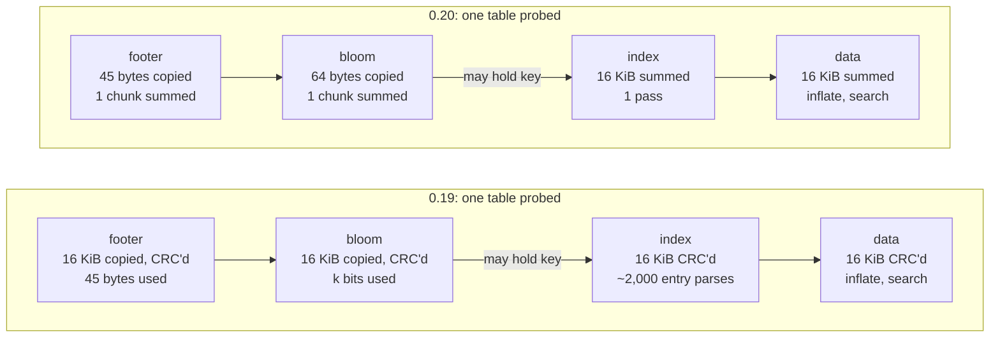
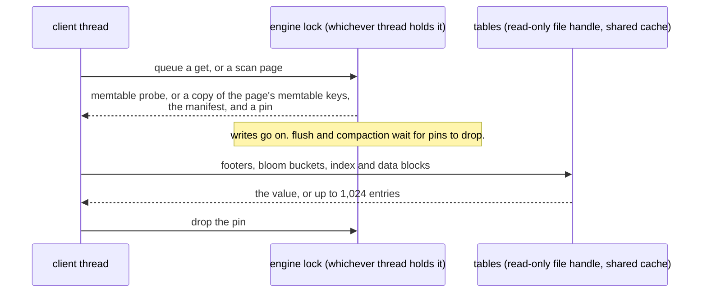

# Throughput: horton's key-value store against RocksDB

horton is a firmware store: one owner, no threads, no allocator, memory
fixed at compile time. `examples/kvstore` puts it on a host in the role
RocksDB fills. This document measures the two on db_bench's workloads,
says where horton's time went, records what v0.20 changed because of
it, and says what the remaining gap is made of.

It is a comparison of a 20,000-line `no_std` library, run outside its
design point, with the engine that defines the field. The useful result
is not who wins. It is which costs belong to horton's design and which
were just costs.

## Summary

v0.20 was done in passes. The first made one read cheaper. The second
let reads, scans and seeks run on every client thread at once. The
third gave every table a bloom filter sized to it. The fourth and
fifth took the footer and the cache's locks out of a reader's way. The
sixth took point reads out of the store's request queue and, for
nearly all of them, out of its lock. The seventh took compaction's
merge out of that lock, and writers that wait for it. The eighth runs
two compaction jobs at a time. A ninth pass, after
the release table below was measured, went back over the code a block
passes through: CRC-32, the LZ77 codec, the cache's copies and the
memtable's insert ([step 16](#then-the-hot-path-measured-again)).
Against the build before it, writes are 1.3 to 1.4 times faster and
point reads 1.6.

| db_bench workload, 1 M keys, 4 threads, ops/s | horton 0.19 | horton 0.20 | against 0.19 | RocksDB, same memory | RocksDB, as shipped | 0.20 / RocksDB, same memory |
|---|---:|---:|---:|---:|---:|---:|
| `fillseq` | 90,389 | 222,118 | 2.5× | 241,835 | 408,901 | 0.92× |
| `fillrandom` | 47,054 | 133,455 | 2.8× | 189,794 | 330,383 | 0.70× |
| `overwrite` | 44,143 | 128,749 | 2.9× | 133,682 | 336,217 | 0.96× |
| `readrandom` | 7,190 | 190,269 | 26× | 356,681 | 626,371 | 0.53× |
| `readmissing` | 7,995 | 4,958,200 | 620× | 4,761,060 | 1,505,577 | 1.04× |
| `readseq` | 209,822 | 8,148,692 | 39× | 16,118,609 | 7,860,138 | 0.51× |
| `readreverse` | 186,400 | 4,839,314 | 26× | 16,524,470 | 4,419,448 | 0.29× |
| `seekrandom` | 1,964 | 117,645 | 60× | 301,626 | 221,475 | 0.39× |
| `readwhilewriting` | not measured | 101,688 | | 191,614 | 419,316 | 0.53× |
| `deleterandom` | 55,882 | 196,918 | 3.5× | 362,007 | 347,232 | 0.54× |

Every column but the first is one run. The 0.19 column is from an
earlier run on the same kind of machine. **The read rows move from run
to run** (see [Run to run](#run-to-run)): what a read costs depends on
how many level-0 tables the fills happened to leave, between none and
five, and `seekrandom` has been anywhere from 45 K to 120 K for that
reason alone. The comparisons between builds in
[What changed in v0.20](#what-changed-in-v020) are made on identical
tables instead. The `readseq` and `readreverse` figures for 0.19 are
one thread scanning (that benchmark ignored the thread count); in 0.20
four threads each scan the whole store, as db_bench's do, and one
thread alone scans at 1.9 M entries/s forwards and 1.1 M backwards.

- **Reads were the problem, and most of it was not design.** In 0.19 a
  point read cost 100 to 140 µs, and 53% of all CPU went to re-running
  CRC-32 over blocks that were already in the cache and had already
  passed. One read is now 5 times cheaper, and readers run in parallel
  on top of that.
- **A read of an absent key is 140 times cheaper on one thread**:
  125 µs in 0.19, 12 µs after the first two passes, 0.87 µs now. Most
  of that is the bloom filter. A table's filter was one block whatever
  the table held, so the large tables that hold most of a store had
  1.3 bits a key and stopped almost nothing. It is now sized to the
  table, ten bits a key.
- **And four threads now read four times what one does.** With the
  tables cheap, what an absent-key read waited on was the store
  itself: every read queued for its memtable probe, and four threads
  got through the queue more slowly than one. A read of a key the
  memtable cannot hold now takes no lock at all. Against RocksDB with
  the same memory that row went from 0.05× to 0.17× (the filters) to
  about 1× (the lock). The two engines are level there, give or take
  the spread of single runs.
- **Reads no longer stop for writes.** While one thread overwrote the
  store, a reader got a sixth of its quiet rate: the few reads that
  needed the engine lock waited behind a writer that held it for the
  length of a compaction job. Compaction's merge now runs on its own
  thread outside the lock, and a write that waits for it waits without
  the lock. Four readers went from 17 K reads a second to 135 K while
  a fifth thread wrote. They get 102 K now that the writer writes
  twice as fast (the eighth pass); RocksDB with the same memory gets
  192 K.
- **Scans and seeks were three costs, one of them threads.** A scan
  re-decoded a block every time its merge changed table, a seek read
  every table in range before yielding anything, and both held the
  engine for their whole length. A scanning thread is now 3.6 times
  faster by itself and four of them do 3.7 times one's work.
- **Unsynced writes were bound by thread hand-offs**, two per
  operation, and then by compaction: first on the writers' own time,
  then as one merge on one thread, and at this size in a region with
  no slot for a second. Sequential fills are 2.5 times faster and
  within 10% of RocksDB given the same memory. Random fills are 2.8
  times faster, at 0.7 of RocksDB's rate, and overwrites are level
  with it. Half of that came last: two compaction jobs at a time, with
  a slot reserve for each, took random fills from 66 K to 133 K a
  second. Less than half of *that* is the second thread; the rest is
  that the jobs now rewrite less (step 15).
- **Synced writes did not change**, and all three engines are within
  a quarter of each other there: each waits for the same `fdatasync`.
- **What remains.** One thread at a time writes, flushes run on the
  writers' time, and level 0 drains as one merge on one thread, which
  is nearly all the compaction a store with slots to spare has. A
  present-key read is 19 µs of one core: a block is 16 KiB, summed
  whole, cached compressed and inflated on every read, and CRC'd in
  software when it misses the cache. A seek positions a cursor in
  every table that could hold its key. Most of that is what makes
  horton fit in 112 KiB on an ESP32-S3.

## Method

```sh
apt install rocksdb-tools                 # db_bench 8.9.1
examples/kvstore/vs-rocksdb.sh 1000000    # the table above
examples/kvstore/vs-rocksdb.sh 100000 --sync
KVSTORE_BASELINE=path/to/an/older/kvstore examples/kvstore/vs-rocksdb.sh   # adds a "before" column
```

[`vs-rocksdb.sh`](../examples/kvstore/vs-rocksdb.sh) runs the same
benchmark list on three configurations and prints ops/s side by side:

| | memtable | block cache | block | flush and compaction |
|---|---|---|---|---|
| **RocksDB, as shipped** | 64 MiB | 32 MiB, uncompressed blocks | 4 KiB, Snappy | background threads |
| **RocksDB, same memory** | 1 MiB | 16 MiB, uncompressed blocks | 16 KiB, Snappy | background threads |
| **horton** (`examples/kvstore`) | 1 MiB, 4096 entries | 16 MiB, compressed images, read without locks (ADR-0022); 32 decoded blocks (512 KiB) per scanning thread | 16 KiB, LZ77 | flush on the calling thread, holding a 255 KiB bloom filter while it writes a table; compaction's merges on two background threads, a job each (ADR-0024, ADR-0025) |

All three: 16-byte keys, 100-byte values that compress to half, 10
bloom bits per key, a write-ahead log, 4 client threads, one file
system (ext4 on a virtio disk). The machine
is a 4-vCPU Xeon at 2.3 GHz with 15 GiB of RAM; rustc 1.97, fat LTO.

Read the numbers with these in mind:

- **They are single runs on a shared virtual machine.** horton's
  write numbers moved by up to 20% between runs, and its read numbers
  by more ([Run to run](#run-to-run)). RocksDB's moved by up to
  60% between two runs an hour apart (its background threads compete
  with whatever else the host is doing), so a ratio to RocksDB is good
  to a factor of 1.5 at best.
- **Operation counts differ.** db_bench gives each of its 4 threads NUM
  operations; the kvstore splits NUM over its threads, except in
  `readseq` and `readreverse`, where each thread scans the whole store
  as db_bench's do. Rates compare; totals do not. Both hold NUM
  distinct keys once filled.
- **`readrandom` after `compact` is not comparable.** db_bench's
  `deleterandom` has by then deleted almost every key (four passes over
  the key space), so RocksDB answers from bloom filters. The kvstore
  deletes one pass's worth and still finds 37%.
- **"Same memory" is not "same work".** RocksDB flushes and compacts on
  background threads, on cores horton leaves idle.
- **A 1 M-key store is 116 MB of data.** Everything fits in the page
  cache, so no engine waits for a disk on a read. On flash, horton's
  device reads would dominate and this comparison would say little.

## Results

"horton (before)" in these tables is v0.20 with one compaction job at
a time (commit `3b3583e`); "horton" is v0.20. For the earlier steps
see [What changed in v0.20](#what-changed-in-v020).

### No fsync (`--no-sync`; db_bench's default)

1 M keys:

```text
benchmark                           rocksdb  rocksdb (small)  horton (before)           horton  horton / rocksdb (small)
fillseq                              408901           241835           211344           222118                     0.92x
fillrandom                           330383           189794            65959           133455                     0.70x
overwrite                            336217           133682            61733           128749                     0.96x
readrandom                           626371           356681           205233           190269                     0.53x
readmissing                         1505577          4761060          5996121          4958200                     1.04x
readseq                             7860138         16118609          8213468          8148692                     0.51x
readreverse                         4419448         16524470          4684071          4839314                     0.29x
seekrandom                           221475           301626           113878           117645                     0.39x
readwhilewriting                     419316           191614           146314           101688                     0.53x
deleterandom                         347232           362007            79775           196918                     0.54x
readrandom (after compact)         11958646         13065277           319013           419701                     0.03x
```

The three write rows and `deleterandom` are this step: two compaction
jobs at a time (step 15 of [What changed](#what-changed-in-v020)).
`readwhilewriting` fell with it: its writer now does twice the writes
in the same time, on the same four cores (see
[Reader threads](#reader-threads)). The read rows of a quiet store are
not a like-for-like pair (each column fills its own store and they end
with different tables), and pairs show none of them slower.

100 K keys (11 MB: RocksDB as shipped never leaves its memtable):

```text
benchmark                           rocksdb  rocksdb (small)  horton (before)           horton  horton / rocksdb (small)
fillseq                              482342           382459           260254           251052                     0.66x
fillrandom                           424282           353330           185010           167703                     0.47x
overwrite                            407590           340425           155260           168782                     0.50x
readrandom                          1790991          1205705           461059           443471                     0.37x
readmissing                         1869438          3888440         11888848          6440671                     1.66x
readseq                             6161479         22991030         15645962         12039519                     0.52x
readreverse                         1105526         16100016          8202155          6783045                     0.42x
seekrandom                           758813           651918           220440            96049                     0.15x
readwhilewriting                    1339154           669747           306924           271808                     0.41x
deleterandom                         411099           462118           243263           208249                     0.45x
readrandom (after compact)         13183915         13038659          1408637          1443382                     0.11x
```

A store this small has slots to spare and one job's worth of
compaction, so this step should change nothing here, and it does not.
Each run is half a second of writing, and single runs spread by more
than the columns differ: four more pairs of the write rows had
`fillrandom` at 154,696 before and 166,998 after, `overwrite` at
153,318 and 171,536, `fillseq` at 238,504 and 277,988, and
`deleterandom` at 205,880 and 217,433. The read rows are decided by
the tables the fills happen to leave ([Run to run](#run-to-run)).

### Run to run

The kvstore's background compaction stops when the fills do, and the
reads then run over whatever is left: between zero and five tables in
level 0, on top of some twenty below. Every level-0 table is one more
table a point read probes and a seek positions. With four writer
threads, how many are left changes from run to run.

Three pairs of runs at 1 M keys and 4 threads, taken when the bloom
filters were sized (step 10 below: "one bloom block" is the build
before it, "sized filters" the build after), show the size of it.
"Tables" is the count per level when the reads ran:

| run | build | tables per level | `readrandom` | `readmissing` | `seekrandom` | `fillrandom` |
|---|---|---|---:|---:|---:|---:|
| 1 | one bloom block | 4, 6, 1, 13 | 128,201 | 207,958 | 51,072 | 71,333 |
| 1 | sized filters | 4, 6, 1, 13 | 131,004 | 450,104 | 51,176 | 69,538 |
| 2 | one bloom block | 5, 6, 1, 13 | 118,989 | 187,588 | 44,161 | 69,927 |
| 2 | sized filters | 5, 6, 1, 13 | 128,910 | 414,717 | 44,227 | 69,214 |
| 3 | one bloom block | 0, 6, 0, 13 | 141,264 | 265,889 | 117,058 | 70,038 |
| 3 | sized filters | 2, 6, 0, 14 | 157,528 | 722,663 | 73,251 | 68,530 |

Within a build, `seekrandom` runs from 44 K to 117 K on the level-0
count alone. Runs 1 and 2 happened to pair equal layouts; run 3 did
not, and says nothing about the two builds.

Fills on **one** thread leave the same tables every time: 4, 5, 0 and
14 per level in the runs of steps 11 and 12, and 3, 6, 0 and 13 in
those of step 13, the same in every run and in both builds of each
pair. `bench --threads 1 --read-threads N` fills that way and reads on
N threads, and every comparison between builds from step 11 on is made
like that.

From step 15 that is no longer exact. Two compaction threads finish
their jobs in an order that timing decides, and four one-thread fills
of the same keys ended with 1, 4, 1 and 2 tables in level 0 (over 2,
1 or 0, and 17 below). Comparisons of reads across step 15 are made
over several pairs for that reason.

### Every write synced

100 K keys. A synced commit is one `fdatasync`, about 150 µs on this
disk, so the engines converge: each is waiting for the same device.

```text
benchmark                           rocksdb  rocksdb (small)  horton (before)           horton  horton / rocksdb (small)
fillseq                               14570            16606            16025            15580                     0.94x
fillrandom                            15204            16020            16642            16429                     1.03x
overwrite                             14662            15492            16544            16994                     1.10x
```

Both group commits. horton averaged 2.6 client writes per
`fdatasync` with 4 writers.

### Reader threads

1 M keys, no fsync, the same tables in every column (fills on one
thread); ops/s (entries/s for the two scans). The machine has four
cores, so eight threads show what oversubscribing costs, not more
scaling. `readoutside` reads keys past every table: it consults no
table and no cache, and is what a read costs in the store itself.

| reader threads | 1 | 2 | 4 | 8 |
|---|---:|---:|---:|---:|
| `readrandom` | 51,005 | 104,821 | 195,858 | 192,441 |
| `seekrandom` | 18,354 | 63,483 | 95,603 | 116,775 |
| `readseq`, a scan per thread | 1,839,372 | 4,054,988 | 7,752,425 | 9,357,889 |
| `readreverse`, a scan per thread | 1,103,978 | 2,291,408 | 4,543,204 | 5,053,304 |
| `readmissing` | 1,039,691 | 3,304,857 | 5,248,717 | 5,844,051 |
| `readoutside` | 5,192,464 | 11,617,632 | 22,196,069 | 20,235,544 |
| `readwhilewriting`, one more thread overwriting | 47,037 | 81,792 | 104,912 | 119,651 |
| the writer meanwhile, writes/s | 134,000 | 123,000 | 95,000 | 75,000 |

For comparison, at the start of v0.20's second pass (commit `75063ad`,
one reader at a time) `readrandom` was 43,594 on one thread and 38,581
on four, and `seekrandom` 6,956 and 7,962. Before step 13, with every
point read queued, `readmissing` was 675 K on one thread and 701 K on
four, and `readoutside` 1.62 M and 0.66 M.

Four threads give 3.8 times one thread's present-key reads, 4.2 times
its forward and 4.1 times its reverse scans, and 4.3 times its reads
of keys outside the store. Nothing a point read does is serial any
more unless the memtable could hold its key. A scan takes the engine
lock once a page. Each column is a run of its own, and a ratio a
little over four is the spread between runs. The `seekrandom` and
`readmissing` rows are the tables: since step 15 a fill on one thread
no longer leaves the same tables each time, and these four columns
had 1, 4, 1 and 2 tables in level 0 ([Run to run](#run-to-run)). On
equal tables `seekrandom` scaled by 3.8 and `readmissing` by 3.7.

`readwhilewriting` is `readrandom` with a writer running: one, two
and four readers get 92%, 78% and 54% of the rate they get from a
quiet store, while the writer does 134 K, 123 K and 95 K writes a
second. At four readers there are seven threads at work on four cores
(the readers, the writer and two compaction threads). Before step 15,
with one compaction thread, the same readers got 94%, 93% and 69%,
and the writer 59 K, 58 K and 46 K: the writer has more than doubled
and the readers have paid for part of it. Before step 14 the readers
got 8 K and 28 K at one and four threads.

## Where horton's time went

`perf` on the 0.19 kvstore running fills, point reads, seeks and a scan
(100 K keys, 4 threads):

| share of CPU | where | what it is |
|---:|---|---|
| 52.6% | `check_block_crc` | CRC-32 of a whole block, on every read of it, cache hit or not |
| 21.4% | futex wake and wait (kernel) | a request and a reply crossing between a client thread and the store thread |
| 4.0% | `memmove` | 16 KiB block images copied out of the cache |
| 2.4% | index search | re-parsing the index from its start for each step of a binary search |
| 1.7% | LZ77 decompress | |

A point read probes every table whose key range covers the key: each
level-0 table and one per deeper level. Per table it read the footer
and the bloom block, and for the table holding the key the index and a
data block. Every one of those was copied out of the cache and CRC'd
again (ADR-0014 required it, to catch a bit flipping in cached RAM).
At 16 KiB a CRC costs 8.3 µs:



## What changed in v0.20

Each row adds one change to the rows above it. 100 K keys, no fsync, 4
threads, ops/s; single runs taken while the work was done, with the
store in whatever state the fills left it, so read them as the size of
each step and not as a benchmark.

| | `readrandom` | `readmissing` | `seekrandom` | `fillrandom` |
|---|---:|---:|---:|---:|
| 0.19 | 7,500 | 8,300 | 4,200 | 76,000 |
| cache hits checked by a RAM checksum, not CRC-32 (ADR-0016) | 25,400 | 37,800 | 11,100 | 83,000 |
| bucketed bloom; footer and bloom read as ranges (ADR-0017) | 30,900 | 56,800 | 12,600 | 78,000 |
| callers run the engine under a lock; no store thread | 37,400 | 89,700 | 22,800 | 131,000 |
| one-pass index search; 8 MiB hashed cache | 43,100 | 102,000 | 19,600 | 139,000 |
| the lock holder serves every queued request (flat combining) | 64,400 | 207,000 | 44,000 | 178,000 |

1. **Cache hits are checked by a RAM checksum** (library, ADR-0016).
   The cache needs to know that a hit is the bytes it was given, not
   that they are a valid block. Only CRC-verified blocks are inserted;
   each slot keeps a four-lane multiply-rotate sum of its image, and a
   hit must match it. That runs at 11 to 14 GB/s where table-driven
   CRC-32 runs at 2.0, and it detects every single-bit flip, which is
   what the CRC was there for. A mismatch re-reads the device.
2. **A probe reads what it uses** (library, ADR-0017). The sum is kept
   per sixteenth of a block, so the cache can hand out a byte range
   after checking only its chunk. The bloom filter's probes for a key
   now fall in one 64-byte bucket (a format change: `hrtsst03`). A
   table that does not hold the key is ruled out in well under a
   microsecond.
3. **No store thread** (kvstore). The store thread gave every call two
   thread switches. Callers now take a lock and run horton themselves.
4. **Index search and a larger cache** (library and kvstore). The index
   has no offset table, and the binary search re-parsed it from the
   start for every probe. One pass with a key comparison every 16
   entries replaces it. Caches above 8 slots hash a block to a window
   of 8, so the kvstore can hold 512 blocks without scanning 512 tags.
5. **Flat combining** (kvstore). With a bare lock, four threads read
   more slowly (43 K/s) than one thread alone (73 K/s): the database is
   megabytes of state, and each thread dragged it into its own CPU's
   cache. Now a read or a write is queued, and whichever thread holds
   the lock serves the whole queue. Group commit is the write half of
   the same mechanism.

### Then: readers, scans and seeks on every thread

After the five steps above a read was cheap enough that the engine
lock was what bound it: four reader threads got one core's worth. The
second pass moved the table work of every read, scan and seek out of
the lock. The measurements are in [Reader threads](#reader-threads).



6. **Detached point reads** (library, ADR-0018). A point read is a
   search of the memtable and then of the tables, and only the first
   needs the `Db`. `Db::probe_memtable` returns what the memtable held
   as plain data; `TableView::resolve` finishes the read over a copy
   of the manifest, any handle to the device, and the caller's own
   buffers. The kvstore serves the probe under the lock and runs the
   table phase on the calling thread, through a second file handle and
   a cache in eight locked shards. Flush and compaction, the only
   calls that change the tables, wait for readers to leave them.
7. **Detached scans** (library, ADR-0019). A scan merges the memtable
   all the way through, so it cannot take one probe and go.
   `Db::copy_memtable_range` copies one page's worth of memtable keys
   and returns the horizon the page must stop at; `Scan::detached`
   runs over that copy. A kvstore scan takes the lock for about 30 µs
   per 1,024 entries and does the rest on its own thread.
8. **A block pool for scans** (library, ADR-0019). A `Scan` had one
   decoded block for all its table cursors, and fetched, checked and
   inflated a block again each time the merge came back to a table:
   nearly every entry, over tables that overlap. `use_block_pool`
   lends it buffers, so each table's block stays decoded. With this
   and step 7, one thread's `readseq` went from 0.50 to 1.80 M
   entries/s. Firmware lends none and keeps its 10.9 KiB scan.
9. **A forward seek reads the tables it reaches** (library, ADR-0019).
   `seek` used to position a cursor in every table that overlapped the
   range: a footer, an index block and a data block from each of over
   twenty tables, to yield one entry. A table that starts after the seek
   key now waits at its lower bound, which is in the manifest, and is
   read when the merge gets there. Over steps 7 to 9, one thread's
   `seekrandom` went from 144 to 67 µs.

### Then: a bloom filter sized to its table

10. **A filter may span blocks, and is folded to fit** (library,
    ADR-0020). A table's bloom filter was one block: 131,000 bits here,
    which is 32 bits a key for the 4,096 entries of a flush and 1.3 for
    the 100,000 of a full table. At 1.3 bits a filter passes more than
    half of what it is asked, so an absent key read an index block and
    a data block in most of the deep tables. The filter can now be up
    to sixteen blocks. The table writer builds it at that length and,
    when the table ends and its entry count is known, folds it (ORs
    runs of neighbouring buckets together) down to the fewest blocks
    that give each entry 10 bits. A flush still writes one bloom block;
    a 70,000-entry table at the bottom of this store writes eight. A
    lookup still reads one
    64-byte bucket. One thread's `readmissing` went from 11.8 to
    2.3 µs.

    The first measurement of it showed random fills 6% slower. A
    well-fed filter takes 6 to 13 probes a key where a starved one took
    1, and each probe ended in a 64-bit division. A bucket is 512 bits,
    so the remainder is now a mask, and the fills are back within
    noise.

### Then: readers that do not read footers

11. **The manifest record describes a table in full** (library,
    ADR-0021). With the filters doing their work, a table that does
    not hold the key cost two small reads from the cache: the footer's
    fields, to learn where the filter is and how to probe it, and then
    one bloom bucket. The manifest record already had most of what the
    footer says, and the rest follows from the table's layout. It now
    carries the two facts that were missing (the probe count and the
    filter's length), a reader is built from it with no I/O, and
    nothing on a read, scan or compaction path reads a footer. A probe
    the filter turns away is one read of one bucket; a seek reads one
    block fewer per table it positions.

    Measured on identical tables (fills on one thread, which leaves the
    same layout every time: 4, 5, 0 and 14 tables per level), 1 M keys,
    each figure the mean of two or three runs:

    | | reader threads | footer and bucket | bucket only | change |
    |---|---:|---:|---:|---:|
    | `readmissing` | 1 | 419,150 | 516,329 | +23% |
    | `readmissing` | 4 | 431,268 | 587,948 | +36% |
    | `readrandom` | 1 | 48,377 | 49,453 | +2% |
    | `readrandom` | 4 | 136,152 | 150,612 | +11% |
    | `seekrandom` | 1 | 17,121 | 16,872 | -1% |
    | `seekrandom` | 4 | 51,313 | 55,827 | +9% |
    | `readseq` | 4 | 7,114,846 | 7,305,777 | +3% |

    An absent-key read on one thread is 1.9 µs, from 2.4. The gains
    are larger at four threads than at one because what was removed
    was a read of the shared cache, and the cache is what the threads
    contend on. The one-thread seek figure is inside the noise of
    these runs (three pairs: 17,073, 17,179 and 17,110 before; 16,896,
    16,814 and 16,905 after), and nothing in the change would make a
    seek cost more: it reads one block fewer.

### Then: a cache whose hits write nothing shared

12. **The readers' cache takes no lock on a hit** (kvstore, ADR-0022).
    The cache the readers shared was the library's `BlockCache` in
    eight shards, each behind a lock. Every hit wrote shared memory:
    the lock, a reference bit, a counter. A cached block is named by
    its table and block ids, and a table id is never reused, so an
    entry is never wrong, only evicted. The kvstore's own cache uses
    that: entries are immutable, each reader thread keeps a view of the
    slots it uses and compares one atomic epoch per slot, and only an
    insert or an eviction takes a lock. The RAM checksum on every hit
    (ADR-0016) is kept, per 256 bytes.

    On identical tables (fills on one thread), 1 M keys, means of two
    runs at one reader thread and three at four:

    | | reader threads | locked shards | lock-free hits | change |
    |---|---:|---:|---:|---:|
    | `readrandom` | 1 | 51,051 | 51,194 | 0% |
    | `readrandom` | 4 | 152,974 | 182,986 | +20% |
    | `seekrandom` | 1 | 17,403 | 17,192 | -1% |
    | `seekrandom` | 4 | 55,966 | 66,003 | +18% |
    | `readmissing` | 1 | 535,932 | 658,564 | +23% |
    | `readmissing` | 4 | 570,496 | 635,650 | +11% |
    | `readoutside` | 1 | 1,670,505 | 1,638,345 | -2% |
    | `readoutside` | 4 | 577,800 | 635,836 | +10% |
    | `readseq` | 1 | 1,935,718 | 1,898,063 | -2% |
    | `readseq` | 4 | 7,290,771 | 7,124,246 | -2% |
    | `readreverse` | 1 | 1,092,332 | 1,092,159 | 0% |
    | `readreverse` | 4 | 4,162,125 | 4,288,337 | +3% |

    Where the tables are what a read waits on, four threads gain a
    fifth: present-key reads and seeks. An absent-key read gains a
    quarter on one thread (1.87 µs to 1.52 µs).

    On four threads absent-key reads did not gain, and `readoutside`
    says why. It reads keys past every table, so it consults no table
    and no cache: it is the request queue and the memtable probe and
    nothing else. One thread does 1.65 M of those a second. Four
    threads do 0.6 M between them. Absent-key reads at four threads
    run at exactly that rate, in both builds. They were bound by the
    queue before this change and they are bound by it after. (The 10%
    between the two builds on `readoutside`, which neither build's
    cache touches, is how far apart two four-thread runs land.)

    Forward scans are 2% slower in both rows. The first version of
    this cache lost 3% to 5%: a scan evicting a block it had itself
    read a page earlier still held a reference to it, so the entry
    could not be reused and each such eviction allocated 17 KiB. The
    inserting thread now lets go of its own reference first. The 2%
    that is left is the size of the spread between runs here
    (`readoutside` on one thread, which this change does not touch,
    also moved by 2%), and is not explained.

### Then: point reads that do not queue, and mostly do not lock

13. **A read of a key the memtable cannot hold takes no lock**
    (kvstore, ADR-0023). Step 12 left every point read queueing for
    its memtable probe, and `readoutside` showed what that cost: 1.6 M
    reads a second through the queue on one thread, 0.64 M on four.

    Two things were in the way, and they came out one at a time.
    First the queue: a read now takes the engine lock itself, probes
    the memtable into a probe its thread keeps, and lets go. That
    doubled `readoutside` (3.2 M on one thread, 1.2 M on four, single
    runs) and left four threads slower than one, because an exclusive
    lock taken on every read is a cache line every reader writes.

    Then the lock. What a read asks the database is nearly always
    answered the same way: the memtable has nothing for this key, and
    the tables are the ones you already have. The store now says both
    in words that are written only when the answer changes. A filter
    over the memtable has two bits for each key written since the last
    flush (32 KiB; a write sets them before it writes the memtable).
    The manifest's sequence number is published after every table
    change. A reader raises a pin in a slot of its own, checks that
    the gate is open, that its manifest copy carries the published
    number and that the filter does not have its key, and goes to the
    tables. Flush and compaction raise a flag, wait for every slot to
    read zero, change the tables and publish. Each side stores and
    then looks at the other's store, so one of them always sees the
    other.

    ```mermaid
    flowchart LR
        subgraph before["step 12: every read"]
            direction LR
            Q1["queue the read<br/>(allocate, lock)"] --> E1["engine lock, held by<br/>whichever thread serves:<br/>probe the memtable"] --> T1["tables"]
        end
        subgraph after["step 13: a key the memtable cannot hold"]
            direction LR
            P2["raise own pin"] --> C2["3 loads:<br/>gate open, manifest current,<br/>key not in the filter"] --> T2["tables"]
        end
    ```

    On identical tables (fills on one thread: 3, 6, 0 and 13 tables
    per level with this benchmark list), 1 M keys, means of three
    runs. "Queued" is step 12 with the benchmark fix described below:

    | | reader threads | queued | no lock | change |
    |---|---:|---:|---:|---:|
    | `readoutside` | 1 | 1,618,525 | 5,268,530 | 3.3× |
    | `readoutside` | 2 | 890,113 | 10,114,028 | 11× |
    | `readoutside` | 4 | 641,223 | 20,840,502 | 33× |
    | `readmissing` | 1 | 738,739 | 1,153,940 | 1.6× |
    | `readmissing` | 2 | 859,277 | 2,071,064 | 2.4× |
    | `readmissing` | 4 | 645,098 | 4,259,914 | 6.6× |
    | `readrandom` | 1 | 50,945 | 53,775 | +6% |
    | `readrandom` | 2 | 97,135 | 103,281 | +6% |
    | `readrandom` | 4 | 188,246 | 204,933 | +9% |
    | `seekrandom` | 1 | 16,258 | 16,147 | -1% |
    | `seekrandom` | 4 | 63,468 | 63,429 | 0% |
    | `readseq` | 1 | 1,965,903 | 1,929,854 | -2% |
    | `readseq` | 4 | 7,380,259 | 7,352,198 | 0% |
    | `readreverse` | 1 | 1,119,077 | 1,102,959 | -1% |
    | `readreverse` | 4 | 4,360,243 | 4,295,793 | -1% |
    | `fillseq` (one writer; nine pairs) | | 189,423 | 192,846 | +2% |
    | `fillrandom` | | 52,943 | 52,359 | -1% |
    | `overwrite` | | 50,814 | 51,259 | +1% |

    A read that touches nothing but the store costs 0.19 µs and four
    threads do 3.96 times one thread's. An absent-key read is 0.87 µs
    on one thread, from 1.35, and four threads do 3.7 times one's
    rate, where they did 0.9 times. A present-key read lost the
    microsecond the queue cost it, of twenty. Seeks and scans did not
    change: a page still takes the engine lock once, and at 1,024
    entries a page that lock was never what a scan waited on. Writes
    did not change either: two filter bits a key do not show.

    **The benchmark had to be fixed first.** `readmissing` built each
    key with an allocation and a reallocation. The first measurement
    of this step had four threads reading absent keys *slower* than
    one (1.4 M against 2.0 M, on a store with fewer tables than the
    one above). A profile put a third of their time in the kernel,
    waking and sleeping on the allocator's lock: at half a microsecond
    a read, the benchmark's own loop was the contended thing. The key
    is now built on the stack, as `db_bench` builds its keys. The
    "queued" column above is the old store with the same fix. The fix
    did nothing for the old store on four threads (0.65 M here; 0.70 M
    before it, on slightly different tables): the queue was slower
    than the allocator, and hid it.

    What still takes the lock: a key written since the last flush
    (which is how a thread reads its own writes), every key after a
    range delete or a recovery until the next flush, a thread's first
    read after each flush or compaction commit, and every page of a
    scan. In these runs about 800 point reads of three million did
    (0.03%): the keys the last writes left in the memtable.

### Then: compaction's merge off the engine lock, and writers that wait without it

14. **A compaction job's merge runs without the `Db`** (library and
    kvstore, ADR-0024). Every `compact_step` ran under the engine
    lock: one at the end of each write while a job was pending, and
    whole jobs, back to back, by whichever writer found level 0 full.
    A job is nearly all merge (one output is up to 2,047 blocks, a
    step each), and the merge needs only a device and the target
    level's table list. `Compaction::merge_detached` runs it over any
    handle to the device; `Db::compact_step` keeps the rest: choosing
    the job, sealing and committing each output.

    The kvstore's compaction thread now does the merging, with a file
    handle of its own and no lock, and the job's scratch is handed
    back and forth between it and whoever holds the engine lock for
    the short steps in between. A store compacted this way is, block
    for block, the store `compact_step` alone leaves
    (`tests/detached_compaction.rs` compares the two images).

    ```mermaid
    sequenceDiagram
        participant W as writer (engine lock)
        participant C as compaction thread (no lock)
        participant T as tables (its own file handle)
        W->>W: compact_step: choose a job, position its cursors
        W-->>C: lend the scratch and a manifest copy
        Note over W: writes and flushes go on; readers are not shut out
        loop until the output is full or the inputs are exhausted
            C->>T: merge_detached: read inputs, write one output block
        end
        C-->>W: give the scratch back
        W->>W: compact_step: seal the output, commit it, open the next
    ```

    That alone did little for a reader, and the first measurement said
    why. With one thread overwriting the store, a reader got 8 K reads
    a second where a quiet store gave it 55 K; with the merge off the
    lock it got 10 K. Of its reads, one or two in a hundred needed the
    engine lock (the key was in the memtable, or the manifest had just
    changed), and each of those waited for it behind the writer, which
    had found level 0 full and held the lock until compaction made
    room. **A write that has to wait for compaction now waits without
    the lock**: its group stays at the head of the queue, and its
    thread lets go, sleeps 200 µs and looks again.

    1 M keys, no fsync, fills on a 1 GiB file, means of three pairs:

    | | before | after | change |
    |---|---:|---:|---:|
    | `readwhilewriting`, 1 reader and 1 writer, reads/s | 8,404 | 50,033 | 6.0× |
    | `readwhilewriting`, 4 readers and 1 writer | 28,234 | 132,910 | 4.7× |
    | `fillseq`, 1 writer | 181,782 | 239,937 | +32% |
    | `fillrandom`, 1 writer | 52,199 | 61,548 | +18% |
    | `overwrite`, 1 writer | 50,988 | 58,248 | +14% |
    | `fillseq`, 4 writers | 121,122 | 158,950 | +31% |
    | `fillrandom`, 4 writers | 57,942 | 68,155 | +18% |
    | `overwrite`, 4 writers | 57,518 | 65,930 | +15% |

    The writer in `readwhilewriting` did 53 K writes a second before
    and 59 K after (one reader), so the readers' gain was not taken
    from it.

    **Writes gained less than this document predicted**, and less on
    the comparison's own configuration. On a 256 MiB file (two pairs
    each): one writer's `fillrandom` and `overwrite` gained 12%; four
    writers' fills did not move (within 4% either way); and
    `readwhilewriting` at four readers went from 17 K to 137 K.
    `fillseq` there could not be told apart from drift: the old build
    alone ran from 243 K to 295 K between sessions. The reason for the
    small gain is in the next section: the merge is one thread, it is
    busy all the time, and the writers were waiting for it before and
    are waiting for it now. What moved off the writers' thread was
    work they were not short of time for.

    Reads of a quiet store did not change. The first three pairs had
    `readrandom` at four threads 4% lower after (192 K against 201 K),
    every time. Nine more runs of three builds landed on either 199 K
    or 206 K whichever build they were: a run settles on one of the
    two, and three pairs happened to split by build.

    What still runs under the engine lock: flush (a table of 4,096
    entries, a few milliseconds), each job's short steps, and the
    whole wait of the calls that are not queued (`delete_range`,
    `flush`, `compact`) when they need room.

### Then: two compaction jobs at a time, and room for the second

15. **Two compaction jobs at a time** (library and kvstore, ADR-0025).
    `Db::compact_step_in` steps a job in each of two lanes. Two jobs
    run side by side when they share no table, write to different
    levels and neither is tight or requested. The kvstore has a
    compaction thread, a scratch and a file handle for each lane, and
    the steps with the database are taken for both by whichever thread
    has the engine lock.

    Step 14's profile said what to expect: 70% of merge quanta wrote
    level 1, 28% the bottom level and 3% the level above it, so a
    second job could overlap a quarter of the work.

    **The lanes alone changed nothing.** At 1 M keys a second job
    passed the three rules 866 times in a random fill and was refused
    865 times, for slots. The region has 28; the bottom level held 17
    tables; flush filled what was left down to the two-slot reserve,
    and the job in flight held those two. A second job has work when
    the region is under pressure, and that is when it had nowhere to
    write.

    So a caller that steps two lanes has a reserve for each: flush
    stops four slots short, not two. That took `fillrandom` at 1 M
    keys from 53 K to 164 K, and at 1.2 M keys, nine tenths of what the
    store holds, from 15 K to 6 K. With the second reserve taken out of it,
    a nearly full region has two slots left to batch flushes in, and
    every other flush pushes a table at the bottom level, which
    rewrites the bottom level.

    Two more rules came out of measuring that:

    - **The second reserve is kept while the region has room for it**
      (seven slots or more above the bottom level). In a fuller region
      the reserve is one job's while compaction is idle and both
      lanes' once a job runs.
    - **With two lanes, pressure merges level 0 first.** One job at a
      time pushes the deepest table above the bottom down first. A
      level 0 table is one flush in a slot that could hold fifteen:
      merging level 0 frees the most slots for the least rewriting,
      and it can go on beside the long merge below.

    `fillrandom`, one writer, on a store filled in order; single runs
    of each rule, writes a second:

    | reserve | order under pressure | 1.0 M keys | 1.1 M | 1.2 M | 1.3 M |
    |---|---|---:|---:|---:|---:|
    | one job's (before) | deepest first | 52,959 | 22,569 | 15,484 | 11,373 |
    | both lanes', always | deepest first | 163,564 | 125,013 | 6,430 | 5,840 |
    | both lanes', always | level 0 first | 136,738 | 106,110 | 58,860 | 5,910 |
    | one job more than in flight | deepest first | 85,535 | 23,235 | 15,648 | |
    | one job more than in flight | level 0 first | 27,549 | 48,891 | 61,546 | 58,826 |
    | **both with room, else one more** | **level 0 first** | 138,949 | 107,333 | 58,734 | 58,571 |

    Every rule but the last is the best somewhere and collapses
    somewhere else. One lane with level 0 first did 29,954 at 1.0 M,
    against 52,959: the order is right only with a second job to run
    beside, so `compact_step` keeps the order and the reserve it had.

    Before and after, one writer, the default 256 MiB file (the 1 M
    row is the mean of three pairs, the others one pair each):

    | keys | `fillrandom` before | after | | `overwrite` before | after | |
    |---:|---:|---:|---:|---:|---:|---:|
    | 300,000 | 70,244 | 69,326 | 1.0× | 73,909 | 72,082 | 1.0× |
    | 600,000 | 67,825 | 75,399 | 1.1× | 67,096 | 74,856 | 1.1× |
    | 1,000,000 | 54,936 | 141,377 | 2.6× | 54,010 | 135,558 | 2.5× |
    | 1,100,000 | 23,291 | 112,521 | 4.8× | 22,565 | 103,523 | 4.6× |
    | 1,200,000 | 15,273 | 58,697 | 3.8× | 15,003 | 59,811 | 4.0× |
    | 1,300,000 | 11,398 | 58,351 | 5.1× | 11,403 | 55,480 | 4.9× |

    With four writers at 1 M keys (two pairs): `fillrandom` 65,596 to
    139,818 and `overwrite` 61,571 to 133,139. `fillseq` did not move
    (284 K and 321 K on one writer, 230 K and 216 K on four, inside
    what it moves between runs). Both builds hold 1.3 M keys and
    refuse 1.4 M.

    **What the 2.6 times is made of.** For the same million random
    writes the merges did 27% less work, 166,010 quanta against
    227,990, and did it on two threads: 12.3 s of CPU in 7.0 s, where
    it had been 16.7 s in 17.9 s. About 1.4 times from rewriting less
    and 1.9 times from two merges at once. That is more than the
    quarter the profile promised, because the profile was of the old
    schedule: with the bottom level's job running beside it, level 0
    is merged into a level 1 that the pressure rules keep nearly
    empty.

    **Where it does nothing.** Up to 600,000 keys the store has slots
    to spare and nearly all its compaction is level 0 draining into
    level 1, one job whatever the lanes. That is still one merge on
    one thread.

    Reads of a quiet store are not slower (four reader threads, two
    pairs: `readrandom` 190,783 before and 194,878 after). Reads
    beside a writer are: the writer does twice the writes, and there
    are two compaction threads on the same four cores
    ([Reader threads](#reader-threads)).

### Then: the hot path measured again

Step 16 (ADR-0026). With the locks out of the way, a callgrind profile
of the store put what was left in the code a block passes through:

| | fill | reads |
|---|---:|---:|
| LZ77 compression | 38% | 5% |
| CRC-32 (sealing, device reads, WAL records) | 18% | 4% |
| LZ77 decompression and its `memcpy` calls | 3% | 22% |
| 16 KiB images copied out of the cache | | 17% |
| a 4 KiB value buffer zeroed per table a read probes | | 14% |
| shifting the memtable's sorted slots | 4% | |

None of it was design. Seven changes, no format change:

- **CRC-32 in three chains**, joined with the CRC's own algebra, and
  **carried across runs of zero bytes** by one multiplication instead
  of computed through them: 3.6 GB/s on a 16 KiB block where it was
  1.4, and 5.2 GB/s on a block that is half zeros, which most
  compressed blocks are. No hardware CRC: `unsafe` is forbidden, and
  rustc still asks for it to call a `#[target_feature]` function when
  the build enables the feature.
- **The encoder** counts matches a word at a time, loads a word with
  one bounds check where it took four, stops indexing every byte of a
  match, and steps faster over input with no match: 1.45 times faster,
  and its output about 2% smaller. **The decoder** copies short runs
  as one 16-byte chunk and fills one-byte runs: 1.4 times faster.
- **A cache hit on a compressed block** is inflated where it lies in
  the cache (`CachePort::with_range`), and **the index search** runs on
  the cached image in place. No 16 KiB copies on a hit.
- **A point read** writes the first value it finds straight into its
  stage, and no longer zeroes a 4 KiB buffer for every table.
- **The memtable** keeps entries in arrival order behind a sorted view
  of positions: an insert into 4,096 entries is 0.34 µs, not 0.77.

1 M keys, no fsync, four threads (the layout of the table at the top),
two runs of each build, ops/s:

| | before | after | after / before |
|---|---:|---:|---:|
| `fillseq` | 163,059 / 170,811 | 217,412 / 209,967 | 1.28× |
| `fillrandom` | 97,512 / 96,867 | 126,758 / 133,969 | 1.34× |
| `overwrite` | 90,722 / 88,020 | 124,302 / 128,466 | 1.41× |
| `readrandom` | 134,243 / 136,173 | 215,763 / 223,744 | 1.63× |
| `readmissing` | 3,073,581 / 3,444,969 | 4,427,257 / 4,737,398 | 1.41× |
| `readseq` | 4,070,387 / 5,012,688 | 5,284,520 / 5,993,134 | 1.24× |
| `readreverse` | 2,497,387 / 3,037,894 | 3,610,294 / 3,700,322 | 1.32× |
| `seekrandom` | 52,629 / 69,867 | 117,201 / 109,993 | 1.85× |
| `readwhilewriting` | 69,748 / 71,808 | 107,566 / 112,854 | 1.56× |
| `deleterandom` | 132,201 / 131,720 | 169,545 / 167,678 | 1.28× |

The runs left 6, 5, 4 and 2 tables in level 0, in that order, so the
seek and scan rows carry the layout as well as the change. Fills on one
thread and reads on four (four more runs) agree on the rows the layout
does not decide: the three write rows gained 1.29 to 1.36 times and
`readrandom` 1.55 times. This machine was slower than the one the
table at the top was measured on (its "before" column is below that
table's 0.20 column throughout), and `db_bench` was not installed, so
the RocksDB columns were not run again.

## What the remaining gap is made of

| workload, 1 M keys | horton / RocksDB (same memory) | why |
|---|---:|---|
| `fillseq` | 0.92× | one writer at a time commits in about 4 µs; little to compact when keys arrive in order |
| `fillrandom` | 0.70× | each 16 KiB block compaction writes is about 80 µs of one core, and it writes some twenty times what the writers do; two jobs run at once, where RocksDB's cost less each |
| `overwrite` | 0.96× | the same work; RocksDB's own rate falls by a third from `fillrandom` to here, and horton's does not |
| `readrandom` | 0.53× | a read is 19 µs of one core: an index block summed whole, a data block summed and inflated, and for a block that misses the cache a 16 KiB software CRC |
| `readmissing` | 1.04× | no gap: 0.87 µs on one thread, one bloom bucket per table in range, and nothing shared is written, so four threads do four times one's |
| `readseq` | 0.51× | 0.52 µs an entry on one thread: the merge compares every cursor's head for each entry, every entry is copied out, and every block is inflated |
| `readreverse` | 0.29× | the same, and stepping backwards through a block's version runs costs more than forwards |
| `seekrandom` | 0.39× | a seek still positions a cursor in every table that could hold the key (each level-0 table, one per deeper level), and each costs a whole index block and an inflated data block |
| `readwhilewriting` | 0.53× | `readrandom`'s 19 µs, on four cores shared with a writer and two merges; and every table compaction writes is new to the cache |
| `deleterandom` | 0.54× | as `fillrandom` |

**One thread at a time writes, and level 0 drains as one job.** `Db`
is a single-owner value with `&mut self` writes; that is ADR-0002's
point, and firmware has one core. A commit of a sequential write
takes about 4 µs, which is why `fillseq`, with little to compact,
keeps up. `fillrandom` waits for compaction. The merges run on two
threads outside the engine lock (steps 14 and 15), and at 1 M keys
both are busy for most of the benchmark: about 166,000 blocks written
for a million random writes, each block about 80 µs of reading,
merging, compressing, summing and writing. In a store with slots to
spare there is one job to run, level 0 into level 1, and one thread
does it. RocksDB at the same memtable size flushes and compacts on
background threads, with 4 KiB blocks, Snappy and a hardware CRC.

**The store is small for the benchmark.** Four levels of seven tables
is 28 slots, and a table's index is one block, so a table holds about
7 MiB. A million db_bench entries leave eleven slots above the bottom
level; 1.35 M fill the region. Much of what step 15 measured is how a
region that full is compacted, which RocksDB, growing its files as it
goes, never has to ask.

**Most point reads take no lock; a scan takes one a page.** A read of
a key the memtable cannot hold raises a pin of its own and goes to the
tables (step 13). A key written since the last flush still asks the
memtable under the engine lock, and so does every key after a range
delete or a recovery until the next flush. A scan page copies its part
of the memtable under the lock: once per 1,024 entries, which is why
scans scale by 3.8 on four cores with it.

**What four reader threads waited on was the queue, then the lock, and
then the benchmark.** An earlier profile of four threads reading
absent keys put 60% of their time in the old cache's ranged read and
14% in the queue, and that was read as the cache being the limit. It
was where the time went, not what the rate waited on: with the cache's
locks gone (ADR-0022) the four-thread rate did not move. `readoutside`
was added to measure the store without its tables, and showed the
queue serving four threads at 0.4 times the rate it served one. With
the queue gone the engine lock did the same at twice the rate. With
the lock gone, the benchmark's own allocation per key did. Each was
found by measuring the thing itself, and each time the profile of the
whole had pointed somewhere else.

**A point read that misses the cache is expensive.** It reads a 16 KiB
block, CRCs it in software (8.3 µs before step 16, about 3 µs since;
`unsafe` is forbidden, so no CRC instruction) and inflates it (3 µs
before step 16, which made it 1.4 times faster). RocksDB reads 4 KiB, checks it with a
hardware CRC32C or XXH3 and caches the block uncompressed. horton's
cache holds the compressed image, so even a hit inflates the block
again, after summing it (no longer copying it), and the whole index
block is summed for every lookup that passes the filter.

**A scan's merge is linear in its cursors.** Each `next` compares the
head of every table cursor, one per table in range, where a heap or
one iterator per level would compare a few. Each entry's key and value
are then copied to the caller. Reverse scans cost nearly twice a
forward scan, and a reverse seek still positions every table in range: the
reverse cursor resolves version runs backwards across blocks and was
left as it was.

**Compression is about 600 MB/s.** Sealing a 16 KiB table block costs
about 27 µs of LZ77 (40 before step 16), 3 µs of CRC (8 before) and a
write. It is still the largest single item in `fillrandom` at 1 M
keys.

## Levers not pulled

Measured or scoped while doing this, and left:

- **Scan pages that do not lock.** A page copies its slice of the
  memtable under the engine lock. A page whose range the memtable does
  not reach could learn that the way a point read does. Not measured:
  at one lock per 1,024 entries it is not what a scan waits on.
- **A filter for range tombstones.** One `delete_range` sends every
  point read back to the engine lock until the next flush (ADR-0023).
  Remembering the ranges, not a flag, would keep the others out of it.
- **A level 0 merge split across threads.** Two jobs run at a time
  now (ADR-0025), but level 0 draining into level 1 is one job, and in
  a store with slots to spare it is nearly all the work: 75 K random
  writes a second at 600,000 keys, where step 15 changed nothing.
  Splitting that merge by key range, or giving its output half
  (compress, sum, write) a thread of its own, is what would lift it.
  Both are the library's to offer.
- **The order under pressure for one job at a time.** Left as it was:
  the deepest table above the bottom level goes down first, one at a
  time, and near capacity that is a rewrite of the bottom level for
  every table or two that is flushed (11 K writes a second at 1.3 M
  keys). Level 0 first, which is right with two lanes, is slower with
  one at 1 M keys. Something between the two would help firmware near
  a full region, where it also means flash wear. Not designed.
- **More slots.** `LEVELS × TABLES` is at most 64 and a job reads
  through at most 8 cursors, which caps `TABLES` at 7. A larger
  region, or tables larger than one index block allows, is a format
  question.
- **Flush off the writers' thread.** A flush writes a table of 4,096
  entries under the engine lock, a few milliseconds every 4,096
  writes, with the readers' gate shut. Its table could be written
  detached, like a compaction output, with only the commit under the
  lock.
- **A decoded-block cache for hosts.** The cache keeps compressed
  images, so every hit inflates a block. Caching what the pool holds
  would take 3 µs off a point read, at twice the RAM per block for
  data that compresses by half.
- **A heap or per-level iterators in the scan merge**, and lazy seeks
  for `RevScan`.
- **Slicing-by-16 CRC-32**: 2.0 → 2.7 GB/s on this machine, for 8 KiB
  more constant tables. Superseded by step 16: three slicing-by-8
  chains reach 3.6 GB/s with the tables there are.
- **Group commit across WAL blocks.** A write group is one WAL block
  and one `fdatasync`, at most about 120 puts of 100 bytes. With four
  writers a synced group averages 2.6 client writes, so the block is
  not what limits a group here. Covering several blocks with one sync
  would also need `Db::write` split into a WAL append and a memtable
  apply, so that no reader sees a write before it is durable.
- **Inflating a data block only up to the key.** A point read inflates
  all 16 KiB to search one key, because the restart offsets are at the
  end of the block. A resumable decoder and a linear search could stop
  at the key, about half the inflate on average.
- **Index blocks verified by the entry.** Needs checksums inside the
  index block, which costs index capacity, and a table's index is one
  block (ADR-0017).
- **LZ77 with skip acceleration and word-wide match counting.** Done
  in step 16.
- **A check that a detached reader's tables are still its own.** The
  rule that keeps compaction away from readers is the caller's to
  keep (ADR-0018). A table generation stamped in every block would let
  the library catch a caller that breaks it, at four bytes a block and
  a format change.
