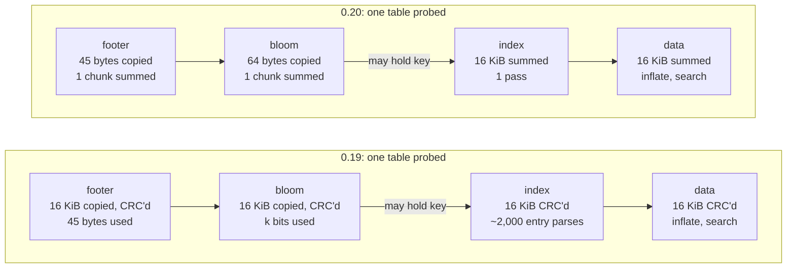
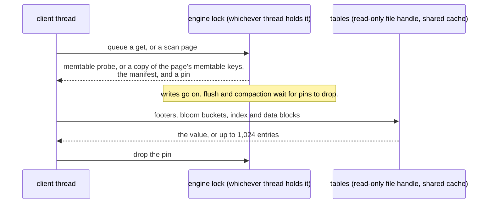

# Throughput: horton's key-value store against RocksDB

horton is a firmware store: one owner, no threads, no allocator, memory
fixed at compile time. `examples/kvstore` puts it on a host in the role
RocksDB fills. This document measures the two on db_bench's workloads,
says where horton's time went, records what v0.20 changed because of
it, and says what the remaining gap is made of.

It is a comparison of a 20,000-line `no_std` library, run outside its
design point, with the engine that defines the field. The useful result
is not who wins. It is which costs belong to horton's design and which
were just costs.

## Summary

v0.20 was done in two passes. The first made one read cheaper (the
"one reader" column). The second let reads, scans and seeks run on
every client thread at once (the "0.20" column).

| db_bench workload, 1 M keys, 4 threads, ops/s | horton 0.19 | 0.20, one reader at a time | horton 0.20 | against 0.19 | RocksDB, same memory | RocksDB, as shipped |
|---|---:|---:|---:|---:|---:|---:|
| `fillseq` | 90,389 | 218,609 | 217,825 | 2.4× | 255,789 | 562,049 |
| `fillrandom` | 47,054 | 65,684 | 66,336 | 1.4× | 193,049 | 441,659 |
| `overwrite` | 44,143 | 59,772 | 60,037 | 1.4× | 153,576 | 367,448 |
| `readrandom` | 7,190 | 37,793 | 115,909 | 16× | 344,063 | 475,325 |
| `readmissing` | 7,995 | 80,698 | 194,406 | 24× | 4,059,182 | 2,220,125 |
| `readseq` | 209,822 | 587,563 | 7,598,571 | 36× | 19,878,304 | 9,475,910 |
| `readreverse` | 186,400 | 482,887 | 4,139,832 | 22× | 16,217,731 | 8,372,295 |
| `seekrandom` | 1,964 | 8,887 | 64,471 | 33× | 315,589 | 243,612 |
| `deleterandom` | 55,882 | 84,490 | 82,435 | 1.5× | 370,818 | 379,165 |

The last four columns are one run. The 0.19 column is from an earlier
run on the same kind of machine, on a day when the fills ran about a
fifth faster. The `readseq` and `readreverse` figures before the last
pass are **one** thread scanning (that benchmark ignored the thread
count); now four threads each scan the whole store, as db_bench's do.
One thread alone now scans at 1.80 M entries/s forwards and 1.06 M
backwards.

- **Reads were the problem, and most of it was not design.** In 0.19 a
  point read cost 100 to 140 µs, and 53% of all CPU went to re-running
  CRC-32 over blocks that were already in the cache and had already
  passed. One read is now 5 times cheaper (10 times for an absent
  key), and readers run in parallel on top of that.
- **Scans and seeks were three costs, one of them threads.** A scan
  re-decoded a block every time its merge changed table, a seek read
  every table in range before yielding anything, and both held the
  engine for their whole length. A scanning thread is now 3.6 times
  faster by itself and four of them scale by four: `readseq` went from
  0.03× of RocksDB with the same memory to 0.38×, `seekrandom` from
  0.03× to 0.20×.
- **Unsynced writes were bound by thread hand-offs**, two per
  operation. Sequential fills are 2.4 times faster and within 15% of
  RocksDB given the same memory; random fills are 1.4 times faster and
  still 3 times behind it.
- **Synced writes did not change**, and all three engines are within
  a quarter of each other there: each waits for the same `fdatasync`.
- **What remains is mostly design.** One thread at a time writes, and
  flush and compaction run on the writers' time. A table has one
  bloom block, so absent keys are still 20 times slower than
  RocksDB's. A block is 16 KiB, CRC'd in software and cached
  compressed. These are what make horton fit in 112 KiB on an
  ESP32-S3.

## Method

```sh
apt install rocksdb-tools                 # db_bench 8.9.1
examples/kvstore/vs-rocksdb.sh 1000000    # the table above
examples/kvstore/vs-rocksdb.sh 100000 --sync
KVSTORE_BASELINE=path/to/an/older/kvstore examples/kvstore/vs-rocksdb.sh   # adds a "before" column
```

[`vs-rocksdb.sh`](../examples/kvstore/vs-rocksdb.sh) runs the same
benchmark list on three configurations and prints ops/s side by side:

| | memtable | block cache | block | flush and compaction |
|---|---|---|---|---|
| **RocksDB, as shipped** | 64 MiB | 32 MiB, uncompressed blocks | 4 KiB, Snappy | background threads |
| **RocksDB, same memory** | 1 MiB | 16 MiB, uncompressed blocks | 16 KiB, Snappy | background threads |
| **horton** (`examples/kvstore`) | 1 MiB, 4096 entries | 16 MiB, compressed images, in 8 locked shards; 32 decoded blocks (512 KiB) per scanning thread | 16 KiB, LZ77 | on the calling thread |

All three: 16-byte keys, 100-byte values that compress to half, 10
bloom bits per key where the engine lets one choose, a write-ahead log,
4 client threads, one file system (ext4 on a virtio disk). The machine
is a 4-vCPU Xeon at 2.3 GHz with 15 GiB of RAM; rustc 1.97, fat LTO.

Read the numbers with these in mind:

- **They are single runs on a shared virtual machine.** horton's
  numbers moved by up to 20% between runs. RocksDB's moved by up to
  60% between two runs an hour apart (its background threads compete
  with whatever else the host is doing), so a ratio to RocksDB is good
  to a factor of 1.5 at best.
- **Operation counts differ.** db_bench gives each of its 4 threads NUM
  operations; the kvstore splits NUM over its threads, except in
  `readseq` and `readreverse`, where each thread scans the whole store
  as db_bench's do. Rates compare; totals do not. Both hold NUM
  distinct keys once filled.
- **`readrandom` after `compact` is not comparable.** db_bench's
  `deleterandom` has by then deleted almost every key (four passes over
  the key space), so RocksDB answers from bloom filters. The kvstore
  deletes one pass's worth and still finds 37%.
- **"Same memory" is not "same work".** RocksDB flushes and compacts on
  background threads, on cores horton leaves idle.
- **A 1 M-key store is 116 MB of data.** Everything fits in the page
  cache, so no engine waits for a disk on a read. On flash, horton's
  device reads would dominate and this comparison would say little.

## Results

"horton (before)" in these tables is v0.20 with one reader at a time
(commit `75063ad`); "horton" is v0.20. For 0.19 see the summary and
[What changed in v0.20](#what-changed-in-v020).

### No fsync (`--no-sync`; db_bench's default)

1 M keys:

```text
benchmark                           rocksdb  rocksdb (small)  horton (before)           horton  horton / rocksdb (small)
fillseq                              562049           255789           218609           217825                     0.85x
fillrandom                           441659           193049            65684            66336                     0.34x
overwrite                            367448           153576            59772            60037                     0.39x
readrandom                           475325           344063            37793           115909                     0.34x
readmissing                         2220125          4059182            80698           194406                     0.05x
readseq                             9475910         19878304           587563          7598571                     0.38x
readreverse                         8372295         16217731           482887          4139832                     0.26x
seekrandom                           243612           315589             8887            64471                     0.20x
deleterandom                         379165           370818            84490            82435                     0.22x
readrandom (after compact)         12938200         12474933            58535           197944                     0.02x
```

100 K keys (11 MB: RocksDB as shipped never leaves its memtable):

```text
benchmark                           rocksdb  rocksdb (small)  horton (before)           horton  horton / rocksdb (small)
fillseq                              375413           297040           236224           226309                     0.76x
fillrandom                           345568           267057           149534           140718                     0.53x
overwrite                            315388           267439           157548           158186                     0.59x
readrandom                          1715104          1077783            62398           176205                     0.16x
readmissing                         1818471          3795282           146077           269102                     0.07x
readseq                             5433331         22821985           463502         10804602                     0.47x
readreverse                         1064663         11412620           413784          6073475                     0.53x
seekrandom                           765247           529816            13371            56037                     0.11x
deleterandom                         323697           326455           186954           180411                     0.55x
readrandom (after compact)         12530543          7878823           201730           422643                     0.05x
```

### Every write synced

100 K keys. A synced commit is one `fdatasync`, about 150 µs on this
disk, so the engines converge: each is waiting for the same device.

```text
benchmark                           rocksdb  rocksdb (small)  horton (before)           horton  horton / rocksdb (small)
fillseq                               12675            15623            14857            15272                     0.98x
fillrandom                            13909            15715            14586            16086                     1.02x
overwrite                             13821            16418            14363            14459                     0.88x
```

Both group commits. horton averaged 2.6 client writes per
`fdatasync` with 4 writers.

### Reader threads

1 M keys, no fsync, the same store for every row; ops/s (entries/s
for the two scans). The machine has four cores, so eight threads show
what oversubscribing costs, not more scaling.

| | 1 thread | 2 | 4 | 8 |
|---|---:|---:|---:|---:|
| `readrandom`, one reader at a time | 43,594 | 39,586 | 38,581 | 28,822 |
| `readrandom` | 45,157 | 76,728 | 136,715 | 132,496 |
| `readmissing`, one reader at a time | 73,367 | 72,924 | 73,880 | 64,824 |
| `readmissing` | 83,689 | 133,952 | 222,376 | 199,399 |
| `seekrandom`, one reader at a time | 6,956 | 8,932 | 7,962 | 6,971 |
| `seekrandom` | 14,914 | 31,060 | 60,359 | 49,379 |
| `readseq`, one scan | 498,388 | | | |
| `readseq`, a scan per thread | 1,800,529 | 3,681,076 | 7,649,640 | 8,775,491 |
| `readreverse`, one scan | 424,561 | | | |
| `readreverse`, a scan per thread | 1,057,185 | 2,155,206 | 4,225,699 | 4,631,024 |

Four threads give 3.0 times one thread's point reads, 2.7 times its
absent-key reads, and 4 times its seeks and scans. Before, more
threads gave nothing, or less.

## Where horton's time went

`perf` on the 0.19 kvstore running fills, point reads, seeks and a scan
(100 K keys, 4 threads):

| share of CPU | where | what it is |
|---:|---|---|
| 52.6% | `check_block_crc` | CRC-32 of a whole block, on every read of it, cache hit or not |
| 21.4% | futex wake and wait (kernel) | a request and a reply crossing between a client thread and the store thread |
| 4.0% | `memmove` | 16 KiB block images copied out of the cache |
| 2.4% | index search | re-parsing the index from its start for each step of a binary search |
| 1.7% | LZ77 decompress | |

A point read probes every table whose key range covers the key: each
level-0 table and one per deeper level. Per table it read the footer
and the bloom block, and for the table holding the key the index and a
data block. Every one of those was copied out of the cache and CRC'd
again (ADR-0014 required it, to catch a bit flipping in cached RAM).
At 16 KiB a CRC costs 8.3 µs:



## What changed in v0.20

Each row adds one change to the rows above it. 100 K keys, no fsync, 4
threads, ops/s; single runs taken while the work was done, with the
store in whatever state the fills left it, so read them as the size of
each step and not as a benchmark.

| | `readrandom` | `readmissing` | `seekrandom` | `fillrandom` |
|---|---:|---:|---:|---:|
| 0.19 | 7,500 | 8,300 | 4,200 | 76,000 |
| cache hits checked by a RAM checksum, not CRC-32 (ADR-0016) | 25,400 | 37,800 | 11,100 | 83,000 |
| bucketed bloom; footer and bloom read as ranges (ADR-0017) | 30,900 | 56,800 | 12,600 | 78,000 |
| callers run the engine under a lock; no store thread | 37,400 | 89,700 | 22,800 | 131,000 |
| one-pass index search; 8 MiB hashed cache | 43,100 | 102,000 | 19,600 | 139,000 |
| the lock holder serves every queued request (flat combining) | 64,400 | 207,000 | 44,000 | 178,000 |

1. **Cache hits are checked by a RAM checksum** (library, ADR-0016).
   The cache needs to know that a hit is the bytes it was given, not
   that they are a valid block. Only CRC-verified blocks are inserted;
   each slot keeps a four-lane multiply-rotate sum of its image, and a
   hit must match it. That runs at 11 to 14 GB/s where table-driven
   CRC-32 runs at 2.0, and it detects every single-bit flip, which is
   what the CRC was there for. A mismatch re-reads the device.
2. **A probe reads what it uses** (library, ADR-0017). The sum is kept
   per sixteenth of a block, so the cache can hand out a byte range
   after checking only its chunk. The bloom filter's probes for a key
   now fall in one 64-byte bucket (a format change: `hrtsst03`). A
   table that does not hold the key is ruled out in well under a
   microsecond.
3. **No store thread** (kvstore). The store thread gave every call two
   thread switches. Callers now take a lock and run horton themselves.
4. **Index search and a larger cache** (library and kvstore). The index
   has no offset table, and the binary search re-parsed it from the
   start for every probe. One pass with a key comparison every 16
   entries replaces it. Caches above 8 slots hash a block to a window
   of 8, so the kvstore can hold 512 blocks without scanning 512 tags.
5. **Flat combining** (kvstore). With a bare lock, four threads read
   more slowly (43 K/s) than one thread alone (73 K/s): the database is
   megabytes of state, and each thread dragged it into its own CPU's
   cache. Now a read or a write is queued, and whichever thread holds
   the lock serves the whole queue. Group commit is the write half of
   the same mechanism.

### Then: readers, scans and seeks on every thread

After the five steps above a read was cheap enough that the engine
lock was what bound it: four reader threads got one core's worth. The
second pass moved the table work of every read, scan and seek out of
the lock. The measurements are in [Reader threads](#reader-threads).



6. **Detached point reads** (library, ADR-0018). A point read is a
   search of the memtable and then of the tables, and only the first
   needs the `Db`. `Db::probe_memtable` returns what the memtable held
   as plain data; `TableView::resolve` finishes the read over a copy
   of the manifest, any handle to the device, and the caller's own
   buffers. The kvstore serves the probe under the lock and runs the
   table phase on the calling thread, through a second file handle and
   a cache in eight locked shards. Flush and compaction, the only
   calls that change the tables, wait for readers to leave them.
7. **Detached scans** (library, ADR-0019). A scan merges the memtable
   all the way through, so it cannot take one probe and go.
   `Db::copy_memtable_range` copies one page's worth of memtable keys
   and returns the horizon the page must stop at; `Scan::detached`
   runs over that copy. A kvstore scan takes the lock for about 30 µs
   per 1,024 entries and does the rest on its own thread.
8. **A block pool for scans** (library, ADR-0019). A `Scan` had one
   decoded block for all its table cursors, and fetched, checked and
   inflated a block again each time the merge came back to a table:
   nearly every entry, over tables that overlap. `use_block_pool`
   lends it buffers, so each table's block stays decoded. With this
   and step 7, one thread's `readseq` went from 0.50 to 1.80 M
   entries/s. Firmware lends none and keeps its 10.9 KiB scan.
9. **A forward seek reads the tables it reaches** (library, ADR-0019).
   `seek` used to position a cursor in every table that overlapped the
   range: a footer, an index block and a data block from each of over
   twenty tables, to yield one entry. A table that starts after the seek
   key now waits at its lower bound, which is in the manifest, and is
   read when the merge gets there. Over steps 7 to 9, one thread's
   `seekrandom` went from 144 to 67 µs.

## What the remaining gap is made of

| workload, 1 M keys | horton / RocksDB (same memory) | why |
|---|---:|---|
| `fillseq` | 0.85× | one writer at a time commits in under 5 µs; nothing to compact when keys arrive in order |
| `fillrandom` | 0.34× | flush and compaction run on the writers' time; RocksDB's run on other cores |
| `overwrite` | 0.39× | the same |
| `readrandom` | 0.34× | a read is 22 µs of one core: an index block summed whole, a data block summed and inflated, and for a block that misses the cache a 16 KiB software CRC |
| `readmissing` | 0.05× | one bloom block per table filters the deep levels poorly, so an absent key still reads an index and a data block there |
| `readseq` | 0.38× | 0.55 µs an entry on one thread: the merge compares every cursor's head for each entry, every entry is copied out, and every block is inflated |
| `readreverse` | 0.26× | the same, and stepping backwards through a block's version runs costs more than forwards |
| `seekrandom` | 0.20× | a seek still positions a cursor in every table that could hold the key (each level-0 table, one per deeper level), and each costs a whole index block and an inflated data block |
| `deleterandom` | 0.22× | as `fillrandom` |

**One thread at a time writes.** `Db` is a single-owner value with
`&mut self` writes; that is ADR-0002's point, and firmware has one
core. Reads no longer wait for it, but `fillrandom` at 1 M keys is
bound by flush and compaction, which RocksDB runs on other cores and
horton runs between the writes, and while one runs, new readers wait.
A horton commit of a sequential write takes under 5 µs, which is why
`fillseq`, with nothing to compact, keeps up.

**A read still passes through the lock once.** The memtable probe and
the page copy are served from the request queue. That is the serial
part: point reads scale by 3.0 on four cores, not 4. Scans, which
take the lock once per 1,024 entries, scale by 4.

**A point read that misses the cache is expensive.** It reads a 16 KiB
block, CRCs it in software (8.3 µs; `unsafe` is forbidden, so no
CRC instruction) and inflates it (3 µs). RocksDB reads 4 KiB, checks
it with a hardware CRC32C or XXH3 and caches the block uncompressed.
horton's cache holds the compressed image, so even a hit inflates the
block again (3 µs) after summing it (1.4 µs), and the whole index
block is summed for every lookup that passes the filter.

**A bloom filter is one block.** At 16 KiB that is 131,000 bits. A
level-0 table (4,096 entries) gets 32 bits per key; a full bottom-level
table (about 100,000 entries) gets 1.3 and filters almost nothing, so
a read usually pays for an index and a data block at every level below
0, hit or miss. This is now the widest gap in the table: RocksDB
answers an absent key from its filters alone.

**A scan's merge is linear in its cursors.** Each `next` compares the
head of every table cursor, one per table in range, where a heap or
one iterator per level would compare a few. Each entry's key and value
are then copied to the caller. Reverse scans cost nearly twice a
forward scan, and a reverse seek still positions every table in range: the
reverse cursor resolves version runs backwards across blocks and was
left as it was.

**Compression is 554 MB/s.** Sealing a 16 KiB table block costs 30 µs
of LZ77, 8 µs of CRC and a write. It is the largest single item in
`fillrandom` at 1 M keys, about a third of the engine's time.

## Levers not pulled

Measured or scoped while doing this, and left:

- **A bloom filter of more than one block**, or one per index
  partition. It is a format change, and it is what `readmissing`
  needs: nothing else in this list moves it much.
- **Compaction off the writers' thread.** A compaction job reads
  tables and writes new ones. If its merge ran detached, the way reads
  now do, with only its commit under the lock, it would use the cores
  RocksDB uses. It is the largest remaining gain for random writes on
  a host, and none for firmware. Not scoped further than that.
- **A decoded-block cache for hosts.** The cache keeps compressed
  images, so every hit inflates a block. Caching what the pool holds
  would take 3 µs off a point read, at twice the RAM per block for
  data that compresses by half.
- **A heap or per-level iterators in the scan merge**, and lazy seeks
  for `RevScan`.
- **Slicing-by-16 CRC-32**: 2.0 → 2.7 GB/s on this machine, for 8 KiB
  more constant tables. It would take 2 µs off every cache miss and
  every block written. A modest gain, and the firmware targets would
  pay the table.
- **Index blocks verified by the entry.** Needs checksums inside the
  index block, which costs index capacity, and a table's index is one
  block (ADR-0017).
- **LZ77 with skip acceleration and word-wide match counting.** The
  stream format would not change; the compressed bytes would.
- **A check that a detached reader's tables are still its own.** The
  rule that keeps compaction away from readers is the caller's to
  keep (ADR-0018). A table generation stamped in every block would let
  the library catch a caller that breaks it, at four bytes a block and
  a format change.
