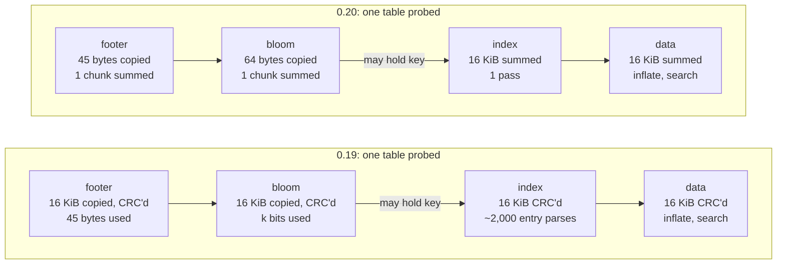
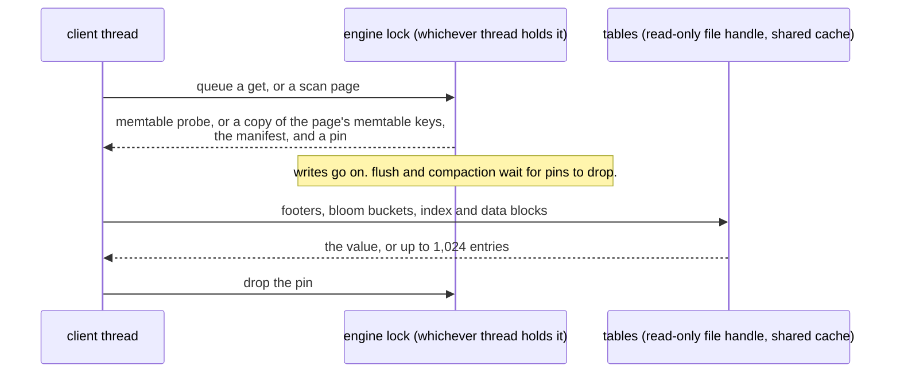

# Throughput: horton's key-value store against RocksDB

horton is a firmware store: one owner, no threads, no allocator, memory
fixed at compile time. `examples/kvstore` puts it on a host in the role
RocksDB fills. This document measures the two on db_bench's workloads,
says where horton's time went, records what v0.20 changed because of
it, and says what the remaining gap is made of.

It is a comparison of a 20,000-line `no_std` library, run outside its
design point, with the engine that defines the field. The useful result
is not who wins. It is which costs belong to horton's design and which
were just costs.

## Summary

v0.20 was done in passes. The first made one read cheaper. The second
let reads, scans and seeks run on every client thread at once. The
third gave every table a bloom filter sized to it. The fourth and
fifth took the footer and the cache's locks out of a reader's way. The
sixth took point reads out of the store's request queue and, for
nearly all of them, out of its lock. The seventh took compaction's
merge out of that lock, and writers that wait for it.

| db_bench workload, 1 M keys, 4 threads, ops/s | horton 0.19 | horton 0.20 | against 0.19 | RocksDB, same memory | RocksDB, as shipped | 0.20 / RocksDB, same memory |
|---|---:|---:|---:|---:|---:|---:|
| `fillseq` | 90,389 | 237,290 | 2.6× | 255,781 | 394,342 | 0.93× |
| `fillrandom` | 47,054 | 66,547 | 1.4× | 177,573 | 327,745 | 0.37× |
| `overwrite` | 44,143 | 60,733 | 1.4× | 139,492 | 312,899 | 0.44× |
| `readrandom` | 7,190 | 194,129 | 27× | 372,643 | 544,929 | 0.52× |
| `readmissing` | 7,995 | 5,480,704 | 690× | 5,136,113 | 2,031,786 | 1.07× |
| `readseq` | 209,822 | 7,905,716 | 38× | 20,227,143 | 9,578,682 | 0.39× |
| `readreverse` | 186,400 | 4,532,973 | 24× | 15,074,261 | 7,649,214 | 0.30× |
| `seekrandom` | 1,964 | 106,273 | 54× | 355,991 | 243,255 | 0.30× |
| `readwhilewriting` | not measured | 134,918 | | 216,634 | 395,620 | 0.62× |
| `deleterandom` | 55,882 | 86,953 | 1.6× | 418,870 | 379,182 | 0.21× |

Every column but the first is one run. The 0.19 column is from an
earlier run on the same kind of machine. **The read rows move from run
to run** (see [Run to run](#run-to-run)): what a read costs depends on
how many level-0 tables the fills happened to leave, between none and
five, and `seekrandom` has been anywhere from 45 K to 120 K for that
reason alone. The comparisons between builds in
[What changed in v0.20](#what-changed-in-v020) are made on identical
tables instead. The `readseq` and `readreverse` figures for 0.19 are
one thread scanning (that benchmark ignored the thread count); in 0.20
four threads each scan the whole store, as db_bench's do, and one
thread alone scans at 1.9 M entries/s forwards and 1.1 M backwards.

- **Reads were the problem, and most of it was not design.** In 0.19 a
  point read cost 100 to 140 µs, and 53% of all CPU went to re-running
  CRC-32 over blocks that were already in the cache and had already
  passed. One read is now 5 times cheaper, and readers run in parallel
  on top of that.
- **A read of an absent key is 140 times cheaper on one thread**:
  125 µs in 0.19, 12 µs after the first two passes, 0.87 µs now. Most
  of that is the bloom filter. A table's filter was one block whatever
  the table held, so the large tables that hold most of a store had
  1.3 bits a key and stopped almost nothing. It is now sized to the
  table, ten bits a key.
- **And four threads now read four times what one does.** With the
  tables cheap, what an absent-key read waited on was the store
  itself: every read queued for its memtable probe, and four threads
  got through the queue more slowly than one. A read of a key the
  memtable cannot hold now takes no lock at all. Against RocksDB with
  the same memory that row went from 0.05× to 0.17× (the filters) to
  about 1× (the lock). The two engines are level there, give or take
  the spread of single runs.
- **Reads no longer stop for writes.** While one thread overwrote the
  store, a reader got a sixth of its quiet rate: the few reads that
  needed the engine lock waited behind a writer that held it for the
  length of a compaction job. Compaction's merge now runs on its own
  thread outside the lock, and a write that waits for it waits without
  the lock. Four readers get 135 K reads a second while a fifth thread
  writes, from 17 K; RocksDB with the same memory gets 217 K.
- **Scans and seeks were three costs, one of them threads.** A scan
  re-decoded a block every time its merge changed table, a seek read
  every table in range before yielding anything, and both held the
  engine for their whole length. A scanning thread is now 3.6 times
  faster by itself and four of them do 3.7 times one's work.
- **Unsynced writes were bound by thread hand-offs**, two per
  operation, and then by compaction on the writers' own time.
  Sequential fills are 2.6 times faster and within 10% of RocksDB
  given the same memory; random fills are 1.4 times faster and still
  2.7 times behind it. Moving the merge to its own thread bought
  random fills 12% to 18% in every configuration measured but one
  (four writers on the comparison's 256 MiB file, where it bought
  nothing): there is one merge at a time, on one thread, and it is
  what random writes wait for.
- **Synced writes did not change**, and all three engines are within
  a quarter of each other there: each waits for the same `fdatasync`.
- **What remains.** One thread at a time writes, flushes run on the
  writers' time, and one compaction job runs at a time on one thread.
  A present-key read is 19 µs of one core: a block is 16 KiB, summed
  whole, cached compressed and inflated on every read, and CRC'd in
  software when it misses the cache. A seek positions a cursor in
  every table that could hold its key. Most of that is what makes
  horton fit in 112 KiB on an ESP32-S3.

## Method

```sh
apt install rocksdb-tools                 # db_bench 8.9.1
examples/kvstore/vs-rocksdb.sh 1000000    # the table above
examples/kvstore/vs-rocksdb.sh 100000 --sync
KVSTORE_BASELINE=path/to/an/older/kvstore examples/kvstore/vs-rocksdb.sh   # adds a "before" column
```

[`vs-rocksdb.sh`](../examples/kvstore/vs-rocksdb.sh) runs the same
benchmark list on three configurations and prints ops/s side by side:

| | memtable | block cache | block | flush and compaction |
|---|---|---|---|---|
| **RocksDB, as shipped** | 64 MiB | 32 MiB, uncompressed blocks | 4 KiB, Snappy | background threads |
| **RocksDB, same memory** | 1 MiB | 16 MiB, uncompressed blocks | 16 KiB, Snappy | background threads |
| **horton** (`examples/kvstore`) | 1 MiB, 4096 entries | 16 MiB, compressed images, read without locks (ADR-0022); 32 decoded blocks (512 KiB) per scanning thread | 16 KiB, LZ77 | flush on the calling thread, holding a 255 KiB bloom filter while it writes a table; compaction's merge on one background thread (ADR-0024) |

All three: 16-byte keys, 100-byte values that compress to half, 10
bloom bits per key, a write-ahead log, 4 client threads, one file
system (ext4 on a virtio disk). The machine
is a 4-vCPU Xeon at 2.3 GHz with 15 GiB of RAM; rustc 1.97, fat LTO.

Read the numbers with these in mind:

- **They are single runs on a shared virtual machine.** horton's
  write numbers moved by up to 20% between runs, and its read numbers
  by more ([Run to run](#run-to-run)). RocksDB's moved by up to
  60% between two runs an hour apart (its background threads compete
  with whatever else the host is doing), so a ratio to RocksDB is good
  to a factor of 1.5 at best.
- **Operation counts differ.** db_bench gives each of its 4 threads NUM
  operations; the kvstore splits NUM over its threads, except in
  `readseq` and `readreverse`, where each thread scans the whole store
  as db_bench's do. Rates compare; totals do not. Both hold NUM
  distinct keys once filled.
- **`readrandom` after `compact` is not comparable.** db_bench's
  `deleterandom` has by then deleted almost every key (four passes over
  the key space), so RocksDB answers from bloom filters. The kvstore
  deletes one pass's worth and still finds 37%.
- **"Same memory" is not "same work".** RocksDB flushes and compacts on
  background threads, on cores horton leaves idle.
- **A 1 M-key store is 116 MB of data.** Everything fits in the page
  cache, so no engine waits for a disk on a read. On flash, horton's
  device reads would dominate and this comparison would say little.

## Results

"horton (before)" in these tables is v0.20 with compaction under the
engine lock (commit `5e14da9`, with the `readwhilewriting` benchmark
added to it); "horton" is v0.20. For the earlier steps see
[What changed in v0.20](#what-changed-in-v020).

### No fsync (`--no-sync`; db_bench's default)

1 M keys:

```text
benchmark                           rocksdb  rocksdb (small)  horton (before)           horton  horton / rocksdb (small)
fillseq                              394342           255781           212315           237290                     0.93x
fillrandom                           327745           177573            65551            66547                     0.37x
overwrite                            312899           139492            58326            60733                     0.44x
readrandom                           544929           372643           182004           194129                     0.52x
readmissing                         2031786          5136113          3427774          5480704                     1.07x
readseq                             9578682         20227143          6498172          7905716                     0.39x
readreverse                         7649214         15074261          4012348          4532973                     0.30x
seekrandom                           243255           355991            54872           106273                     0.30x
readwhilewriting                     395620           216634            16648           134918                     0.62x
deleterandom                         379182           418870            86315            86953                     0.21x
readrandom (after compact)         12978964         13062034           281376           317284                     0.02x
```

The two horton columns are not a like-for-like pair: each fills its
own store on four threads, and they ended with different numbers of
level-0 tables. `seekrandom`, `readmissing` and the scans moving
between them is that; nothing in this step touches a read of a quiet
store, and pairs on equal tables show none of it (step 14 of
[What changed](#what-changed-in-v020)). `readwhilewriting` is this
step.

100 K keys (11 MB: RocksDB as shipped never leaves its memtable):

```text
benchmark                           rocksdb  rocksdb (small)  horton (before)           horton  horton / rocksdb (small)
fillseq                              465719           360404           235220           307075                     0.85x
fillrandom                           416982           368097           159162           179409                     0.49x
overwrite                            392272           368975           172868           177852                     0.48x
readrandom                          1791954          1357496           405754           433942                     0.32x
readmissing                         1729490          3863689          4777151         16757658                     4.34x
readseq                             6273861         22443646         10361289         18060197                     0.80x
readreverse                         1095734         14036930          6145470          8783732                     0.63x
seekrandom                           800171           555595            58960           393963                     0.71x
readwhilewriting                    1260203           675892            75036           286705                     0.42x
deleterandom                         403592           507489           200122           270352                     0.53x
readrandom (after compact)         13256006         13512144          1459630          1424699                     0.11x
```

At this size the read rows are decided by the tables the fills happen
to leave ([Run to run](#run-to-run)): the two horton columns are 3 to
7 times apart on `readmissing` and `seekrandom`, and no pair on equal
tables shows a read of a quiet store changing in this step.

### Run to run

The kvstore's background compaction stops when the fills do, and the
reads then run over whatever is left: between zero and five tables in
level 0, on top of some twenty below. Every level-0 table is one more
table a point read probes and a seek positions. With four writer
threads, how many are left changes from run to run.

Three pairs of runs at 1 M keys and 4 threads, taken when the bloom
filters were sized (step 10 below: "one bloom block" is the build
before it, "sized filters" the build after), show the size of it.
"Tables" is the count per level when the reads ran:

| run | build | tables per level | `readrandom` | `readmissing` | `seekrandom` | `fillrandom` |
|---|---|---|---:|---:|---:|---:|
| 1 | one bloom block | 4, 6, 1, 13 | 128,201 | 207,958 | 51,072 | 71,333 |
| 1 | sized filters | 4, 6, 1, 13 | 131,004 | 450,104 | 51,176 | 69,538 |
| 2 | one bloom block | 5, 6, 1, 13 | 118,989 | 187,588 | 44,161 | 69,927 |
| 2 | sized filters | 5, 6, 1, 13 | 128,910 | 414,717 | 44,227 | 69,214 |
| 3 | one bloom block | 0, 6, 0, 13 | 141,264 | 265,889 | 117,058 | 70,038 |
| 3 | sized filters | 2, 6, 0, 14 | 157,528 | 722,663 | 73,251 | 68,530 |

Within a build, `seekrandom` runs from 44 K to 117 K on the level-0
count alone. Runs 1 and 2 happened to pair equal layouts; run 3 did
not, and says nothing about the two builds.

Fills on **one** thread leave the same tables every time: 4, 5, 0 and
14 per level in the runs of steps 11 and 12, and 3, 6, 0 and 13 in
those of step 13, the same in every run and in both builds of each
pair. `bench --threads 1 --read-threads N` fills that way and reads on
N threads, and every comparison between builds from step 11 on is made
like that.

### Every write synced

100 K keys. A synced commit is one `fdatasync`, about 150 µs on this
disk, so the engines converge: each is waiting for the same device.

```text
benchmark                           rocksdb  rocksdb (small)  horton (before)           horton  horton / rocksdb (small)
fillseq                               14895            16304            16224            15816                     0.97x
fillrandom                            14992            16070            15532            15551                     0.97x
overwrite                             15311            16589            15057            16325                     0.98x
```

Both group commits. horton averaged 2.6 client writes per
`fdatasync` with 4 writers.

### Reader threads

1 M keys, no fsync, the same tables in every column (fills on one
thread); ops/s (entries/s for the two scans). The machine has four
cores, so eight threads show what oversubscribing costs, not more
scaling. `readoutside` reads keys past every table: it consults no
table and no cache, and is what a read costs in the store itself.

| reader threads | 1 | 2 | 4 | 8 |
|---|---:|---:|---:|---:|
| `readrandom` | 53,162 | 103,466 | 200,780 | 198,035 |
| `seekrandom` | 16,295 | 31,522 | 62,747 | 63,089 |
| `readseq`, a scan per thread | 1,927,267 | 3,701,258 | 7,315,912 | 8,796,726 |
| `readreverse`, a scan per thread | 1,106,884 | 2,105,024 | 4,202,392 | 4,749,982 |
| `readmissing` | 1,142,536 | 2,038,601 | 3,818,820 | 4,187,464 |
| `readoutside` | 5,284,619 | 9,781,863 | 20,785,057 | 17,513,306 |
| `readwhilewriting`, one more thread overwriting | 49,775 | 96,203 | 138,328 | 147,106 |

For comparison, at the start of v0.20's second pass (commit `75063ad`,
one reader at a time) `readrandom` was 43,594 on one thread and 38,581
on four, and `seekrandom` 6,956 and 7,962. Before step 13, with every
point read queued, `readmissing` was 675 K on one thread and 701 K on
four, and `readoutside` 1.62 M and 0.66 M.

Four threads give 3.8 times one thread's present-key reads, seeks,
forward and reverse scans, 3.3 times its absent-key reads in this run
(3.7 in the three pairs of step 13) and 3.9 times its reads of keys
outside the store. Nothing a point read does is serial any more unless
the memtable could hold its key. A scan takes the engine lock once a
page.

`readwhilewriting` is `readrandom` with a writer running: one, two
and four readers get 94%, 93% and 69% of the rate they get from a
quiet store, and the writer 59 K, 58 K and 46 K writes a second. At
four readers there are six threads at work on four cores (the readers,
the writer and the compaction thread). Before step 14 the same
readers got 8 K and 28 K at one and four threads.

## Where horton's time went

`perf` on the 0.19 kvstore running fills, point reads, seeks and a scan
(100 K keys, 4 threads):

| share of CPU | where | what it is |
|---:|---|---|
| 52.6% | `check_block_crc` | CRC-32 of a whole block, on every read of it, cache hit or not |
| 21.4% | futex wake and wait (kernel) | a request and a reply crossing between a client thread and the store thread |
| 4.0% | `memmove` | 16 KiB block images copied out of the cache |
| 2.4% | index search | re-parsing the index from its start for each step of a binary search |
| 1.7% | LZ77 decompress | |

A point read probes every table whose key range covers the key: each
level-0 table and one per deeper level. Per table it read the footer
and the bloom block, and for the table holding the key the index and a
data block. Every one of those was copied out of the cache and CRC'd
again (ADR-0014 required it, to catch a bit flipping in cached RAM).
At 16 KiB a CRC costs 8.3 µs:



## What changed in v0.20

Each row adds one change to the rows above it. 100 K keys, no fsync, 4
threads, ops/s; single runs taken while the work was done, with the
store in whatever state the fills left it, so read them as the size of
each step and not as a benchmark.

| | `readrandom` | `readmissing` | `seekrandom` | `fillrandom` |
|---|---:|---:|---:|---:|
| 0.19 | 7,500 | 8,300 | 4,200 | 76,000 |
| cache hits checked by a RAM checksum, not CRC-32 (ADR-0016) | 25,400 | 37,800 | 11,100 | 83,000 |
| bucketed bloom; footer and bloom read as ranges (ADR-0017) | 30,900 | 56,800 | 12,600 | 78,000 |
| callers run the engine under a lock; no store thread | 37,400 | 89,700 | 22,800 | 131,000 |
| one-pass index search; 8 MiB hashed cache | 43,100 | 102,000 | 19,600 | 139,000 |
| the lock holder serves every queued request (flat combining) | 64,400 | 207,000 | 44,000 | 178,000 |

1. **Cache hits are checked by a RAM checksum** (library, ADR-0016).
   The cache needs to know that a hit is the bytes it was given, not
   that they are a valid block. Only CRC-verified blocks are inserted;
   each slot keeps a four-lane multiply-rotate sum of its image, and a
   hit must match it. That runs at 11 to 14 GB/s where table-driven
   CRC-32 runs at 2.0, and it detects every single-bit flip, which is
   what the CRC was there for. A mismatch re-reads the device.
2. **A probe reads what it uses** (library, ADR-0017). The sum is kept
   per sixteenth of a block, so the cache can hand out a byte range
   after checking only its chunk. The bloom filter's probes for a key
   now fall in one 64-byte bucket (a format change: `hrtsst03`). A
   table that does not hold the key is ruled out in well under a
   microsecond.
3. **No store thread** (kvstore). The store thread gave every call two
   thread switches. Callers now take a lock and run horton themselves.
4. **Index search and a larger cache** (library and kvstore). The index
   has no offset table, and the binary search re-parsed it from the
   start for every probe. One pass with a key comparison every 16
   entries replaces it. Caches above 8 slots hash a block to a window
   of 8, so the kvstore can hold 512 blocks without scanning 512 tags.
5. **Flat combining** (kvstore). With a bare lock, four threads read
   more slowly (43 K/s) than one thread alone (73 K/s): the database is
   megabytes of state, and each thread dragged it into its own CPU's
   cache. Now a read or a write is queued, and whichever thread holds
   the lock serves the whole queue. Group commit is the write half of
   the same mechanism.

### Then: readers, scans and seeks on every thread

After the five steps above a read was cheap enough that the engine
lock was what bound it: four reader threads got one core's worth. The
second pass moved the table work of every read, scan and seek out of
the lock. The measurements are in [Reader threads](#reader-threads).



6. **Detached point reads** (library, ADR-0018). A point read is a
   search of the memtable and then of the tables, and only the first
   needs the `Db`. `Db::probe_memtable` returns what the memtable held
   as plain data; `TableView::resolve` finishes the read over a copy
   of the manifest, any handle to the device, and the caller's own
   buffers. The kvstore serves the probe under the lock and runs the
   table phase on the calling thread, through a second file handle and
   a cache in eight locked shards. Flush and compaction, the only
   calls that change the tables, wait for readers to leave them.
7. **Detached scans** (library, ADR-0019). A scan merges the memtable
   all the way through, so it cannot take one probe and go.
   `Db::copy_memtable_range` copies one page's worth of memtable keys
   and returns the horizon the page must stop at; `Scan::detached`
   runs over that copy. A kvstore scan takes the lock for about 30 µs
   per 1,024 entries and does the rest on its own thread.
8. **A block pool for scans** (library, ADR-0019). A `Scan` had one
   decoded block for all its table cursors, and fetched, checked and
   inflated a block again each time the merge came back to a table:
   nearly every entry, over tables that overlap. `use_block_pool`
   lends it buffers, so each table's block stays decoded. With this
   and step 7, one thread's `readseq` went from 0.50 to 1.80 M
   entries/s. Firmware lends none and keeps its 10.9 KiB scan.
9. **A forward seek reads the tables it reaches** (library, ADR-0019).
   `seek` used to position a cursor in every table that overlapped the
   range: a footer, an index block and a data block from each of over
   twenty tables, to yield one entry. A table that starts after the seek
   key now waits at its lower bound, which is in the manifest, and is
   read when the merge gets there. Over steps 7 to 9, one thread's
   `seekrandom` went from 144 to 67 µs.

### Then: a bloom filter sized to its table

10. **A filter may span blocks, and is folded to fit** (library,
    ADR-0020). A table's bloom filter was one block: 131,000 bits here,
    which is 32 bits a key for the 4,096 entries of a flush and 1.3 for
    the 100,000 of a full table. At 1.3 bits a filter passes more than
    half of what it is asked, so an absent key read an index block and
    a data block in most of the deep tables. The filter can now be up
    to sixteen blocks. The table writer builds it at that length and,
    when the table ends and its entry count is known, folds it (ORs
    runs of neighbouring buckets together) down to the fewest blocks
    that give each entry 10 bits. A flush still writes one bloom block;
    a 70,000-entry table at the bottom of this store writes eight. A
    lookup still reads one
    64-byte bucket. One thread's `readmissing` went from 11.8 to
    2.3 µs.

    The first measurement of it showed random fills 6% slower. A
    well-fed filter takes 6 to 13 probes a key where a starved one took
    1, and each probe ended in a 64-bit division. A bucket is 512 bits,
    so the remainder is now a mask, and the fills are back within
    noise.

### Then: readers that do not read footers

11. **The manifest record describes a table in full** (library,
    ADR-0021). With the filters doing their work, a table that does
    not hold the key cost two small reads from the cache: the footer's
    fields, to learn where the filter is and how to probe it, and then
    one bloom bucket. The manifest record already had most of what the
    footer says, and the rest follows from the table's layout. It now
    carries the two facts that were missing (the probe count and the
    filter's length), a reader is built from it with no I/O, and
    nothing on a read, scan or compaction path reads a footer. A probe
    the filter turns away is one read of one bucket; a seek reads one
    block fewer per table it positions.

    Measured on identical tables (fills on one thread, which leaves the
    same layout every time: 4, 5, 0 and 14 tables per level), 1 M keys,
    each figure the mean of two or three runs:

    | | reader threads | footer and bucket | bucket only | change |
    |---|---:|---:|---:|---:|
    | `readmissing` | 1 | 419,150 | 516,329 | +23% |
    | `readmissing` | 4 | 431,268 | 587,948 | +36% |
    | `readrandom` | 1 | 48,377 | 49,453 | +2% |
    | `readrandom` | 4 | 136,152 | 150,612 | +11% |
    | `seekrandom` | 1 | 17,121 | 16,872 | -1% |
    | `seekrandom` | 4 | 51,313 | 55,827 | +9% |
    | `readseq` | 4 | 7,114,846 | 7,305,777 | +3% |

    An absent-key read on one thread is 1.9 µs, from 2.4. The gains
    are larger at four threads than at one because what was removed
    was a read of the shared cache, and the cache is what the threads
    contend on. The one-thread seek figure is inside the noise of
    these runs (three pairs: 17,073, 17,179 and 17,110 before; 16,896,
    16,814 and 16,905 after), and nothing in the change would make a
    seek cost more: it reads one block fewer.

### Then: a cache whose hits write nothing shared

12. **The readers' cache takes no lock on a hit** (kvstore, ADR-0022).
    The cache the readers shared was the library's `BlockCache` in
    eight shards, each behind a lock. Every hit wrote shared memory:
    the lock, a reference bit, a counter. A cached block is named by
    its table and block ids, and a table id is never reused, so an
    entry is never wrong, only evicted. The kvstore's own cache uses
    that: entries are immutable, each reader thread keeps a view of the
    slots it uses and compares one atomic epoch per slot, and only an
    insert or an eviction takes a lock. The RAM checksum on every hit
    (ADR-0016) is kept, per 256 bytes.

    On identical tables (fills on one thread), 1 M keys, means of two
    runs at one reader thread and three at four:

    | | reader threads | locked shards | lock-free hits | change |
    |---|---:|---:|---:|---:|
    | `readrandom` | 1 | 51,051 | 51,194 | 0% |
    | `readrandom` | 4 | 152,974 | 182,986 | +20% |
    | `seekrandom` | 1 | 17,403 | 17,192 | -1% |
    | `seekrandom` | 4 | 55,966 | 66,003 | +18% |
    | `readmissing` | 1 | 535,932 | 658,564 | +23% |
    | `readmissing` | 4 | 570,496 | 635,650 | +11% |
    | `readoutside` | 1 | 1,670,505 | 1,638,345 | -2% |
    | `readoutside` | 4 | 577,800 | 635,836 | +10% |
    | `readseq` | 1 | 1,935,718 | 1,898,063 | -2% |
    | `readseq` | 4 | 7,290,771 | 7,124,246 | -2% |
    | `readreverse` | 1 | 1,092,332 | 1,092,159 | 0% |
    | `readreverse` | 4 | 4,162,125 | 4,288,337 | +3% |

    Where the tables are what a read waits on, four threads gain a
    fifth: present-key reads and seeks. An absent-key read gains a
    quarter on one thread (1.87 µs to 1.52 µs).

    On four threads absent-key reads did not gain, and `readoutside`
    says why. It reads keys past every table, so it consults no table
    and no cache: it is the request queue and the memtable probe and
    nothing else. One thread does 1.65 M of those a second. Four
    threads do 0.6 M between them. Absent-key reads at four threads
    run at exactly that rate, in both builds. They were bound by the
    queue before this change and they are bound by it after. (The 10%
    between the two builds on `readoutside`, which neither build's
    cache touches, is how far apart two four-thread runs land.)

    Forward scans are 2% slower in both rows. The first version of
    this cache lost 3% to 5%: a scan evicting a block it had itself
    read a page earlier still held a reference to it, so the entry
    could not be reused and each such eviction allocated 17 KiB. The
    inserting thread now lets go of its own reference first. The 2%
    that is left is the size of the spread between runs here
    (`readoutside` on one thread, which this change does not touch,
    also moved by 2%), and is not explained.

### Then: point reads that do not queue, and mostly do not lock

13. **A read of a key the memtable cannot hold takes no lock**
    (kvstore, ADR-0023). Step 12 left every point read queueing for
    its memtable probe, and `readoutside` showed what that cost: 1.6 M
    reads a second through the queue on one thread, 0.64 M on four.

    Two things were in the way, and they came out one at a time.
    First the queue: a read now takes the engine lock itself, probes
    the memtable into a probe its thread keeps, and lets go. That
    doubled `readoutside` (3.2 M on one thread, 1.2 M on four, single
    runs) and left four threads slower than one, because an exclusive
    lock taken on every read is a cache line every reader writes.

    Then the lock. What a read asks the database is nearly always
    answered the same way: the memtable has nothing for this key, and
    the tables are the ones you already have. The store now says both
    in words that are written only when the answer changes. A filter
    over the memtable has two bits for each key written since the last
    flush (32 KiB; a write sets them before it writes the memtable).
    The manifest's sequence number is published after every table
    change. A reader raises a pin in a slot of its own, checks that
    the gate is open, that its manifest copy carries the published
    number and that the filter does not have its key, and goes to the
    tables. Flush and compaction raise a flag, wait for every slot to
    read zero, change the tables and publish. Each side stores and
    then looks at the other's store, so one of them always sees the
    other.

    ```mermaid
    flowchart LR
        subgraph before["step 12: every read"]
            direction LR
            Q1["queue the read<br/>(allocate, lock)"] --> E1["engine lock, held by<br/>whichever thread serves:<br/>probe the memtable"] --> T1["tables"]
        end
        subgraph after["step 13: a key the memtable cannot hold"]
            direction LR
            P2["raise own pin"] --> C2["3 loads:<br/>gate open, manifest current,<br/>key not in the filter"] --> T2["tables"]
        end
    ```

    On identical tables (fills on one thread: 3, 6, 0 and 13 tables
    per level with this benchmark list), 1 M keys, means of three
    runs. "Queued" is step 12 with the benchmark fix described below:

    | | reader threads | queued | no lock | change |
    |---|---:|---:|---:|---:|
    | `readoutside` | 1 | 1,618,525 | 5,268,530 | 3.3× |
    | `readoutside` | 2 | 890,113 | 10,114,028 | 11× |
    | `readoutside` | 4 | 641,223 | 20,840,502 | 33× |
    | `readmissing` | 1 | 738,739 | 1,153,940 | 1.6× |
    | `readmissing` | 2 | 859,277 | 2,071,064 | 2.4× |
    | `readmissing` | 4 | 645,098 | 4,259,914 | 6.6× |
    | `readrandom` | 1 | 50,945 | 53,775 | +6% |
    | `readrandom` | 2 | 97,135 | 103,281 | +6% |
    | `readrandom` | 4 | 188,246 | 204,933 | +9% |
    | `seekrandom` | 1 | 16,258 | 16,147 | -1% |
    | `seekrandom` | 4 | 63,468 | 63,429 | 0% |
    | `readseq` | 1 | 1,965,903 | 1,929,854 | -2% |
    | `readseq` | 4 | 7,380,259 | 7,352,198 | 0% |
    | `readreverse` | 1 | 1,119,077 | 1,102,959 | -1% |
    | `readreverse` | 4 | 4,360,243 | 4,295,793 | -1% |
    | `fillseq` (one writer; nine pairs) | | 189,423 | 192,846 | +2% |
    | `fillrandom` | | 52,943 | 52,359 | -1% |
    | `overwrite` | | 50,814 | 51,259 | +1% |

    A read that touches nothing but the store costs 0.19 µs and four
    threads do 3.96 times one thread's. An absent-key read is 0.87 µs
    on one thread, from 1.35, and four threads do 3.7 times one's
    rate, where they did 0.9 times. A present-key read lost the
    microsecond the queue cost it, of twenty. Seeks and scans did not
    change: a page still takes the engine lock once, and at 1,024
    entries a page that lock was never what a scan waited on. Writes
    did not change either: two filter bits a key do not show.

    **The benchmark had to be fixed first.** `readmissing` built each
    key with an allocation and a reallocation. The first measurement
    of this step had four threads reading absent keys *slower* than
    one (1.4 M against 2.0 M, on a store with fewer tables than the
    one above). A profile put a third of their time in the kernel,
    waking and sleeping on the allocator's lock: at half a microsecond
    a read, the benchmark's own loop was the contended thing. The key
    is now built on the stack, as `db_bench` builds its keys. The
    "queued" column above is the old store with the same fix. The fix
    did nothing for the old store on four threads (0.65 M here; 0.70 M
    before it, on slightly different tables): the queue was slower
    than the allocator, and hid it.

    What still takes the lock: a key written since the last flush
    (which is how a thread reads its own writes), every key after a
    range delete or a recovery until the next flush, a thread's first
    read after each flush or compaction commit, and every page of a
    scan. In these runs about 800 point reads of three million did
    (0.03%): the keys the last writes left in the memtable.

### Then: compaction's merge off the engine lock, and writers that wait without it

14. **A compaction job's merge runs without the `Db`** (library and
    kvstore, ADR-0024). Every `compact_step` ran under the engine
    lock: one at the end of each write while a job was pending, and
    whole jobs, back to back, by whichever writer found level 0 full.
    A job is nearly all merge (one output is up to 2,047 blocks, a
    step each), and the merge needs only a device and the target
    level's table list. `Compaction::merge_detached` runs it over any
    handle to the device; `Db::compact_step` keeps the rest: choosing
    the job, sealing and committing each output.

    The kvstore's compaction thread now does the merging, with a file
    handle of its own and no lock, and the job's scratch is handed
    back and forth between it and whoever holds the engine lock for
    the short steps in between. A store compacted this way is, block
    for block, the store `compact_step` alone leaves
    (`tests/detached_compaction.rs` compares the two images).

    ```mermaid
    sequenceDiagram
        participant W as writer (engine lock)
        participant C as compaction thread (no lock)
        participant T as tables (its own file handle)
        W->>W: compact_step: choose a job, position its cursors
        W-->>C: lend the scratch and a manifest copy
        Note over W: writes and flushes go on; readers are not shut out
        loop until the output is full or the inputs are exhausted
            C->>T: merge_detached: read inputs, write one output block
        end
        C-->>W: give the scratch back
        W->>W: compact_step: seal the output, commit it, open the next
    ```

    That alone did little for a reader, and the first measurement said
    why. With one thread overwriting the store, a reader got 8 K reads
    a second where a quiet store gave it 55 K; with the merge off the
    lock it got 10 K. Of its reads, one or two in a hundred needed the
    engine lock (the key was in the memtable, or the manifest had just
    changed), and each of those waited for it behind the writer, which
    had found level 0 full and held the lock until compaction made
    room. **A write that has to wait for compaction now waits without
    the lock**: its group stays at the head of the queue, and its
    thread lets go, sleeps 200 µs and looks again.

    1 M keys, no fsync, fills on a 1 GiB file, means of three pairs:

    | | before | after | change |
    |---|---:|---:|---:|
    | `readwhilewriting`, 1 reader and 1 writer, reads/s | 8,404 | 50,033 | 6.0× |
    | `readwhilewriting`, 4 readers and 1 writer | 28,234 | 132,910 | 4.7× |
    | `fillseq`, 1 writer | 181,782 | 239,937 | +32% |
    | `fillrandom`, 1 writer | 52,199 | 61,548 | +18% |
    | `overwrite`, 1 writer | 50,988 | 58,248 | +14% |
    | `fillseq`, 4 writers | 121,122 | 158,950 | +31% |
    | `fillrandom`, 4 writers | 57,942 | 68,155 | +18% |
    | `overwrite`, 4 writers | 57,518 | 65,930 | +15% |

    The writer in `readwhilewriting` did 53 K writes a second before
    and 59 K after (one reader), so the readers' gain was not taken
    from it.

    **Writes gained less than this document predicted**, and less on
    the comparison's own configuration. On a 256 MiB file (two pairs
    each): one writer's `fillrandom` and `overwrite` gained 12%; four
    writers' fills did not move (within 4% either way); and
    `readwhilewriting` at four readers went from 17 K to 137 K.
    `fillseq` there could not be told apart from drift: the old build
    alone ran from 243 K to 295 K between sessions. The reason for the
    small gain is in the next section: the merge is one thread, it is
    busy all the time, and the writers were waiting for it before and
    are waiting for it now. What moved off the writers' thread was
    work they were not short of time for.

    Reads of a quiet store did not change. The first three pairs had
    `readrandom` at four threads 4% lower after (192 K against 201 K),
    every time. Nine more runs of three builds landed on either 199 K
    or 206 K whichever build they were: a run settles on one of the
    two, and three pairs happened to split by build.

    What still runs under the engine lock: flush (a table of 4,096
    entries, a few milliseconds), each job's short steps, and the
    whole wait of the calls that are not queued (`delete_range`,
    `flush`, `compact`) when they need room.

## What the remaining gap is made of

| workload, 1 M keys | horton / RocksDB (same memory) | why |
|---|---:|---|
| `fillseq` | 0.93× | one writer at a time commits in about 4 µs; little to compact when keys arrive in order |
| `fillrandom` | 0.37× | compaction is one job at a time on one thread, at about 80 µs for each 16 KiB block it writes, and it writes about thirty times what the writers do; RocksDB's jobs run side by side and cost less each |
| `overwrite` | 0.44× | the same |
| `readrandom` | 0.52× | a read is 19 µs of one core: an index block summed whole, a data block summed and inflated, and for a block that misses the cache a 16 KiB software CRC |
| `readmissing` | 1.07× | no gap: 0.87 µs on one thread, one bloom bucket per table in range, and nothing shared is written, so four threads do four times one's |
| `readseq` | 0.39× | 0.52 µs an entry on one thread: the merge compares every cursor's head for each entry, every entry is copied out, and every block is inflated |
| `readreverse` | 0.30× | the same, and stepping backwards through a block's version runs costs more than forwards |
| `seekrandom` | 0.30× | a seek still positions a cursor in every table that could hold the key (each level-0 table, one per deeper level), and each costs a whole index block and an inflated data block |
| `readwhilewriting` | 0.62× | `readrandom`'s 19 µs, on cores shared with the writer and the merge; and every table compaction writes is new to the cache |
| `deleterandom` | 0.21× | as `fillrandom` |

**One thread at a time writes, and one job at a time compacts.** `Db`
is a single-owner value with `&mut self` writes; that is ADR-0002's
point, and firmware has one core. A commit of a sequential write
takes about 4 µs, which is why `fillseq`, with little to compact,
keeps up. `fillrandom` at 1 M keys waits for compaction. The merge
now runs on a thread of its own, outside the engine lock (step 14),
and that thread is busy for the whole of the benchmark (100% of a
core, with the one writer at 10% of another): about 420,000 blocks
written for two million random writes, each block about 80 µs of
reading, merging, compressing, summing and writing. The writers'
keys land all over level 1, so each job of level 0 rewrites all of
it. RocksDB at the same memtable size compacts with several threads,
4 KiB blocks, Snappy and a hardware CRC.

**Most point reads take no lock; a scan takes one a page.** A read of
a key the memtable cannot hold raises a pin of its own and goes to the
tables (step 13). A key written since the last flush still asks the
memtable under the engine lock, and so does every key after a range
delete or a recovery until the next flush. A scan page copies its part
of the memtable under the lock: once per 1,024 entries, which is why
scans scale by 3.8 on four cores with it.

**What four reader threads waited on was the queue, then the lock, and
then the benchmark.** An earlier profile of four threads reading
absent keys put 60% of their time in the old cache's ranged read and
14% in the queue, and that was read as the cache being the limit. It
was where the time went, not what the rate waited on: with the cache's
locks gone (ADR-0022) the four-thread rate did not move. `readoutside`
was added to measure the store without its tables, and showed the
queue serving four threads at 0.4 times the rate it served one. With
the queue gone the engine lock did the same at twice the rate. With
the lock gone, the benchmark's own allocation per key did. Each was
found by measuring the thing itself, and each time the profile of the
whole had pointed somewhere else.

**A point read that misses the cache is expensive.** It reads a 16 KiB
block, CRCs it in software (8.3 µs; `unsafe` is forbidden, so no
CRC instruction) and inflates it (3 µs). RocksDB reads 4 KiB, checks
it with a hardware CRC32C or XXH3 and caches the block uncompressed.
horton's cache holds the compressed image, so even a hit inflates the
block again (3 µs) after summing it (1.4 µs), and the whole index
block is summed for every lookup that passes the filter.

**A scan's merge is linear in its cursors.** Each `next` compares the
head of every table cursor, one per table in range, where a heap or
one iterator per level would compare a few. Each entry's key and value
are then copied to the caller. Reverse scans cost nearly twice a
forward scan, and a reverse seek still positions every table in range: the
reverse cursor resolves version runs backwards across blocks and was
left as it was.

**Compression is 554 MB/s.** Sealing a 16 KiB table block costs 30 µs
of LZ77, 8 µs of CRC and a write. It is the largest single item in
`fillrandom` at 1 M keys, about a third of the engine's time.

## Levers not pulled

Measured or scoped while doing this, and left:

- **Scan pages that do not lock.** A page copies its slice of the
  memtable under the engine lock. A page whose range the memtable does
  not reach could learn that the way a point read does. Not measured:
  at one lock per 1,024 entries it is not what a scan waits on.
- **A filter for range tombstones.** One `delete_range` sends every
  point read back to the engine lock until the next flush (ADR-0023).
  Remembering the ranges, not a flag, would keep the others out of it.
- **More than one compaction job at a time, or a merge split across
  threads.** The merge is off the engine lock now (ADR-0024) and one
  thread is all it has. A second job on other levels, or the output
  half of a merge (compress, sum, write) on a thread of its own, is
  what random writes would gain from next. Both are the library's to
  offer: a `Db` knows one job.
- **Flush off the writers' thread.** A flush writes a table of 4,096
  entries under the engine lock, a few milliseconds every 4,096
  writes, with the readers' gate shut. Its table could be written
  detached, like a compaction output, with only the commit under the
  lock.
- **A decoded-block cache for hosts.** The cache keeps compressed
  images, so every hit inflates a block. Caching what the pool holds
  would take 3 µs off a point read, at twice the RAM per block for
  data that compresses by half.
- **A heap or per-level iterators in the scan merge**, and lazy seeks
  for `RevScan`.
- **Slicing-by-16 CRC-32**: 2.0 → 2.7 GB/s on this machine, for 8 KiB
  more constant tables. It would take 2 µs off every cache miss and
  every block written. A modest gain, and the firmware targets would
  pay the table.
- **Index blocks verified by the entry.** Needs checksums inside the
  index block, which costs index capacity, and a table's index is one
  block (ADR-0017).
- **LZ77 with skip acceleration and word-wide match counting.** The
  stream format would not change; the compressed bytes would.
- **A check that a detached reader's tables are still its own.** The
  rule that keeps compaction away from readers is the caller's to
  keep (ADR-0018). A table generation stamped in every block would let
  the library catch a caller that breaks it, at four bytes a block and
  a format change.
