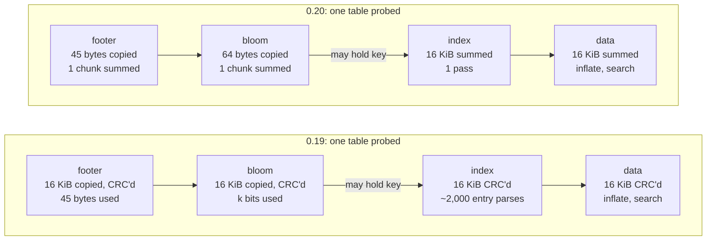
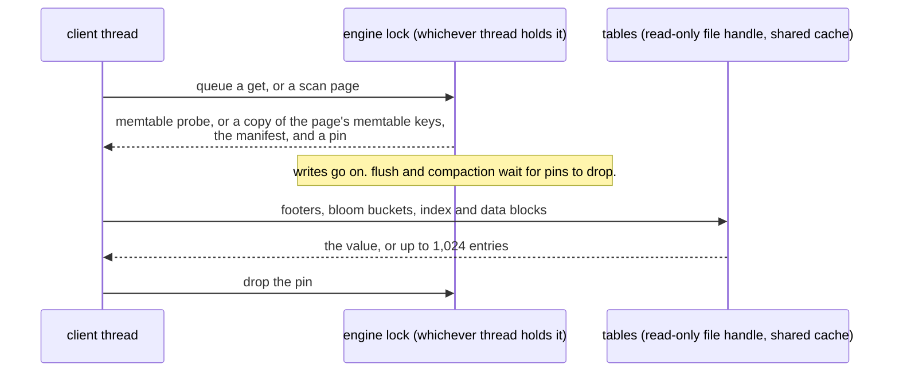

# Throughput: horton's key-value store against RocksDB

horton is a firmware store: one owner, no threads, no allocator, memory
fixed at compile time. `examples/kvstore` puts it on a host in the role
RocksDB fills. This document measures the two on db_bench's workloads,
says where horton's time went, records what v0.20 changed because of
it, and says what the remaining gap is made of.

It is a comparison of a 20,000-line `no_std` library, run outside its
design point, with the engine that defines the field. The useful result
is not who wins. It is which costs belong to horton's design and which
were just costs.

## Summary

v0.20 was done in passes. The first made one read cheaper. The second
let reads, scans and seeks run on every client thread at once. The
third gave every table a bloom filter sized to it. The fourth and
fifth took the footer and the cache's locks out of a reader's way. The
sixth took point reads out of the store's request queue and, for
nearly all of them, out of its lock. The seventh took compaction's
merge out of that lock, and writers that wait for it. The eighth runs
two compaction jobs at a time. A ninth pass went back over the code a
block passes through: CRC-32, the LZ77 codec, the cache's copies and
the memtable's insert ([step 16](#then-the-hot-path-measured-again)).
Against the build before it, writes are 1.3 to 1.4 times faster and
point reads 1.6. Then one `fdatasync` came to cover many WAL blocks of
writes, and one atomic batch to span them
([steps 18 and 19](#then-one-fdatasync-for-more-than-a-block-of-writes)),
and the host store's memtable grew to fill its arena
([step 20](#then-a-memtable-as-large-as-its-arena)). Last, tables
written into levels 0 and 1 stopped compressing
([step 21](#then-no-compression-in-levels-0-and-1)): fills and
overwrites 16% to 43% faster, point reads 5% to 8% and seeks about 40%.
And a point read served from the cache came to check only the bytes it
reads ([step 22](#then-a-cached-point-read-checks-what-it-reads)):
10% to 15% faster when the cache holds the keys read. Then the index
block came to end in restart offsets, so its search binary-searches
and checks only what it reads, as a data block's does
([step 23](#then-an-index-search-that-reads-only-what-it-needs)):
point reads 14% to 41% faster, seeks 19% to 75%. And a seek came to
check and copy only the bytes of a data block it reads
([step 24](#then-a-seek-that-copies-only-what-it-checks)): 58% to 70%
fewer instructions, and 49% to 86% faster at 1 M keys. Then the host store
came to keep its scans' buffers per reader thread
([step 25](#then-a-scan-the-host-store-keeps)): 17% to 38% fewer
instructions a seek, and 8% to 12% faster at 1 M keys. And a seek came
to inflate a compressed block only as far as it reads
([step 26](#then-a-seek-that-inflates-only-what-it-reads)): 9% fewer
instructions for a page of one, level at ten, 3% more at a hundred.
Last, a compressed block came to list points a decode may start at
([step 27](#then-compressed-blocks-a-read-can-enter-part-way)): a
cached point read takes 38% fewer instructions and is about 50%
faster, a cached seek 11% to 17% fewer and 7% to 36% faster.

The table was measured again after step 20, with RocksDB run beside it
on the same machine; it is the first of two runs.

| db_bench workload, 1 M keys, 4 threads, ops/s | horton 0.19 | horton 0.20 | against 0.19 | RocksDB, same memory | RocksDB, as shipped | 0.20 / RocksDB, same memory |
|---|---:|---:|---:|---:|---:|---:|
| `fillseq` | 90,389 | 223,147 | 2.5× | 200,573 | 342,300 | 1.11× |
| `fillrandom` | 47,054 | 153,563 | 3.3× | 125,661 | 286,123 | 1.22× |
| `overwrite` | 44,143 | 138,729 | 3.1× | 103,328 | 269,536 | 1.34× |
| `readrandom` | 7,190 | 238,987 | 33× | 278,538 | 435,611 | 0.86× |
| `readmissing` | 7,995 | 5,028,867 | 629× | 2,783,882 | 2,020,095 | 1.81× |
| `readseq` | 209,822 | 7,390,476 | 35× | 12,137,523 | 8,525,004 | 0.61× |
| `readreverse` | 186,400 | 4,478,393 | 24× | 9,275,436 | 7,671,802 | 0.48× |
| `seekrandom` | 1,964 | 99,868 | 51× | 202,886 | 207,251 | 0.49× |
| `readwhilewriting` | not measured | 129,524 | | 153,960 | 297,626 | 0.84× |
| `deleterandom` | 55,882 | 181,177 | 3.2× | 299,607 | 260,399 | 0.60× |
| `fillrandom`, every write synced (100 K keys) | | 15,096 | | 10,900 | 10,877 | 1.38× |
| `fillrandom`, 100 writes a batch | | 283,894 | | 164,562 | 463,335 | 1.73× |
| `fillrandom`, 1,000 writes a batch, synced | | 202,665 | | 209,774 | 520,711 | 0.97× |

Every column but the first is one run. The 0.19 column is from an
earlier run on the same kind of machine. **RocksDB ran slower in this
session** than the day before on the same kind of machine, by 3% to 23%
on writes without large batches and 12% to 38% on most reads with the same memory
([Results](#results)), so its ratios are good to a factor of 1.5 at
best, as [Method](#method) says. **The read rows move from run to
run** (see [Run to run](#run-to-run)): what a read costs depends on how
many level-0 tables the fills happened to leave, and in the second run
`seekrandom` was 55,825, `readseq` 6.2 M and `readmissing` 3.5 M. The
comparisons between builds in
[What changed in v0.20](#what-changed-in-v020) are made on identical
tables instead. The `readseq` and `readreverse` figures for 0.19 are
one thread scanning (that benchmark ignored the thread count); in 0.20
four threads each scan the whole store, as db_bench's do, and one
thread alone scans at 1.9 M entries/s forwards and 1.1 M backwards.

- **Reads were the problem, and most of it was not design.** In 0.19 a
  point read cost 100 to 140 µs, and 53% of all CPU went to re-running
  CRC-32 over blocks that were already in the cache and had already
  passed. One read is now 5 times cheaper, and readers run in parallel
  on top of that.
- **A read of an absent key is 140 times cheaper on one thread**:
  125 µs in 0.19, 12 µs after the first two passes, 0.87 µs now. Most
  of that is the bloom filter. A table's filter was one block whatever
  the table held, so the large tables that hold most of a store had
  1.3 bits a key and stopped almost nothing. It is now sized to the
  table, ten bits a key.
- **And four threads now read four times what one does.** With the
  tables cheap, what an absent-key read waited on was the store
  itself: every read queued for its memtable probe, and four threads
  got through the queue more slowly than one. A read of a key the
  memtable cannot hold now takes no lock at all. Against RocksDB with
  the same memory that row went from 0.05× to 0.17× (the filters) to
  about 1× (the lock), and was 1.2× and 1.8× in the two latest runs.
  The two engines are about level there, give or take the spread of
  single runs.
- **Reads no longer stop for writes.** While one thread overwrote the
  store, a reader got a sixth of its quiet rate: the few reads that
  needed the engine lock waited behind a writer that held it for the
  length of a compaction job. Compaction's merge now runs on its own
  thread outside the lock, and a write that waits for it waits without
  the lock. Four readers went from 17 K reads a second to 135 K while
  a fifth thread wrote. They got 102 K once the writer wrote twice as
  fast (the eighth pass), and 130 K in the two latest runs; RocksDB
  with the same memory got 154 K and 164 K beside them.
- **Scans and seeks were three costs, one of them threads.** A scan
  re-decoded a block every time its merge changed table, a seek read
  every table in range before yielding anything, and both held the
  engine for their whole length. A scanning thread is now 3.6 times
  faster by itself and four of them do 3.7 times one's work.
- **Unsynced writes were bound by thread hand-offs**, two per
  operation, and then by compaction: first on the writers' own time,
  then as one merge on one thread, and at this size in a region with
  no slot for a second. Sequential fills are 2.5 times faster, random
  fills 3.3 times and overwrites 3.1, and in the latest runs horton
  wrote at 1.0 to 1.3 times RocksDB's rate given the same memory on all
  three (in a session that was slow for RocksDB). Half of that is step
  15: two compaction jobs at a time, with a slot
  reserve for each, took random fills from 66 K to 133 K a second in
  that run, and step 16's pass over the hot path did most of the rest.
  Less than half of step 15's gain is the second thread; the rest is
  that the jobs now rewrite less.
- **Synced single writes are level with RocksDB's or better**: 15.1 K
  a second against 10.9 K in the latest run, 1.24 times RocksDB in
  step 19's and 0.94 to 1.10 times in step 15's. Each engine waits for the same `fdatasync`, and
  horton's writer queue puts 2.5 client writes behind each; the
  difference between the runs is RocksDB's spread.
- **Batches.** With 100 writes a batch and no `fdatasync`, horton
  writes 1.7 to 2.6 times as fast as RocksDB with the same memory
  (RocksDB as shipped, with a 64 MiB memtable, is faster still). A
  batch may now be larger than a 16 KiB WAL block and stay atomic (step
  19), up to 16 blocks, about 1,800 of these writes. Past 100 writes a
  batch `fdatasync` is not what horton waits on, compaction is, and
  RocksDB gains more from larger batches: at 1,000 writes a batch
  horton is 0.63 to 1.66 times RocksDB's rate without `fdatasync` and
  0.91 to 1.21 with it, and at 1,800, synced, 0.70 to 1.17. Step 20's
  larger memtable, with half the flushes and less to compact, made
  batched writes 1.0 to 1.7 times faster
  ([Batches](#batches-and-batches-larger-than-a-wal-block)).
- **What remains.** One thread at a time writes, flushes run on the
  writers' time, and level 0 drains as one merge on one thread, which
  is nearly all the compaction a store with slots to spare has. A
  present-key read is 19 µs of one core: a block is 16 KiB, summed
  whole, cached compressed and inflated on every read, and CRC'd in
  software when it misses the cache. A seek positions a cursor in
  every table that could hold its key. Most of that is what makes
  horton fit in 112 KiB on an ESP32-S3.

## Method

```sh
apt install rocksdb-tools                 # db_bench 8.9.1
examples/kvstore/vs-rocksdb.sh 1000000    # the table above
examples/kvstore/vs-rocksdb.sh 100000 --sync
examples/kvstore/vs-rocksdb.sh 100000
examples/kvstore/vs-rocksdb.sh 1000000 --batch 1000          # also 100; 1,000 writes a client batch
examples/kvstore/vs-rocksdb.sh 1000000 --sync --batch 1000   # also 100 and 1800
kvstore --db target/vs-rocksdb/d.db bench --num 1000000 --threads 4 --batch 1000 --benchmarks fillrandom   # the writer-queue table
KVSTORE_BASELINE=path/to/an/older/kvstore examples/kvstore/vs-rocksdb.sh   # adds a "before" column
```

[`vs-rocksdb.sh`](../examples/kvstore/vs-rocksdb.sh) runs the same
benchmark list on three configurations and prints ops/s side by side.
`--batch N` puts N writes in each client batch on both (db_bench's
`--batch_size`, the kvstore's `--batch`) and runs only the write
benchmarks; both then count entries, not batches, a second. A build
that refuses the batch size shows `-`.

| | memtable | block cache | block | flush and compaction |
|---|---|---|---|---|
| **RocksDB, as shipped** | 64 MiB | 32 MiB, uncompressed blocks | 4 KiB, Snappy | background threads |
| **RocksDB, same memory** | 1 MiB | 16 MiB, uncompressed blocks | 16 KiB, Snappy | background threads |
| **horton** (`examples/kvstore`) | 1 MiB, 8192 entries | 16 MiB, compressed images, read without locks (ADR-0022); 32 decoded blocks (512 KiB) per scanning thread | 16 KiB, LZ77 | flush on the calling thread, holding a 255 KiB bloom filter while it writes a table; compaction's merges on two background threads, a job each (ADR-0024, ADR-0025) |

All three: 16-byte keys, 100-byte values that compress to half, 10
bloom bits per key, a write-ahead log, 4 client threads, one file
system (ext4 on a virtio disk). The machine
is a 4-vCPU Xeon at 2.3 GHz with 15 GiB of RAM; rustc 1.97, fat LTO.

Read the numbers with these in mind:

- **They are single runs on a shared virtual machine.** horton's
  write numbers moved by up to 20% between runs, and its read numbers
  by more ([Run to run](#run-to-run)). RocksDB's moved by up to
  60% between two runs an hour apart (its background threads compete
  with whatever else the host is doing), so a ratio to RocksDB is good
  to a factor of 1.5 at best.
- **Operation counts differ.** db_bench gives each of its 4 threads NUM
  operations; the kvstore splits NUM over its threads, except in
  `readseq` and `readreverse`, where each thread scans the whole store
  as db_bench's do. Rates compare; totals do not. Both hold NUM
  distinct keys once filled.
- **`readrandom` after `compact` is not comparable.** db_bench's
  `deleterandom` has by then deleted almost every key (four passes over
  the key space), so RocksDB answers from bloom filters. The kvstore
  deletes one pass's worth and still finds 37%.
- **"Same memory" is not "same work".** RocksDB flushes and compacts on
  background threads, on cores horton leaves idle.
- **A 1 M-key store is 116 MB of data.** Everything fits in the page
  cache, so no engine waits for a disk on a read. On flash, horton's
  device reads would dominate and this comparison would say little.

## Results

"horton (before)" in these tables is v0.20 after step 19, with the
host store's memtable at 4,096 entries (commit `6a43c0c`); "horton" is
step 20, at 8,192 entries in the same 1 MiB arena. The tables down to
the batches were measured on 2026-11-25, one run after another on an
otherwise idle machine; [Run to run](#run-to-run) and
[Reader threads](#reader-threads) are from the steps they name. For
the earlier steps see [What changed in v0.20](#what-changed-in-v020).

RocksDB was slower in this session than in step 19's, the day before
on the same kind of machine: with the same memory, 3% to 23% on the
write rows (but faster on `fillseq` at 1,000 writes a batch, 2.0 to 2.2
times without `fdatasync`) and 12% to 38% on most reads. Its ratios here carry
that; the two horton columns, run side by side, are the comparison
between builds.

### No fsync (`--no-sync`; db_bench's default)

1 M keys, two runs:

```text
benchmark                           rocksdb  rocksdb (small)  horton (before)           horton  horton / rocksdb (small)
fillseq                              342300           200573           233863           223147                     1.11x
fillrandom                           286123           125661           146334           153563                     1.22x
overwrite                            269536           103328           136997           138729                     1.34x
readrandom                           435611           278538           252432           238987                     0.86x
readmissing                         2020095          2783882          4508658          5028867                     1.81x
readseq                             8525004         12137523          6681649          7390476                     0.61x
readreverse                         7671802          9275436          3936775          4478393                     0.48x
seekrandom                           207251           202886            72578            99868                     0.49x
readwhilewriting                     297626           153960           134348           129524                     0.84x
deleterandom                         260399           299607           196212           181177                     0.60x
readrandom (after compact)          8769775          9451081           545924           538203                     0.06x
```

```text
benchmark                           rocksdb  rocksdb (small)  horton (before)           horton  horton / rocksdb (small)
fillseq                              335350           189184           237018           243445                     1.29x
fillrandom                           258317           155084           154595           150805                     0.97x
overwrite                            259350           120214           148665           145931                     1.21x
readrandom                           430896           288849           261589           247579                     0.86x
readmissing                         1468211          2857506          5890405          3499110                     1.22x
readseq                             8212100         17092219          7062429          6244929                     0.37x
readreverse                         5604561         11445793          4293551          3892569                     0.34x
seekrandom                           197609           206545           126156            55825                     0.27x
readwhilewriting                     318536           164336           130244           129806                     0.79x
deleterandom                         269915           329540           196546           202637                     0.61x
readrandom (after compact)          9541734          9083332           554249           662202                     0.07x
```

The two horton columns write at the same rate when each write is its
own commit: within 5% of each other on the three write rows, in both
runs.
What a larger memtable saves (half the flushes, a third fewer table
blocks written) is not what a single write waits on; batches are where
it shows ([Batches](#batches-and-batches-larger-than-a-wal-block)). The
read rows are decided by the tables the fills left
([Run to run](#run-to-run)): `seekrandom` was 72,578 and 126,156
before, 99,868 and 55,825 after.

100 K keys (11 MB: RocksDB as shipped never leaves its memtable):

```text
benchmark                           rocksdb  rocksdb (small)  horton (before)           horton  horton / rocksdb (small)
fillseq                              369111           317966           271658           247808                     0.78x
fillrandom                           306786           284909           163521           165332                     0.58x
overwrite                            252920           260587           159694           163362                     0.63x
readrandom                          1135067           914181           416215           452204                     0.49x
readmissing                         1200152          3148044          8033999          4901125                     1.56x
readseq                             4078454         17617977         10733537          6573582                     0.37x
readreverse                          864510         12506333          5966961          4160768                     0.33x
seekrandom                           680785           522769           133039            97163                     0.19x
readwhilewriting                     871769           412299           290697           248679                     0.60x
deleterandom                         312001           363060           232615           264073                     0.73x
readrandom (after compact)          9958919         10494005          1313228          1250040                     0.12x
```

Each run is half a second of writing, and single runs spread by more
than the columns differ. The read rows are decided by the tables the
fills happen to leave ([Run to run](#run-to-run)).

### Run to run

The kvstore's background compaction stops when the fills do, and the
reads then run over whatever is left: between zero and five tables in
level 0, on top of some twenty below. Every level-0 table is one more
table a point read probes and a seek positions. With four writer
threads, how many are left changes from run to run.

Three pairs of runs at 1 M keys and 4 threads, taken when the bloom
filters were sized (step 10 below: "one bloom block" is the build
before it, "sized filters" the build after), show the size of it.
"Tables" is the count per level when the reads ran:

| run | build | tables per level | `readrandom` | `readmissing` | `seekrandom` | `fillrandom` |
|---|---|---|---:|---:|---:|---:|
| 1 | one bloom block | 4, 6, 1, 13 | 128,201 | 207,958 | 51,072 | 71,333 |
| 1 | sized filters | 4, 6, 1, 13 | 131,004 | 450,104 | 51,176 | 69,538 |
| 2 | one bloom block | 5, 6, 1, 13 | 118,989 | 187,588 | 44,161 | 69,927 |
| 2 | sized filters | 5, 6, 1, 13 | 128,910 | 414,717 | 44,227 | 69,214 |
| 3 | one bloom block | 0, 6, 0, 13 | 141,264 | 265,889 | 117,058 | 70,038 |
| 3 | sized filters | 2, 6, 0, 14 | 157,528 | 722,663 | 73,251 | 68,530 |

Within a build, `seekrandom` runs from 44 K to 117 K on the level-0
count alone. Runs 1 and 2 happened to pair equal layouts; run 3 did
not, and says nothing about the two builds.

Fills on **one** thread leave the same tables every time: 4, 5, 0 and
14 per level in the runs of steps 11 and 12, and 3, 6, 0 and 13 in
those of step 13, the same in every run and in both builds of each
pair. `bench --threads 1 --read-threads N` fills that way and reads on
N threads, and every comparison between builds from step 11 on is made
like that.

From step 15 that is no longer exact. Two compaction threads finish
their jobs in an order that timing decides, and four one-thread fills
of the same keys ended with 1, 4, 1 and 2 tables in level 0 (over 2,
1 or 0, and 17 below). Comparisons of reads across step 15 are made
over several pairs for that reason.

### Every write synced

100 K keys. A synced commit is one `fdatasync`, about 150 µs on this
disk, so the engines converge: each is waiting for the same device.

```text
benchmark                           rocksdb  rocksdb (small)  horton (before)           horton  horton / rocksdb (small)
fillseq                               11140            10961            14169            14627                     1.33x
fillrandom                            10877            10900            14684            15096                     1.38x
overwrite                             10833            10624            14629            14413                     1.36x
```

Both group commits. horton's writer queue put 2.5 client writes behind
each `fdatasync` with 4 writers (1 M synced random writes: 395,409
commits, 396,482 syncs, 14,322 writes a second; 14,132 at 4,096
entries). RocksDB's was 14,570 to 16,606 in step 15's run and 11,528
to 12,782 in step 19's; 10,624 to 11,140 here.

### Batches, and batches larger than a WAL block

1 M keys, 4 client threads, each writing N entries a client batch;
entries a second, one run of each. A 16 KiB WAL block holds about 117
of these writes, so a batch of 1,000 spans nine blocks and one of
1,800 sixteen, the most one commit writes (step 19).

No `fdatasync`:

```text
benchmark, writes a batch           rocksdb  rocksdb (small)  horton (before)           horton  horton / rocksdb (small)
fillseq, 100                         877838           243481           362013           628888                     2.58x
fillrandom, 100                      463335           164562           255853           283894                     1.73x
overwrite, 100                       447955           122786           239876           286933                     2.34x
fillseq, 1000                       1021905           830588           470115           523638                     0.63x
fillrandom, 1000                     582129           212608           230756           319004                     1.50x
overwrite, 1000                      555152           164234           219889           272094                     1.66x
```

Every write synced:

```text
benchmark, writes a batch           rocksdb  rocksdb (small)  horton (before)           horton  horton / rocksdb (small)
fillseq, 100                         433780           222648           270090           366911                     1.65x
fillrandom, 100                      323470           159463           171557           174461                     1.09x
overwrite, 100                       303495           113160           173935           194875                     1.72x
fillseq, 1000                        862804           449745           336940           407101                     0.91x
fillrandom, 1000                     520711           209774           176674           202665                     0.97x
overwrite, 1000                      481965           157417           170595           189980                     1.21x
fillseq, 1800                        934574           388597           357765           453294                     1.17x
fillrandom, 1800                     553672           272415           165215           191245                     0.70x
overwrite, 1800                      521072           205892           152116           168739                     0.82x
```

With 8,192 entries batched writes are 1.0 to 1.7 times as fast as with
4,096: `fillseq` most at 100 writes a batch (362 K to 629 K without
`fdatasync`, 270 K to 367 K with it), random writes 2% to 38%, the most
at 1,000 a batch. (RocksDB's `fillseq` with the same memory at 1,000
writes a batch without `fdatasync`, 830,588, is 3.4 times its rate at
100; in step 19's two runs it was 1.4 and 1.5 times. One run, and it
may not repeat.)

What horton's writer queue did, one synced `fillrandom` of 1 M keys
into an empty store, 4 threads, each build:

| writes a batch | commits | `fdatasync`s | flushes | compaction jobs | blocks written | entries/s | at 4,096 entries: entries/s; flushes, jobs, blocks written |
|---:|---:|---:|---:|---:|---:|---:|---|
| 1 | 395,409 | 396,482 | 190 | 36 | 476,409 | 14,322 | 14,132; 378, 62, 524,402 |
| 100 | 4,254 | 5,069 | 125 | 24 | 68,744 | 174,700 | 117,874; 250, 44, 105,388 |
| 1,000 | 1,000 | 1,822 | 125 | 24 | 67,400 | 178,678 | 123,736; 251, 42, 101,097 |

Half the flushes and two fifths fewer compaction jobs, and batched, a
third fewer blocks written and 1.44 to 1.48 times the rate. From 100 writes a
batch up `fdatasync` is still not what random writes wait on: the syncs
fall by 2.8 times at 1,000 and the rate moves by 2%. A commit of 1,000
writes takes a batch alone, since two would not fit 16 blocks.

**Where a batched write's time goes.** Callgrind profiles of the
kvstore before step 20, at 4,096 entries (1 M keys, 1,000 writes a
batch, no `fdatasync`, one client thread, so the writer's waits show;
and 200 K keys at 1, 100 and 1,000 writes a batch, for the cost of a
commit), and timers around the writer queue:

- **Batching only removes per-commit costs**: about 2,400
  instructions a commit (the lock, the queue, the plan, the WAL commit
  and its `pwrite`), and a sync when synced. At 100 writes a batch that
  is 25 instructions an entry, under 1% of one; at 1,000 it is 2.5.
- **The rest is per entry.** Each write is a WAL record (its header,
  CRC and commit, about 840 instructions) and a memtable insert (about
  690), and is then compressed and summed every time it is written to
  a table, its flush included: 2.4 times in `fillseq` and 11 times in
  `fillrandom` at 1 M keys. An entry costs 13.6 K instructions in
  `fillseq`, half of them compaction's, and 60 K in `fillrandom`, 88%
  compaction's; LZ77 alone is about 30% of all of them, and CRC-32
  13%.
- **The writer waits for compaction.** It was parked waiting for room
  for its next flush for 45% of a `fillseq` and 81% of a `fillrandom`.
  Of the two compaction threads, one did 3.9 s of the 4.5 s of
  compaction in `fillrandom`: level 0 into level 1 is one job. What a
  larger batch saves becomes more waiting. With four writers, the
  waiting writers also wake each other millions of times, on cores
  compaction needs.
- **RocksDB's batch is one WAL record** under one hardware CRC32C, in
  one buffer, and its flush is a background thread's; at this size it
  is not waiting on compaction. (This is from its design, not
  measured here.)

The kvstore's memtable also flushed earlier than "the same memory"
suggested: its 4,096 entries filled at about 475 KB of the 1 MiB arena,
where RocksDB's 1 MiB memtable takes about twice as many of these
writes. Step 20 gave it 8,192, with the results above: the writer
waits for compaction less because there is less of it.

### Reader threads

1 M keys, no fsync, the same tables in every column (fills on one
thread); ops/s (entries/s for the two scans). The machine has four
cores, so eight threads show what oversubscribing costs, not more
scaling. `readoutside` reads keys past every table: it consults no
table and no cache, and is what a read costs in the store itself.

| reader threads | 1 | 2 | 4 | 8 |
|---|---:|---:|---:|---:|
| `readrandom` | 51,005 | 104,821 | 195,858 | 192,441 |
| `seekrandom` | 18,354 | 63,483 | 95,603 | 116,775 |
| `readseq`, a scan per thread | 1,839,372 | 4,054,988 | 7,752,425 | 9,357,889 |
| `readreverse`, a scan per thread | 1,103,978 | 2,291,408 | 4,543,204 | 5,053,304 |
| `readmissing` | 1,039,691 | 3,304,857 | 5,248,717 | 5,844,051 |
| `readoutside` | 5,192,464 | 11,617,632 | 22,196,069 | 20,235,544 |
| `readwhilewriting`, one more thread overwriting | 47,037 | 81,792 | 104,912 | 119,651 |
| the writer meanwhile, writes/s | 134,000 | 123,000 | 95,000 | 75,000 |

For comparison, at the start of v0.20's second pass (commit `75063ad`,
one reader at a time) `readrandom` was 43,594 on one thread and 38,581
on four, and `seekrandom` 6,956 and 7,962. Before step 13, with every
point read queued, `readmissing` was 675 K on one thread and 701 K on
four, and `readoutside` 1.62 M and 0.66 M.

Four threads give 3.8 times one thread's present-key reads, 4.2 times
its forward and 4.1 times its reverse scans, and 4.3 times its reads
of keys outside the store. Nothing a point read does is serial any
more unless the memtable could hold its key. A scan takes the engine
lock once a page. Each column is a run of its own, and a ratio a
little over four is the spread between runs. The `seekrandom` and
`readmissing` rows are the tables: since step 15 a fill on one thread
no longer leaves the same tables each time, and these four columns
had 1, 4, 1 and 2 tables in level 0 ([Run to run](#run-to-run)). On
equal tables `seekrandom` scaled by 3.8 and `readmissing` by 3.7.

`readwhilewriting` is `readrandom` with a writer running: one, two
and four readers get 92%, 78% and 54% of the rate they get from a
quiet store, while the writer does 134 K, 123 K and 95 K writes a
second. At four readers there are seven threads at work on four cores
(the readers, the writer and two compaction threads). Before step 15,
with one compaction thread, the same readers got 94%, 93% and 69%,
and the writer 59 K, 58 K and 46 K: the writer has more than doubled
and the readers have paid for part of it. Before step 14 the readers
got 8 K and 28 K at one and four threads.

## Where horton's time went

`perf` on the 0.19 kvstore running fills, point reads, seeks and a scan
(100 K keys, 4 threads):

| share of CPU | where | what it is |
|---:|---|---|
| 52.6% | `check_block_crc` | CRC-32 of a whole block, on every read of it, cache hit or not |
| 21.4% | futex wake and wait (kernel) | a request and a reply crossing between a client thread and the store thread |
| 4.0% | `memmove` | 16 KiB block images copied out of the cache |
| 2.4% | index search | re-parsing the index from its start for each step of a binary search |
| 1.7% | LZ77 decompress | |

A point read probes every table whose key range covers the key: each
level-0 table and one per deeper level. Per table it read the footer
and the bloom block, and for the table holding the key the index and a
data block. Every one of those was copied out of the cache and CRC'd
again (ADR-0014 required it, to catch a bit flipping in cached RAM).
At 16 KiB a CRC costs 8.3 µs:



## What changed in v0.20

Each row adds one change to the rows above it. 100 K keys, no fsync, 4
threads, ops/s; single runs taken while the work was done, with the
store in whatever state the fills left it, so read them as the size of
each step and not as a benchmark.

| | `readrandom` | `readmissing` | `seekrandom` | `fillrandom` |
|---|---:|---:|---:|---:|
| 0.19 | 7,500 | 8,300 | 4,200 | 76,000 |
| cache hits checked by a RAM checksum, not CRC-32 (ADR-0016) | 25,400 | 37,800 | 11,100 | 83,000 |
| bucketed bloom; footer and bloom read as ranges (ADR-0017) | 30,900 | 56,800 | 12,600 | 78,000 |
| callers run the engine under a lock; no store thread | 37,400 | 89,700 | 22,800 | 131,000 |
| one-pass index search; 8 MiB hashed cache | 43,100 | 102,000 | 19,600 | 139,000 |
| the lock holder serves every queued request (flat combining) | 64,400 | 207,000 | 44,000 | 178,000 |

1. **Cache hits are checked by a RAM checksum** (library, ADR-0016).
   The cache needs to know that a hit is the bytes it was given, not
   that they are a valid block. Only CRC-verified blocks are inserted;
   each slot keeps a four-lane multiply-rotate sum of its image, and a
   hit must match it. That runs at 11 to 14 GB/s where table-driven
   CRC-32 runs at 2.0, and it detects every single-bit flip, which is
   what the CRC was there for. A mismatch re-reads the device.
2. **A probe reads what it uses** (library, ADR-0017). The sum is kept
   per sixteenth of a block, so the cache can hand out a byte range
   after checking only its chunk. The bloom filter's probes for a key
   now fall in one 64-byte bucket (a format change: `hrtsst03`). A
   table that does not hold the key is ruled out in well under a
   microsecond.
3. **No store thread** (kvstore). The store thread gave every call two
   thread switches. Callers now take a lock and run horton themselves.
4. **Index search and a larger cache** (library and kvstore). The index
   has no offset table, and the binary search re-parsed it from the
   start for every probe. One pass with a key comparison every 16
   entries replaces it. Caches above 8 slots hash a block to a window
   of 8, so the kvstore can hold 512 blocks without scanning 512 tags.
5. **Flat combining** (kvstore). With a bare lock, four threads read
   more slowly (43 K/s) than one thread alone (73 K/s): the database is
   megabytes of state, and each thread dragged it into its own CPU's
   cache. Now a read or a write is queued, and whichever thread holds
   the lock serves the whole queue. Group commit is the write half of
   the same mechanism.

### Then: readers, scans and seeks on every thread

After the five steps above a read was cheap enough that the engine
lock was what bound it: four reader threads got one core's worth. The
second pass moved the table work of every read, scan and seek out of
the lock. The measurements are in [Reader threads](#reader-threads).



6. **Detached point reads** (library, ADR-0018). A point read is a
   search of the memtable and then of the tables, and only the first
   needs the `Db`. `Db::probe_memtable` returns what the memtable held
   as plain data; `TableView::resolve` finishes the read over a copy
   of the manifest, any handle to the device, and the caller's own
   buffers. The kvstore serves the probe under the lock and runs the
   table phase on the calling thread, through a second file handle and
   a cache in eight locked shards. Flush and compaction, the only
   calls that change the tables, wait for readers to leave them.
7. **Detached scans** (library, ADR-0019). A scan merges the memtable
   all the way through, so it cannot take one probe and go.
   `Db::copy_memtable_range` copies one page's worth of memtable keys
   and returns the horizon the page must stop at; `Scan::detached`
   runs over that copy. A kvstore scan takes the lock for about 30 µs
   per 1,024 entries and does the rest on its own thread.
8. **A block pool for scans** (library, ADR-0019). A `Scan` had one
   decoded block for all its table cursors, and fetched, checked and
   inflated a block again each time the merge came back to a table:
   nearly every entry, over tables that overlap. `use_block_pool`
   lends it buffers, so each table's block stays decoded. With this
   and step 7, one thread's `readseq` went from 0.50 to 1.80 M
   entries/s. Firmware lends none and keeps its 10.9 KiB scan.
9. **A forward seek reads the tables it reaches** (library, ADR-0019).
   `seek` used to position a cursor in every table that overlapped the
   range: a footer, an index block and a data block from each of over
   twenty tables, to yield one entry. A table that starts after the seek
   key now waits at its lower bound, which is in the manifest, and is
   read when the merge gets there. Over steps 7 to 9, one thread's
   `seekrandom` went from 144 to 67 µs.

### Then: a bloom filter sized to its table

10. **A filter may span blocks, and is folded to fit** (library,
    ADR-0020). A table's bloom filter was one block: 131,000 bits here,
    which is 32 bits a key for the 4,096 entries of a flush and 1.3 for
    the 100,000 of a full table. At 1.3 bits a filter passes more than
    half of what it is asked, so an absent key read an index block and
    a data block in most of the deep tables. The filter can now be up
    to sixteen blocks. The table writer builds it at that length and,
    when the table ends and its entry count is known, folds it (ORs
    runs of neighbouring buckets together) down to the fewest blocks
    that give each entry 10 bits. A flush still writes one bloom block;
    a 70,000-entry table at the bottom of this store writes eight. A
    lookup still reads one
    64-byte bucket. One thread's `readmissing` went from 11.8 to
    2.3 µs.

    The first measurement of it showed random fills 6% slower. A
    well-fed filter takes 6 to 13 probes a key where a starved one took
    1, and each probe ended in a 64-bit division. A bucket is 512 bits,
    so the remainder is now a mask, and the fills are back within
    noise.

### Then: readers that do not read footers

11. **The manifest record describes a table in full** (library,
    ADR-0021). With the filters doing their work, a table that does
    not hold the key cost two small reads from the cache: the footer's
    fields, to learn where the filter is and how to probe it, and then
    one bloom bucket. The manifest record already had most of what the
    footer says, and the rest follows from the table's layout. It now
    carries the two facts that were missing (the probe count and the
    filter's length), a reader is built from it with no I/O, and
    nothing on a read, scan or compaction path reads a footer. A probe
    the filter turns away is one read of one bucket; a seek reads one
    block fewer per table it positions.

    Measured on identical tables (fills on one thread, which leaves the
    same layout every time: 4, 5, 0 and 14 tables per level), 1 M keys,
    each figure the mean of two or three runs:

    | | reader threads | footer and bucket | bucket only | change |
    |---|---:|---:|---:|---:|
    | `readmissing` | 1 | 419,150 | 516,329 | +23% |
    | `readmissing` | 4 | 431,268 | 587,948 | +36% |
    | `readrandom` | 1 | 48,377 | 49,453 | +2% |
    | `readrandom` | 4 | 136,152 | 150,612 | +11% |
    | `seekrandom` | 1 | 17,121 | 16,872 | -1% |
    | `seekrandom` | 4 | 51,313 | 55,827 | +9% |
    | `readseq` | 4 | 7,114,846 | 7,305,777 | +3% |

    An absent-key read on one thread is 1.9 µs, from 2.4. The gains
    are larger at four threads than at one because what was removed
    was a read of the shared cache, and the cache is what the threads
    contend on. The one-thread seek figure is inside the noise of
    these runs (three pairs: 17,073, 17,179 and 17,110 before; 16,896,
    16,814 and 16,905 after), and nothing in the change would make a
    seek cost more: it reads one block fewer.

### Then: a cache whose hits write nothing shared

12. **The readers' cache takes no lock on a hit** (kvstore, ADR-0022).
    The cache the readers shared was the library's `BlockCache` in
    eight shards, each behind a lock. Every hit wrote shared memory:
    the lock, a reference bit, a counter. A cached block is named by
    its table and block ids, and a table id is never reused, so an
    entry is never wrong, only evicted. The kvstore's own cache uses
    that: entries are immutable, each reader thread keeps a view of the
    slots it uses and compares one atomic epoch per slot, and only an
    insert or an eviction takes a lock. The RAM checksum on every hit
    (ADR-0016) is kept, per 256 bytes.

    On identical tables (fills on one thread), 1 M keys, means of two
    runs at one reader thread and three at four:

    | | reader threads | locked shards | lock-free hits | change |
    |---|---:|---:|---:|---:|
    | `readrandom` | 1 | 51,051 | 51,194 | 0% |
    | `readrandom` | 4 | 152,974 | 182,986 | +20% |
    | `seekrandom` | 1 | 17,403 | 17,192 | -1% |
    | `seekrandom` | 4 | 55,966 | 66,003 | +18% |
    | `readmissing` | 1 | 535,932 | 658,564 | +23% |
    | `readmissing` | 4 | 570,496 | 635,650 | +11% |
    | `readoutside` | 1 | 1,670,505 | 1,638,345 | -2% |
    | `readoutside` | 4 | 577,800 | 635,836 | +10% |
    | `readseq` | 1 | 1,935,718 | 1,898,063 | -2% |
    | `readseq` | 4 | 7,290,771 | 7,124,246 | -2% |
    | `readreverse` | 1 | 1,092,332 | 1,092,159 | 0% |
    | `readreverse` | 4 | 4,162,125 | 4,288,337 | +3% |

    Where the tables are what a read waits on, four threads gain a
    fifth: present-key reads and seeks. An absent-key read gains a
    quarter on one thread (1.87 µs to 1.52 µs).

    On four threads absent-key reads did not gain, and `readoutside`
    says why. It reads keys past every table, so it consults no table
    and no cache: it is the request queue and the memtable probe and
    nothing else. One thread does 1.65 M of those a second. Four
    threads do 0.6 M between them. Absent-key reads at four threads
    run at exactly that rate, in both builds. They were bound by the
    queue before this change and they are bound by it after. (The 10%
    between the two builds on `readoutside`, which neither build's
    cache touches, is how far apart two four-thread runs land.)

    Forward scans are 2% slower in both rows. The first version of
    this cache lost 3% to 5%: a scan evicting a block it had itself
    read a page earlier still held a reference to it, so the entry
    could not be reused and each such eviction allocated 17 KiB. The
    inserting thread now lets go of its own reference first. The 2%
    that is left is the size of the spread between runs here
    (`readoutside` on one thread, which this change does not touch,
    also moved by 2%), and is not explained.

### Then: point reads that do not queue, and mostly do not lock

13. **A read of a key the memtable cannot hold takes no lock**
    (kvstore, ADR-0023). Step 12 left every point read queueing for
    its memtable probe, and `readoutside` showed what that cost: 1.6 M
    reads a second through the queue on one thread, 0.64 M on four.

    Two things were in the way, and they came out one at a time.
    First the queue: a read now takes the engine lock itself, probes
    the memtable into a probe its thread keeps, and lets go. That
    doubled `readoutside` (3.2 M on one thread, 1.2 M on four, single
    runs) and left four threads slower than one, because an exclusive
    lock taken on every read is a cache line every reader writes.

    Then the lock. What a read asks the database is nearly always
    answered the same way: the memtable has nothing for this key, and
    the tables are the ones you already have. The store now says both
    in words that are written only when the answer changes. A filter
    over the memtable has two bits for each key written since the last
    flush (32 KiB; a write sets them before it writes the memtable).
    The manifest's sequence number is published after every table
    change. A reader raises a pin in a slot of its own, checks that
    the gate is open, that its manifest copy carries the published
    number and that the filter does not have its key, and goes to the
    tables. Flush and compaction raise a flag, wait for every slot to
    read zero, change the tables and publish. Each side stores and
    then looks at the other's store, so one of them always sees the
    other.

    ```mermaid
    flowchart LR
        subgraph before["step 12: every read"]
            direction LR
            Q1["queue the read<br/>(allocate, lock)"] --> E1["engine lock, held by<br/>whichever thread serves:<br/>probe the memtable"] --> T1["tables"]
        end
        subgraph after["step 13: a key the memtable cannot hold"]
            direction LR
            P2["raise own pin"] --> C2["3 loads:<br/>gate open, manifest current,<br/>key not in the filter"] --> T2["tables"]
        end
    ```

    On identical tables (fills on one thread: 3, 6, 0 and 13 tables
    per level with this benchmark list), 1 M keys, means of three
    runs. "Queued" is step 12 with the benchmark fix described below:

    | | reader threads | queued | no lock | change |
    |---|---:|---:|---:|---:|
    | `readoutside` | 1 | 1,618,525 | 5,268,530 | 3.3× |
    | `readoutside` | 2 | 890,113 | 10,114,028 | 11× |
    | `readoutside` | 4 | 641,223 | 20,840,502 | 33× |
    | `readmissing` | 1 | 738,739 | 1,153,940 | 1.6× |
    | `readmissing` | 2 | 859,277 | 2,071,064 | 2.4× |
    | `readmissing` | 4 | 645,098 | 4,259,914 | 6.6× |
    | `readrandom` | 1 | 50,945 | 53,775 | +6% |
    | `readrandom` | 2 | 97,135 | 103,281 | +6% |
    | `readrandom` | 4 | 188,246 | 204,933 | +9% |
    | `seekrandom` | 1 | 16,258 | 16,147 | -1% |
    | `seekrandom` | 4 | 63,468 | 63,429 | 0% |
    | `readseq` | 1 | 1,965,903 | 1,929,854 | -2% |
    | `readseq` | 4 | 7,380,259 | 7,352,198 | 0% |
    | `readreverse` | 1 | 1,119,077 | 1,102,959 | -1% |
    | `readreverse` | 4 | 4,360,243 | 4,295,793 | -1% |
    | `fillseq` (one writer; nine pairs) | | 189,423 | 192,846 | +2% |
    | `fillrandom` | | 52,943 | 52,359 | -1% |
    | `overwrite` | | 50,814 | 51,259 | +1% |

    A read that touches nothing but the store costs 0.19 µs and four
    threads do 3.96 times one thread's. An absent-key read is 0.87 µs
    on one thread, from 1.35, and four threads do 3.7 times one's
    rate, where they did 0.9 times. A present-key read lost the
    microsecond the queue cost it, of twenty. Seeks and scans did not
    change: a page still takes the engine lock once, and at 1,024
    entries a page that lock was never what a scan waited on. Writes
    did not change either: two filter bits a key do not show.

    **The benchmark had to be fixed first.** `readmissing` built each
    key with an allocation and a reallocation. The first measurement
    of this step had four threads reading absent keys *slower* than
    one (1.4 M against 2.0 M, on a store with fewer tables than the
    one above). A profile put a third of their time in the kernel,
    waking and sleeping on the allocator's lock: at half a microsecond
    a read, the benchmark's own loop was the contended thing. The key
    is now built on the stack, as `db_bench` builds its keys. The
    "queued" column above is the old store with the same fix. The fix
    did nothing for the old store on four threads (0.65 M here; 0.70 M
    before it, on slightly different tables): the queue was slower
    than the allocator, and hid it.

    What still takes the lock: a key written since the last flush
    (which is how a thread reads its own writes), every key after a
    range delete or a recovery until the next flush, a thread's first
    read after each flush or compaction commit, and every page of a
    scan. In these runs about 800 point reads of three million did
    (0.03%): the keys the last writes left in the memtable.

### Then: compaction's merge off the engine lock, and writers that wait without it

14. **A compaction job's merge runs without the `Db`** (library and
    kvstore, ADR-0024). Every `compact_step` ran under the engine
    lock: one at the end of each write while a job was pending, and
    whole jobs, back to back, by whichever writer found level 0 full.
    A job is nearly all merge (one output is up to 2,047 blocks, a
    step each), and the merge needs only a device and the target
    level's table list. `Compaction::merge_detached` runs it over any
    handle to the device; `Db::compact_step` keeps the rest: choosing
    the job, sealing and committing each output.

    The kvstore's compaction thread now does the merging, with a file
    handle of its own and no lock, and the job's scratch is handed
    back and forth between it and whoever holds the engine lock for
    the short steps in between. A store compacted this way is, block
    for block, the store `compact_step` alone leaves
    (`tests/detached_compaction.rs` compares the two images).

    ```mermaid
    sequenceDiagram
        participant W as writer (engine lock)
        participant C as compaction thread (no lock)
        participant T as tables (its own file handle)
        W->>W: compact_step: choose a job, position its cursors
        W-->>C: lend the scratch and a manifest copy
        Note over W: writes and flushes go on; readers are not shut out
        loop until the output is full or the inputs are exhausted
            C->>T: merge_detached: read inputs, write one output block
        end
        C-->>W: give the scratch back
        W->>W: compact_step: seal the output, commit it, open the next
    ```

    That alone did little for a reader, and the first measurement said
    why. With one thread overwriting the store, a reader got 8 K reads
    a second where a quiet store gave it 55 K; with the merge off the
    lock it got 10 K. Of its reads, one or two in a hundred needed the
    engine lock (the key was in the memtable, or the manifest had just
    changed), and each of those waited for it behind the writer, which
    had found level 0 full and held the lock until compaction made
    room. **A write that has to wait for compaction now waits without
    the lock**: its group stays at the head of the queue, and its
    thread lets go, sleeps 200 µs and looks again.

    1 M keys, no fsync, fills on a 1 GiB file, means of three pairs:

    | | before | after | change |
    |---|---:|---:|---:|
    | `readwhilewriting`, 1 reader and 1 writer, reads/s | 8,404 | 50,033 | 6.0× |
    | `readwhilewriting`, 4 readers and 1 writer | 28,234 | 132,910 | 4.7× |
    | `fillseq`, 1 writer | 181,782 | 239,937 | +32% |
    | `fillrandom`, 1 writer | 52,199 | 61,548 | +18% |
    | `overwrite`, 1 writer | 50,988 | 58,248 | +14% |
    | `fillseq`, 4 writers | 121,122 | 158,950 | +31% |
    | `fillrandom`, 4 writers | 57,942 | 68,155 | +18% |
    | `overwrite`, 4 writers | 57,518 | 65,930 | +15% |

    The writer in `readwhilewriting` did 53 K writes a second before
    and 59 K after (one reader), so the readers' gain was not taken
    from it.

    **Writes gained less than this document predicted**, and less on
    the comparison's own configuration. On a 256 MiB file (two pairs
    each): one writer's `fillrandom` and `overwrite` gained 12%; four
    writers' fills did not move (within 4% either way); and
    `readwhilewriting` at four readers went from 17 K to 137 K.
    `fillseq` there could not be told apart from drift: the old build
    alone ran from 243 K to 295 K between sessions. The reason for the
    small gain is in the next section: the merge is one thread, it is
    busy all the time, and the writers were waiting for it before and
    are waiting for it now. What moved off the writers' thread was
    work they were not short of time for.

    Reads of a quiet store did not change. The first three pairs had
    `readrandom` at four threads 4% lower after (192 K against 201 K),
    every time. Nine more runs of three builds landed on either 199 K
    or 206 K whichever build they were: a run settles on one of the
    two, and three pairs happened to split by build.

    What still runs under the engine lock: flush (a table of 4,096
    entries, a few milliseconds), each job's short steps, and the
    whole wait of the calls that are not queued (`delete_range`,
    `flush`, `compact`) when they need room.

### Then: two compaction jobs at a time, and room for the second

15. **Two compaction jobs at a time** (library and kvstore, ADR-0025).
    `Db::compact_step_in` steps a job in each of two lanes. Two jobs
    run side by side when they share no table, write to different
    levels and neither is tight or requested. The kvstore has a
    compaction thread, a scratch and a file handle for each lane, and
    the steps with the database are taken for both by whichever thread
    has the engine lock.

    Step 14's profile said what to expect: 70% of merge quanta wrote
    level 1, 28% the bottom level and 3% the level above it, so a
    second job could overlap a quarter of the work.

    **The lanes alone changed nothing.** At 1 M keys a second job
    passed the three rules 866 times in a random fill and was refused
    865 times, for slots. The region has 28; the bottom level held 17
    tables; flush filled what was left down to the two-slot reserve,
    and the job in flight held those two. A second job has work when
    the region is under pressure, and that is when it had nowhere to
    write.

    So a caller that steps two lanes has a reserve for each: flush
    stops four slots short, not two. That took `fillrandom` at 1 M
    keys from 53 K to 164 K, and at 1.2 M keys, nine tenths of what the
    store holds, from 15 K to 6 K. With the second reserve taken out of it,
    a nearly full region has two slots left to batch flushes in, and
    every other flush pushes a table at the bottom level, which
    rewrites the bottom level.

    Two more rules came out of measuring that:

    - **The second reserve is kept while the region has room for it**
      (seven slots or more above the bottom level). In a fuller region
      the reserve is one job's while compaction is idle and both
      lanes' once a job runs.
    - **With two lanes, pressure merges level 0 first.** One job at a
      time pushes the deepest table above the bottom down first. A
      level 0 table is one flush in a slot that could hold fifteen:
      merging level 0 frees the most slots for the least rewriting,
      and it can go on beside the long merge below.

    `fillrandom`, one writer, on a store filled in order; single runs
    of each rule, writes a second:

    | reserve | order under pressure | 1.0 M keys | 1.1 M | 1.2 M | 1.3 M |
    |---|---|---:|---:|---:|---:|
    | one job's (before) | deepest first | 52,959 | 22,569 | 15,484 | 11,373 |
    | both lanes', always | deepest first | 163,564 | 125,013 | 6,430 | 5,840 |
    | both lanes', always | level 0 first | 136,738 | 106,110 | 58,860 | 5,910 |
    | one job more than in flight | deepest first | 85,535 | 23,235 | 15,648 | |
    | one job more than in flight | level 0 first | 27,549 | 48,891 | 61,546 | 58,826 |
    | **both with room, else one more** | **level 0 first** | 138,949 | 107,333 | 58,734 | 58,571 |

    Every rule but the last is the best somewhere and collapses
    somewhere else. One lane with level 0 first did 29,954 at 1.0 M,
    against 52,959: the order is right only with a second job to run
    beside, so `compact_step` keeps the order and the reserve it had.

    Before and after, one writer, the default 256 MiB file (the 1 M
    row is the mean of three pairs, the others one pair each):

    | keys | `fillrandom` before | after | | `overwrite` before | after | |
    |---:|---:|---:|---:|---:|---:|---:|
    | 300,000 | 70,244 | 69,326 | 1.0× | 73,909 | 72,082 | 1.0× |
    | 600,000 | 67,825 | 75,399 | 1.1× | 67,096 | 74,856 | 1.1× |
    | 1,000,000 | 54,936 | 141,377 | 2.6× | 54,010 | 135,558 | 2.5× |
    | 1,100,000 | 23,291 | 112,521 | 4.8× | 22,565 | 103,523 | 4.6× |
    | 1,200,000 | 15,273 | 58,697 | 3.8× | 15,003 | 59,811 | 4.0× |
    | 1,300,000 | 11,398 | 58,351 | 5.1× | 11,403 | 55,480 | 4.9× |

    With four writers at 1 M keys (two pairs): `fillrandom` 65,596 to
    139,818 and `overwrite` 61,571 to 133,139. `fillseq` did not move
    (284 K and 321 K on one writer, 230 K and 216 K on four, inside
    what it moves between runs). Both builds hold 1.3 M keys and
    refuse 1.4 M.

    **What the 2.6 times is made of.** For the same million random
    writes the merges did 27% less work, 166,010 quanta against
    227,990, and did it on two threads: 12.3 s of CPU in 7.0 s, where
    it had been 16.7 s in 17.9 s. About 1.4 times from rewriting less
    and 1.9 times from two merges at once. That is more than the
    quarter the profile promised, because the profile was of the old
    schedule: with the bottom level's job running beside it, level 0
    is merged into a level 1 that the pressure rules keep nearly
    empty.

    **Where it does nothing.** Up to 600,000 keys the store has slots
    to spare and nearly all its compaction is level 0 draining into
    level 1, one job whatever the lanes. That is still one merge on
    one thread.

    Reads of a quiet store are not slower (four reader threads, two
    pairs: `readrandom` 190,783 before and 194,878 after). Reads
    beside a writer are: the writer does twice the writes, and there
    are two compaction threads on the same four cores
    ([Reader threads](#reader-threads)).

### Then: the hot path measured again

Step 16 (ADR-0026). With the locks out of the way, a callgrind profile
of the store put what was left in the code a block passes through:

| | fill | reads |
|---|---:|---:|
| LZ77 compression | 38% | 5% |
| CRC-32 (sealing, device reads, WAL records) | 18% | 4% |
| LZ77 decompression and its `memcpy` calls | 3% | 22% |
| 16 KiB images copied out of the cache | | 17% |
| a 4 KiB value buffer zeroed per table a read probes | | 14% |
| shifting the memtable's sorted slots | 4% | |

None of it was design. Seven changes, no format change:

- **CRC-32 in three chains**, joined with the CRC's own algebra, and
  **carried across runs of zero bytes** by one multiplication instead
  of computed through them: 3.6 GB/s on a 16 KiB block where it was
  1.4, and 5.2 GB/s on a block that is half zeros, which most
  compressed blocks are. No hardware CRC: `unsafe` is forbidden, and
  rustc still asks for it to call a `#[target_feature]` function when
  the build enables the feature.
- **The encoder** counts matches a word at a time, loads a word with
  one bounds check where it took four, stops indexing every byte of a
  match, and steps faster over input with no match: 1.45 times faster,
  and its output about 2% smaller. **The decoder** copies short runs
  as one 16-byte chunk and fills one-byte runs: 1.4 times faster.
- **A cache hit on a compressed block** is inflated where it lies in
  the cache (`CachePort::with_range`), and **the index search** runs on
  the cached image in place. No 16 KiB copies on a hit.
- **A point read** writes the first value it finds straight into its
  stage, and no longer zeroes a 4 KiB buffer for every table.
- **The memtable** keeps entries in arrival order behind a sorted view
  of positions: an insert into 4,096 entries is 0.34 µs, not 0.77.

1 M keys, no fsync, four threads (the layout of the table at the top),
two runs of each build, ops/s:

| | before | after | after / before |
|---|---:|---:|---:|
| `fillseq` | 163,059 / 170,811 | 217,412 / 209,967 | 1.28× |
| `fillrandom` | 97,512 / 96,867 | 126,758 / 133,969 | 1.34× |
| `overwrite` | 90,722 / 88,020 | 124,302 / 128,466 | 1.41× |
| `readrandom` | 134,243 / 136,173 | 215,763 / 223,744 | 1.63× |
| `readmissing` | 3,073,581 / 3,444,969 | 4,427,257 / 4,737,398 | 1.41× |
| `readseq` | 4,070,387 / 5,012,688 | 5,284,520 / 5,993,134 | 1.24× |
| `readreverse` | 2,497,387 / 3,037,894 | 3,610,294 / 3,700,322 | 1.32× |
| `seekrandom` | 52,629 / 69,867 | 117,201 / 109,993 | 1.85× |
| `readwhilewriting` | 69,748 / 71,808 | 107,566 / 112,854 | 1.56× |
| `deleterandom` | 132,201 / 131,720 | 169,545 / 167,678 | 1.28× |

The runs left 6, 5, 4 and 2 tables in level 0, in that order, so the
seek and scan rows carry the layout as well as the change. Fills on one
thread and reads on four (four more runs) agree on the rows the layout
does not decide: the three write rows gained 1.29 to 1.36 times and
`readrandom` 1.55 times. This machine was slower than the one step
15's run was measured on (its "before" column is below that run's 0.20
column throughout), and `db_bench` was not installed, so the RocksDB
columns were not run again then. They were after step 19: the table
at the top.

### Then: point reads that inflate only to their key

Step 17 (ADR-0027). A point read inflated the whole 16 KiB of the data
block it searched, because the restart offsets it binary-searches are
at the end of the block. The decoder can now stop and resume, and a
point lookup scans a compressed block's entries as it inflates them,
stopping at the answer: about half the block inflated on average.
What the scan cannot decide (the end of the entries, where a version
run may go on in the next block) is left to the whole-block search.

300 K keys, fills on one thread, reads on one, two runs of each build,
ops/s:

| | before | after |
|---|---:|---:|
| `readrandom` | 78,891 / 77,010 | 86,248 / 86,065 |
| `readrandom` (again) | 79,832 / 75,545 | 84,667 / 83,844 |

About 9% on point reads. Scans, seeks and compaction read whole blocks
and do not change.

### Then: one `fdatasync` for more than a block of writes

Step 18 (ADR-0028). The writer queue committed what fitted one 16 KiB
WAL block per `fdatasync`: about 117 puts of 100 bytes, or two batches
of 50. horton's `Db::write_group` now places each client's batch inside
a block, writes up to 16 blocks, flushes once, and only then makes them
visible; the queue commits through it.

Every write synced, `fillrandom` at 200 K keys, two runs of each build:

| writers, batch | syncs before → after | batches per sync | ops/s before | ops/s after |
|---|---|---:|---:|---:|
| 8 threads, 50 puts | 2,001 → 933 / 936 | 2.0 → 4.3 | 147,970 / 137,755 | 180,503 / 173,998 |
| 16 threads, 20 puts | 2,015 / 2,005 → 1,112 / 1,120 | 5.0 → 9.0 | 135,157 / 140,050 | 157,498 / 167,361 |
| 4 threads, 1 put (40 K keys) | about 15,700 either way | 2.5 | 12,834 / 12,905 | 13,135 / 12,185 |

Where the block was the limit, half the syncs and a fifth more writes.
Four writers of single puts never filled a block, and do not change.

### Then: batches larger than a WAL block

Step 19 (ADR-0029). A batch had to fit one WAL block to be atomic: in
the kvstore about 117 writes of 100 bytes, and on firmware with 4 KiB
blocks some 30. It may now span up to 16 blocks: two flags in the
record's op byte, `SPAN` and `CONT`, tie its blocks together, and
recovery replays it only when every block of it is intact. The format
changed (manifest `hrtman10`).

Nothing changes for a batch that fits a block: at 1 M keys the write
rows of the build before and after are within 4% of each other, and
synced single puts within 7% at 100 K keys and 1% at 1 M
([Results](#results)), as close as single runs come. What it adds is
batches of 1,000 and 1,800 writes that the build before refused, at
horton's batched rate: at 1,000 writes a batch 0.45 to 0.52 M
sequential and 0.24 to 0.28 M random entries a second without
`fdatasync`, and at 1,000 and 1,800 0.43 to 0.46 M and 0.17 to 0.20 M
synced, in that day's run (since replaced by step 20's in
[Batches](#batches-and-batches-larger-than-a-wal-block)). Synced
sequential writes gained a fifth to a third over 100 writes a batch;
random ones gained nothing, since past 100 writes a batch `fdatasync`
is not what they wait on.

### Then: a memtable as large as its arena

Step 20 (the kvstore only). The host store's memtable held 4,096
entries in a 1 MiB arena, and db_bench's writes (16-byte keys,
100-byte values) filled the slots at about 475 KB: the store flushed
twice as often as a 1 MiB memtable elsewhere, RocksDB's in "the same
memory" among them, and wrote twice as many level-0 tables to compact.
It now holds 8,192 in the same arena, about 950 KB of these writes.

One synced `fillrandom` of 1 M keys into an empty store, 4 threads:

| writes a batch | flushes | compaction jobs | blocks written | entries/s, 4,096 entries | entries/s, 8,192 |
|---:|---:|---:|---:|---:|---:|
| 1 | 378 → 190 | 62 → 36 | 524,402 → 476,409 | 14,132 | 14,322 |
| 100 | 250 → 125 | 44 → 24 | 105,388 → 68,744 | 117,874 | 174,700 |
| 1,000 | 251 → 125 | 42 → 24 | 101,097 → 67,400 | 123,736 | 178,678 |

Batched writes, which were waiting for compaction, gain 1.44 to 1.48
times here, and 1.0 to 1.7 times in the db_bench runs
([Batches](#batches-and-batches-larger-than-a-wal-block)). Single
writes do not change at 1 M keys (`fillseq`, `fillrandom` and
`overwrite` within 5% in both runs; synced, within 3%): each is its own
commit, and a commit's fixed costs (the lock, the queue, the WAL block
and its `pwrite`) are work a larger memtable does not reduce. Reads are within the spread of single runs. A level-0
table now holds 8,192 entries, and its bloom filter still fits one
block (10 bits a key).

### Then: no compression in levels 0 and 1

Step 21 (ADR-0030). A table's blocks are a fixed size and its entries
are packed by their raw size, so LZ77 never saved a table a block: it
cost a trial compression for every block written and an inflate for
every block read. Tables written into levels 0 and 1, the ones written
most and kept least, now store their data blocks raw
(`Config::compression_from_level`, 2 by default); deeper ones are
compressed as before.

1 M keys, no `fdatasync`, 4 threads, the build that compressed every
level ("before") beside this one, two runs, ops/s:

| | before | after | change |
|---|---:|---:|---:|
| `fillseq` | 220,209 / 215,215 | 254,371 / 268,289 | +16%, +25% |
| `fillrandom` | 145,615 / 154,361 | 198,115 / 216,566 | +36%, +40% |
| `overwrite` | 138,014 / 138,486 | 197,351 / 196,485 | +43%, +42% |
| `deleterandom` | 177,567 / 187,631 | 226,115 / 198,462 | +27%, +6% |
| `readwhilewriting` | 123,359 / 129,024 | 146,111 / 139,111 | +18%, +8% |

Batched, one run each:

| writes a batch | `fillseq` | `fillrandom` | `overwrite` |
|---|---:|---:|---:|
| 100, no `fdatasync` | 549 K → 822 K | 306 K → 410 K | 303 K → 398 K |
| 1,000, no `fdatasync` | 557 K → 763 K | 333 K → 383 K | 265 K → 341 K |
| 100, synced | 320 K → 362 K | 189 K → 215 K | 194 K → 228 K |
| 1,000, synced | 442 K → 503 K | 210 K → 251 K | 202 K → 230 K |

One synced `fillrandom` of 1 M keys into an empty store wrote the same
blocks either way (68,740 and 68,737 at 100 writes a batch; 67,400 and
67,401 at 1,000) at 164,505 → 216,207 and 178,340 → 227,560 entries a
second: the work saved was CPU only.

Reads, on identical tables (fills on one thread: 6, 5, 6 and 1 tables
per level in every run), three interleaved pairs on an idle machine,
ops/s (entries/s for the scan):

| | 1 reader | 4 readers |
|---|---:|---:|
| `readrandom`, before | 100 K to 114 K (mean 111 K) | 395 K to 417 K (mean 404 K) |
| `readrandom`, after | 114 K to 125 K (mean 120 K) | 418 K to 433 K (mean 425 K) |
| `seekrandom` | 15.4 K → 21.0 K | 57.8 K → 80.8 K |
| `readseq` | 1.85–2.02 M → 1.76–2.06 M | 6.2–7.4 M → 5.9–8.1 M |
| the fill, on one thread | 84 K–92 K → 129 K–132 K | 87 K–91 K → 120 K–132 K |

Point reads are 5% to 8% faster and seeks 37% to 40%: a point read in a
raw level-0 or level-1 table searches the block where it lies, and a
seek positions a cursor in every table that could hold its key without
inflating any of the shallow ones. A scan is level. An earlier set of
runs on a busier machine had point reads 4% to 12% slower and scans 7%
to 20%; callgrind on the same tables showed the after build doing
fewer instructions per read (4% fewer at 1 M keys, 19% at 300 K, 1.4%
fewer per scanned entry) with the same cache hits and misses, so those
were the machine. The one cost that grew is the CRC of a block read
from the device: CRC-32 carries runs of zero bytes across, and a
compressed block is half zero padding, so a raw block's check costs
about half again as much (62.8 K instructions against 41.7 K), less
than the inflate it saves.

Against RocksDB with the same memory, in the same session: `fillseq`
1.33× and 1.43×, `fillrandom` 1.20× and 1.40×, `overwrite` 1.51× and
1.44×, `readrandom` 0.88× and 0.87×, `seekrandom` 0.34× and 0.42×.

### Then: a cached point read checks what it reads

Step 22 (ADR-0031). A point read whose data block was cached summed the
whole image against its RAM checksums before the search began: 64
chunks of 256 bytes in the host store, about 16 K instructions. The
search reads a fraction of it. Now the cache lends the image with a
`check(from, to)` (`CachePort::with_checked`), and the search checks
each range just before it acts on it: the restart trailer, each entry
it parses, a run of padding. A raw data block's hit summed 8.4 chunks
on average instead of 64 (the trailer, one per restart the binary
search parses, and the run it scans); a compressed one checks its
whole stream before it inflates, about half the block. A search that
fails on a byte it had not yet checked has the whole image checked, so
a flip in RAM is a miss and a device read, never `CorruptBlock`. A test
flips every bit of every data block of a table in the cache, one at a
time, and every lookup answers as if it had not.

Measured on identical tables (filled once, one thread, copied for each
run), `--no-sync`, release builds of `main` and of the change side by
side, the default cache of 1,024 slots. "Hot" reads draw from the
first 60,000 keys, all cache hits; "full" is the bench's own uniform
key range, where at 1 M keys about 95% of reads go to the device.

Instructions per point read (callgrind, one reader, a second pass over
a warm cache):

| store, keys read | before | after | |
|---|---:|---:|---:|
| 300 K keys (all tables raw), hot | 62,370 | 50,067 | −19.7% |
| 300 K keys, full | 108,646 | 103,834 | −4.4% |
| 1 M keys (levels 2 and 3 compressed), hot | 89,260 | 82,032 | −8.1% |
| 1 M keys, full | 143,443 | 142,561 | −0.6% |

Chunks summed per read, at 300 K keys hot: 134.8 before (64 for the
index block, 64 for the data block, 6.8 for bloom buckets), 79.0 after
(63.7, 8.4 and 6.8). Cache hits, misses and device reads per read were
the same in both builds in every configuration.

Wall clock at 1 M keys, ops/s, interleaved pairs (each run reads the
keys twice; both passes shown):

| | before | after | |
|---|---:|---:|---:|
| hot, 1 reader (3 pairs, idle) | 155.7 K / 151.3 K | 171.8 K / 171.3 K | +10%, +13% |
| hot, 4 readers (3 pairs, idle) | 569.5 K / 566.9 K | 653.6 K / 635.3 K | +15%, +12% |
| full, 1 reader (6 pairs, idle) | 79.3 K / 78.4 K | 78.4 K / 78.7 K | level |
| full, 4 readers (4 pairs) | 258.6 K / 272.9 K | 270.4 K / 273.6 K | level |
| `seekrandom`, `readseq` | | | level |

The time saved is larger than the instructions: summing a 16 KiB image
also pulled it through the CPU's caches. Where a read goes to the
device (the full key range at 1 M keys), the hit it saves on is about
one read in eight, and the difference is inside run-to-run spread.
The index block was still summed whole on every read: an index search
parsed every entry to count them, so it read the whole block. That was
then 25% to 31% of a read served from the cache. Step 23 took it out.

### Then: an index search that reads only what it needs

Step 23 (ADR-0034). The index block named one data block per entry,
variable-length, with no offsets: a search parsed every entry to count
them, so a point read's cache hit summed all 64 chunks of it, and a
seek copied each index block out of the cache, summed whole. Now the
block ends in a trailer: the offset of every 16th entry and the entry
count, 2 bytes per 16 entries and 2 more. A search binary-searches the
offsets and scans at most 16 entries, and the cache lends the image
with a check, as step 22 lends a data block: the search checks the
trailer, each offset it reads and each entry it parses before it acts
on it. Point reads and both seek directions use it. The format changed
(`hrtsst05`, manifest `hrtman11`); older images are rejected.

Measured as step 22 was, except that the two builds cannot share
tables: each filled its own store (one thread) with its own build.
Both 1 M stores came out with tables per level [3, 2, 1, 17] and the
same bloom blocks, and cache hits and misses per read differ by under
1% between them; the 300 K stores are identical in shape.

Instructions per op (callgrind, one reader, a second pass over a warm
cache; 100 K reads or 20 K seeks):

| store, workload | before | after | |
|---|---:|---:|---:|
| 300 K keys, `readrandom` hot | 50,067 | 20,888 | −58.3% |
| 300 K keys, `readrandom` full | 103,834 | 74,533 | −28.2% |
| 1 M keys, `readrandom` hot | 82,927 | 54,843 | −33.9% |
| 1 M keys, `readrandom` full | 144,267 | 113,603 | −21.3% |
| 300 K keys, `seekrandom` hot | 728,947 | 466,036 | −36.1% |
| 300 K keys, `seekrandom` full | 800,470 | 542,462 | −32.2% |
| 1 M keys, `seekrandom` hot | 554,251 | 361,122 | −34.8% |
| 1 M keys, `seekrandom` full | 715,443 | 482,705 | −32.5% |

An index search sums about 8.5 of the index block's 64 chunks instead
of all of them (300 K hot: 63.7 before, 8.5 after; 1 M full: 65.2 and
8.7). A seek searched about 7 index blocks, each copied out and summed
whole, 447 chunks at 300 K keys; it now checks 27 to 33 chunks in all.

Wall clock at 1 M keys, ops/s, interleaved pairs, each run from a fresh
copy of its build's store (means of the runs no other process
disturbed; each run reads the keys twice, both passes shown):

| | before | after | |
|---|---:|---:|---:|
| `readrandom` hot, 1 reader (5 pairs) | 121.2 K / 117.8 K | 161.8 K / 165.7 K | +34%, +41% |
| `readrandom` hot, 4 readers (5 pairs) | 457.9 K / 455.3 K | 605.5 K / 622.2 K | +32%, +37% |
| `readrandom` full, 1 reader (5 pairs) | 58.3 K / 58.3 K | 69.7 K / 69.3 K | +19%, +19% |
| `readrandom` full, 4 readers (5 pairs) | 215.2 K / 218.7 K | 244.5 K / 249.4 K | +14%, +14% |
| `seekrandom` hot, 1 reader (3 pairs, idle) | 25.3 K / 25.5 K | 44.2 K / 43.2 K | +75%, +69% |
| `seekrandom` hot, 4 readers (3 pairs, idle) | 96.1 K / 100.6 K | 153.8 K / 158.8 K | +60%, +58% |
| `seekrandom` full, 1 reader, cold (3 fresh fills each) | 19.5 K | 23.2 K | +19% |
| `readseq`, `fillrandom` | | | level |

Unlike step 22's, the gain reaches reads that go to the device: a
read's index block is a cache hit even when its data block is not. On
the full key range seeks gained 30% to 50% on the main pair of stores,
but that store pair needed 13% fewer device reads per seek after than
before, which moves from fill to fill in either build (1.43 to 1.68);
the cold runs over six fresh fills are the fairer figure. The machine
was slower than in step 22 (the same `main` build read 121 K hot
against 172 K there, at the same instructions per read), so compare
within the table only. What a seek still sums whole is its data
blocks, 321 to 450 chunks, now 20% to 25% of its instructions.

The trailer costs index room: a table's index of `n` entries of keys
`k` bytes long needs `n × (18 + k) + 2 + 2⌈n/16⌉` bytes of the block's
`BLOCK − 4`. The host store's index of 16-byte keys holds 479 data
blocks instead of 481.

### Then: a seek that copies only what it checks

Step 24 (ADR-0035). Step 23 left a seek checking a few chunks of each
index block. Each data block it positioned in was still summed whole
(`with_range(0, BLOCK)`), copied out of the cache, and copied again
into the scan's buffer, and the cursor was parked by parsing the block
from its first entry. Now each scan buffer keeps a map of the 64
grains of its block it has checked. A seek binary-searches the block's
restarts in the image the cache lends, and copies each grain it reads
into its buffer right after that grain's check holds. A scan that reads
further takes the rest of the block in one more lend. A cursor that
crosses into a block it will read through takes it whole, in one copy.
The format did not change, so both builds read the same stores: one
fill per size with the new build, tables per level [4, 4, 0, 0] at
300 K keys (every block raw) and [6, 5, 6, 1] at 1 M.

Instructions per op (callgrind, one reader, a second pass over a warm
cache; 20 K seeks, 100 K reads, scans read every key):

| store, workload | before | after | |
|---|---:|---:|---:|
| 300 K keys, `seekrandom` hot | 346,568 | 103,273 | −70.2% |
| 300 K keys, `seekrandom` full | 380,692 | 153,334 | −59.7% |
| 1 M keys, `seekrandom` hot | 537,282 | 182,422 | −66.0% |
| 1 M keys, `seekrandom` full | 570,050 | 238,222 | −58.2% |
| 1 M keys, `readrandom` hot | 39,865 | 38,724 | −2.9% |
| 1 M keys, `readrandom` full | 69,845 | 69,182 | −0.9% |
| 1 M keys, `readseq` | 7,225 | 7,172 | −0.7% |
| 1 M keys, `readreverse` | 11,577 | 10,992 | −5.0% |

Before, 44% to 48% of a seek's instructions were `memcpy`, two 16 KiB
copies per data block, and 19% to 24% were whole-block sums. After,
`memcpy` is 9.6 K of a seek's 182 K. Cache lookups per seek did not
change (10.0 at 300 K keys, 15.2 to 16.0 at 1 M), and nothing was
rejected. The point-read rows are a control: they share no code with
this change. Their 1 M difference is in calls to `memcpy` inside the
inflate, which looks like code layout.

Wall clock at 1 M keys, one reader, ops/s, medians of interleaved
pairs (6 for seeks and reads, 8 for scans), each run from a fresh copy
of the store; each run reads twice, and both passes are shown:

| | before | after | |
|---|---:|---:|---:|
| `seekrandom` hot | 45.2 K / 43.2 K | 81.5 K / 80.3 K | +80%, +86% |
| `seekrandom` full | 31.9 K / 32.9 K | 47.9 K / 49.1 K | +50%, +49% |
| `readrandom` full | 128.6 K / 132.2 K | 129.0 K / 133.9 K | level |
| `readseq` | 2.02 M | 2.01 M | −0.4% |
| `readreverse` | 1.28 M | 1.24 M | −3.2% |

The scans came out of it level, but not on the first try. The first
build parsed every entry through the buffer's gate, a call through a
trait object, and every step went through the async block load. Full
scans ran 5% to 9% slower in wall clock, with flat instructions and
fewer simulated cache misses. Branch simulation showed eight times the
mispredicted indirect branches. Turning the gate into an enum, and
giving a step over a block the scan holds a synchronous path that
builds no future, brought `readseq` level and `readreverse` to 3%,
which is about the spread of its runs.

What a seek's instructions are now, at 1 M keys on the hot range
(182 K):
- the cache checking chunks, 25%;
- inflating the one compressed data block a seek reads in a deep
  level, 21%;
- `memset`, 20%: the host store zeroes a fresh scan, four buffers of
  16 KiB and more, for every seek (`Box::new(KvScan::detached)` in
  `merge_fwd`), as it did before;
- parsing and comparing the rest.

On the full key range a device read's CRC adds 19%.

### Then: a scan the host store keeps

Step 25 (ADR-0037). After step 24 a fifth of a cached seek at 1 M keys,
and over a third at 300 K, was `memset`. The host store built a fresh
scan for every page, and building one zeroes its buffers: 44,000 bytes
at this shape. The library now lets a caller keep a scan's buffers and
cursors (`ScanState`, `RevScanState`) and build each scan in them
(`Scan::detached_in`). The host store keeps one forward and one
reverse state per reader thread. Both builds read the same stores
(format unchanged), the ones step 24 measured.

Instructions per op (callgrind, one reader, a second pass over a warm
cache; 20 K seeks, 100 K reads, scans read every key):

| store, workload | before | after | |
|---|---:|---:|---:|
| 300 K keys, `seekrandom` hot | 103,278 | 63,801 | −38.2% |
| 300 K keys, `seekrandom` full | 153,339 | 113,877 | −25.7% |
| 1 M keys, `seekrandom` hot | 182,429 | 143,040 | −21.6% |
| 1 M keys, `seekrandom` full | 238,229 | 198,841 | −16.5% |
| 1 M keys, `readseq` | 7,172 | 7,151 | −0.3% |
| 1 M keys, `readreverse` | 10,992 | 10,984 | −0.1% |
| 1 M keys, `readrandom` hot | 38,724 | 38,723 | 0.0% |

Every seek saves the same 39,400 instructions: the `memset` (37,300)
and the move of the scan into its `Box`. Cache lookups, misses and
device reads per op are identical.

Wall clock at 1 M keys, ops/s, medians of interleaved pairs, each run
from a fresh copy of the store; each run reads twice, and both passes
are shown:

| | before | after | |
|---|---:|---:|---:|
| `seekrandom` hot, 1 reader (6 pairs) | 91.6 K / 87.6 K | 92.2 K / 94.7 K | +1%, +8% |
| `seekrandom` full, 1 reader (6 pairs) | 52.2 K / 51.2 K | 55.3 K / 57.1 K | +6%, +12% |
| `seekrandom` hot, 4 readers (3 pairs, 800 K seeks) | 309 K | 327 K | +6% |
| `readseq`, `readreverse` (8 pairs) | | | level |

The wall clock gains less than the instructions say. A `memset` is
cheap work per instruction next to the inflate and the CRC that remain.
The first pass of each run also includes first touches of the
thread's new states.

What a cached seek's instructions are now, at 1 M keys on the hot range
(143 K):
- the cache checking chunks, 32%;
- inflating the compressed block a seek reads in a deep level, 27%;
- copies, parsing and comparing the rest.

On the full key range a device read's CRC adds about 23%.

### Then: a seek that inflates only what it reads

Step 26 (ADR-0039). After step 25, inflating the compressed block a
seek reads in a deep level was 27% of a cached seek at 1 M keys, and
checking that block's whole stream came on top. The restart offsets a
seek searches sit at the end of the block, so it inflated all 16 KiB to
read two entries.

A forward seek now checks and inflates the stream only as far as it
reads. It walks from the first entry by entry headers, comparing every
16th key. The decode is kept in the scan's buffer, and a step past what
the seek made goes on with it in one more lend: 2 KiB further the
first time, the rest of the block the second. Every stream byte is
checked in the lend that decodes it. Both builds read the same stores
(format unchanged), the ones step 24 measured. The page limit is the
host store's (`scan(.., limit)`); a page reads one entry past it.

Instructions per op (callgrind, one reader, a second pass over a warm
cache; 20 K seeks, 100 K reads, scans read every key):

| store, workload | before | after | |
|---|---:|---:|---:|
| 1 M keys, `seekrandom` hot, a page of 1 | 143,876 | 130,278 | −9.5% |
| 1 M keys, `seekrandom` hot, a page of 4 | 158,012 | 147,365 | −6.7% |
| 1 M keys, `seekrandom` hot, a page of 10 | 188,760 | 185,449 | −1.8% |
| 1 M keys, `seekrandom` hot, a page of 100 | 728,062 | 750,594 | +3.1% |
| 1 M keys, `seekrandom` full, a page of 1 | 199,678 | 198,996 | −0.3% |
| 1 M keys, `seekrandom` full, a page of 10 | 248,767 | 249,333 | +0.2% |
| 300 K keys, `seekrandom` hot (raw blocks) | 64,630 | 65,039 | +0.6% |
| 1 M keys, `readrandom` hot | 38,723 | 38,723 | 0.0% |
| 1 M keys, `readseq` | 4,492 | 4,537 | +1.0% |
| 1 M keys, `readreverse` | 6,942 | 6,944 | 0.0% |

(The `readseq` and `readreverse` rows come from this step's harness and
are not comparable with step 25's.)

Wall clock at 1 M keys, one reader, ops/s, medians of 6 interleaved
pairs, each run from a fresh copy of the store; each run seeks twice,
and both passes are shown. This session's machine was slower and
noisier than step 25's: runs of one build spread ±10%.

| | before | after | |
|---|---:|---:|---:|
| `seekrandom` hot, a page of 1 | 67.1 K / 68.9 K | 76.4 K / 72.0 K | +14%, +4% |
| `seekrandom` full, a page of 1 | 42.3 K / 44.0 K | 44.6 K / 42.1 K | +5%, −4% |
| `seekrandom` hot, a page of 10 | 52.7 K / 51.5 K | 52.2 K / 52.6 K | −1%, +2% |

The short hot seek gains; the rest are level within the noise.

At a page of one, a seek's inflate falls from 38,400 instructions to
22,900, and the cache's checks from 46,400 to 44,000. The walk from the
block's first entry gives back 3,000 of that: the binary search over
the restarts that it replaces read sixteen entries at most. On the full range most compressed blocks come from the
device, and a device read still inflates whole. The cost of a long page
is the steps past what the seek inflated. Each costs a lend, a re-check
of the flag's chunk and of the chunk the decode stands in, and a re-run
parse. A page that reads the block through pays those on top of the
same inflate. Doubling each step instead measured the same at ten
entries a page and 0.4% worse at a hundred. Taking the rest whole on the
first step was +6.7% at ten.

### Then: compressed blocks a read can enter part way

Step 27 (ADR-0040). After step 26, inflating a compressed block from its
first byte was still a sixth of a cached seek at 1 M keys and a third of
a cached point read: a 16 KiB block decodes as one stream, and the
entry a read wants is, on average, half way through it.

The writer now cuts a compressed block's stream at a restart every
2 KiB or so, forgets its window there, and lists the cuts in the
block's zero fill: about seven a block, 6 bytes each. A point read
decodes the first entry of the block's first chunk, binary-searches the
other chunks' first entries by decoding each, and scans the one that
holds its key. A forward seek does the same inside its lend, and its
later steps go on with that decode. A block with no table (an old
image, and every block under 8 KiB, the firmware's) reads as before.
The format is otherwise unchanged and the magic is not bumped: both
builds read the same store, written by this step's writer, and the
build before it reads the table as fill. A second store, written before
this step, has no tables.

Instructions per op (callgrind, one reader, a second pass over a warm
cache; 20 K seeks, 100 K reads, scans read every key):

| store, workload | before | after | |
|---|---:|---:|---:|
| 1 M keys, `seekrandom` hot, a page of 1 | 131,031 | 108,716 | −17.0% |
| 1 M keys, `seekrandom` hot, a page of 4 | 148,213 | 126,946 | −14.3% |
| 1 M keys, `seekrandom` hot, a page of 10 | 186,639 | 166,664 | −10.7% |
| 1 M keys, `seekrandom` hot, a page of 100 | 754,484 | 742,916 | −1.5% |
| 1 M keys, `seekrandom` full, a page of 1 | 200,105 | 199,764 | −0.2% |
| 1 M keys, `readrandom` hot | 39,086 | 24,159 | −38.2% |
| 1 M keys, `readrandom` full | 69,320 | 62,502 | −9.8% |
| 1 M keys, `readseq` | 4,554 | 4,570 | +0.4% |
| 1 M keys, `readreverse` | 6,946 | 7,022 | +1.1% |
| 1 M keys with no tables, `seekrandom` hot, a page of 1 | 130,278 | 131,236 | +0.7% |
| 1 M keys with no tables, `readrandom` hot | 38,723 | 38,889 | +0.4% |

Wall clock at 1 M keys, one reader, ops/s, medians of 6 interleaved
pairs, each run from a fresh copy of the store with tables; each run
reads or seeks twice, and both passes are shown. Runs of one build
spread ±15% on this session's machine.

| | before | after | |
|---|---:|---:|---:|
| `readrandom` hot | 257 K / 266 K | 379 K / 399 K | +48%, +50% |
| `readrandom` full | 119 K / 116 K | 128 K / 124 K | +8%, +7% |
| `seekrandom` hot, a page of 1 | 80.1 K / 77.1 K | 99.7 K / 104.6 K | +24%, +36% |
| `seekrandom` hot, a page of 10 | 59.4 K / 55.6 K | 63.4 K / 61.7 K | +7%, +11% |
| `seekrandom` full, a page of 1 | 44.6 K / 42.4 K | 44.3 K / 47.8 K | −1%, +13% |

The cached point read and the short cached seek gain beyond the noise;
the full-range seek is level within it.

A cached point read's inflate falls from 15,460 instructions to 4,130,
and its checks of the cache's sums from 8,440 to 4,380: it checks only
the stream it decodes, a lever earlier steps left. A probe of
a chunk's first entry costs about 300. A one-entry seek's inflate falls
from 23,400 to 7,700 and its copies by 2,900; its search over the heads
costs 1,400 more in the lend. On the full range most blocks come from
the device, which inflates whole. Reverse scans and compaction decode
whole and check the table as they go: +1.1% on `readreverse`. A store
with no tables pays for the larger lend state and the lower bound its
gate keeps.

## What the remaining gap is made of

Ratios from the two runs of step 20 ([Results](#results)), in a
session where RocksDB ran 3% to 23% slower on unbatched writes than the day
before; the read rows carry the tables the fills left, as
[Run to run](#run-to-run) says.

| workload, 1 M keys | horton / RocksDB (same memory) | why |
|---|---:|---|
| `fillseq` | 1.1–1.3× | one writer at a time commits in about 4 µs; little to compact when keys arrive in order |
| `fillrandom` | 1.0–1.2× | each 16 KiB block compaction writes is about 80 µs of one core, and each entry is written to a table some eleven times (11.2 at 1 M keys, flush included, at 4,096 entries); two jobs run at once, where RocksDB's cost less each |
| `overwrite` | 1.2–1.3× | the same work; RocksDB's own rate falls by a fifth from `fillrandom` to here, and horton's by a tenth or less |
| `readrandom` | 0.86× | a read is 19 µs of one core: an index block summed whole (step 23 checks only what it reads), a data block summed and inflated, and for a block that misses the cache a 16 KiB software CRC |
| `readmissing` | 1.2–1.8× | no gap: 0.87 µs on one thread, one bloom bucket per table in range, and nothing shared is written, so four threads do four times one's |
| `readseq` | 0.4–0.6× | 0.52 µs an entry on one thread: the merge compares every cursor's head for each entry, every entry is copied out, and every block is inflated |
| `readreverse` | 0.3–0.5× | the same, and stepping backwards through a block's version runs costs more than forwards |
| `seekrandom` | 0.3–0.5× | a seek still positions a cursor in every table that could hold the key (each level-0 table, one per deeper level), and each cost a whole index block and a whole data block, summed and copied twice (since steps 23 and 24, the few chunks of each it reads) |
| `readwhilewriting` | 0.8× | `readrandom`'s 19 µs, on four cores shared with a writer and two merges; and every table compaction writes is new to the cache |
| `deleterandom` | 0.6× | as `fillrandom` |
| `fillrandom`, every write synced (100 K keys) | 1.38× | no gap: both wait for the same `fdatasync`, and horton's queue puts 2.5 writes behind each |
| `fillrandom`, 1,000 writes a batch, synced | 0.97× | not the syncs, which fall by 2.8 times from 100 writes a batch while the rate moves by 2%: in the profile before step 20 (no `fdatasync`, one client thread) the writer waited for compaction 81% of the time, and a batch only saves per-commit work, under 1% of an entry's ([Batches](#batches-and-batches-larger-than-a-wal-block)) |

**One thread at a time writes, and level 0 drains as one job.** `Db`
is a single-owner value with `&mut self` writes; that is ADR-0002's
point, and firmware has one core. A commit of a sequential write
takes about 4 µs, which is why `fillseq`, with little to compact,
keeps up. `fillrandom` waits for compaction. The merges run on two
threads outside the engine lock (steps 14 and 15). At step 15 a
million random writes cost about 166,000 blocks written, each about
80 µs of reading, merging, compressing, summing and writing. In a
store with slots to spare there is one job to run, level 0 into level
1, and one thread does it: in the profile after step 19 one
compaction thread did 3.9 s of the 4.5 s of compaction in a
`fillrandom` of 1 M keys
([Batches](#batches-and-batches-larger-than-a-wal-block)). RocksDB at the same memtable size flushes and compacts on
background threads, with 4 KiB blocks, Snappy and a hardware CRC.

**The store is small for the benchmark.** Four levels of seven tables
is 28 slots, and a table's index is one block, so a table holds about
7 MiB. A million db_bench entries leave eleven slots above the bottom
level; 1.35 M fill the region. Much of what step 15 measured is how a
region that full is compacted, which RocksDB, growing its files as it
goes, never has to ask.

**Most point reads take no lock; a scan takes one a page.** A read of
a key the memtable cannot hold raises a pin of its own and goes to the
tables (step 13). A key written since the last flush still asks the
memtable under the engine lock, and so does every key after a range
delete or a recovery until the next flush. A scan page copies its part
of the memtable under the lock: once per 1,024 entries, which is why
scans scale by 3.8 on four cores with it.

**What four reader threads waited on was the queue, then the lock, and
then the benchmark.** An earlier profile of four threads reading
absent keys put 60% of their time in the old cache's ranged read and
14% in the queue, and that was read as the cache being the limit. It
was where the time went, not what the rate waited on: with the cache's
locks gone (ADR-0022) the four-thread rate did not move. `readoutside`
was added to measure the store without its tables, and showed the
queue serving four threads at 0.4 times the rate it served one. With
the queue gone the engine lock did the same at twice the rate. With
the lock gone, the benchmark's own allocation per key did. Each was
found by measuring the thing itself, and each time the profile of the
whole had pointed somewhere else.

**A point read that misses the cache is expensive.** It reads a 16 KiB
block, CRCs it in software (8.3 µs before step 16, about 3 µs since;
`unsafe` is forbidden, so no CRC instruction) and inflates it (3 µs
before step 16, which made it 1.4 times faster). RocksDB reads 4 KiB, checks it with a
hardware CRC32C or XXH3 and caches the block uncompressed. horton's
cache holds the compressed image, so even a hit inflates the block
again, after summing it (no longer copying it). Until step 23 the
whole index block was summed for every lookup that passed the filter.

**A scan's merge is linear in its cursors.** Each `next` compares the
head of every table cursor, one per table in range, where a heap or
one iterator per level would compare a few. Each entry's key and value
are then copied to the caller. Reverse scans cost nearly twice a
forward scan, and a reverse seek still positions every table in range: the
reverse cursor resolves version runs backwards across blocks and was
left as it was.

**Compression is about 600 MB/s.** Sealing a 16 KiB table block costs
about 27 µs of LZ77 (40 before step 16), 3 µs of CRC (8 before) and a
write. It is still the largest single item in `fillrandom` at 1 M
keys.

## Levers not pulled

Measured or scoped while doing this, and left:

- **Cheaper compaction output.** With compression switched off in an
  experiment before step 20 (a copy of the kvstore with timers in it,
  1 M keys, four threads, 1,000 writes a batch, no `fdatasync`),
  `fillrandom` was 70% faster and `fillseq` up to 85%; with 8,192
  entries as well, 2.3 times. Step 21 stopped compressing levels 0 and
  1. Resetting LZ77's hash table by generation rather than per block,
  and not summing a block's padding, would cheapen the deeper levels'.
  Packing a block by its compressed size would make compression save
  blocks at all (a format change).
- **Entry points in 4 KiB blocks.** A block under 8 KiB holds one cut
  at most, and with one a point read measured 1.9% slower, not faster
  (ADR-0040). The firmware's blocks carry no table.
- **Device misses inflated part way.** A block read from the device
  is inflated whole after its CRC, and its table checked against the
  decode. A point read could inflate only its key's chunk, and a seek
  keep a partial decode, as a cache lend does since step 27. A seek's
  step after would then go on through the cache's copy, which may not
  hold the block. The full-range rows of step 27 are where it shows:
  there most blocks come from the device. Step 26's design panel
  measured −3.7% for seeks on the full range at a page of one.
- **Device misses straight into the scan's buffer.** A block a scan
  misses is read into scratch, checked, and then copied or inflated
  into the buffer. Reading a raw block into the buffer directly would
  save the copy.
- **Range-tombstone probes through the checked lend.** A point read in
  a table that holds range tombstones copies their block out of the
  cache and sums it whole. It could search it where it lies and check
  what it reads, as a data block is now. Not measured: tables with
  range tombstones are rare in these workloads.
- **Waiting writers that do not wake each other.** A writer waiting for
  compaction parks with a timeout, and a commit that finds the stall
  wakes the next one at once: 7 to 23 million wake-ups per million
  writes with four writers. Sleeping instead cut the process's user
  CPU by a third or more and took `fillseq` at 100 writes a batch from
  518 K to 590 K (random fills did not move); waking them when a
  compaction job ends would do it properly.
- **One CRC per WAL group** rather than per record: about 3% of a
  sequential write, and a format change.
- **Scan pages that do not lock.** A page copies its slice of the
  memtable under the engine lock. A page whose range the memtable does
  not reach could learn that the way a point read does. Not measured:
  at one lock per 1,024 entries it is not what a scan waits on.
- **A filter for range tombstones.** One `delete_range` sends every
  point read back to the engine lock until the next flush (ADR-0023).
  Remembering the ranges, not a flag, would keep the others out of it.
- **A level 0 merge split across threads.** Two jobs run at a time
  now (ADR-0025), but level 0 draining into level 1 is one job, and in
  a store with slots to spare it is nearly all the work: 75 K random
  writes a second at 600,000 keys, where step 15 changed nothing.
  Splitting that merge by key range, or giving its output half
  (compress, sum, write) a thread of its own, is what would lift it.
  Both are the library's to offer.
- **The order under pressure for one job at a time.** Left as it was:
  the deepest table above the bottom level goes down first, one at a
  time, and near capacity that is a rewrite of the bottom level for
  every table or two that is flushed (11 K writes a second at 1.3 M
  keys). Level 0 first, which is right with two lanes, is slower with
  one at 1 M keys. Something between the two would help firmware near
  a full region, where it also means flash wear. Not designed.
- **More slots.** `LEVELS × TABLES` is at most 64 and a job reads
  through at most 8 cursors, which caps `TABLES` at 7. A larger
  region, or tables larger than one index block allows, is a format
  question.
- **Flush off the writers' thread.** A flush writes a table of 8,192
  entries under the engine lock, a few milliseconds every 8,192
  writes, with the readers' gate shut. Its table could be written
  detached, like a compaction output, with only the commit under the
  lock.
- **A decoded-block cache for hosts.** The cache keeps compressed
  images, so every hit inflates a block. Caching what the pool holds
  would take 3 µs off a point read, at twice the RAM per block for
  data that compresses by half.
- **A heap or per-level iterators in the scan merge**, and lazy seeks
  for `RevScan`.
- **Slicing-by-16 CRC-32**: 2.0 → 2.7 GB/s on this machine, for 8 KiB
  more constant tables. Superseded by step 16: three slicing-by-8
  chains reach 3.6 GB/s with the tables there are.
- **Group commit across WAL blocks.** Done in step 18 (ADR-0028).
- **Batches larger than a WAL block.** Done in step 19 (ADR-0029).
- **A memtable of 8,192 entries in the kvstore.** Done in step 20.
- **Inflating a data block only up to the key.** Done in step 17
  (ADR-0027).
- **Index blocks verified by the entry.** Done in step 23 (ADR-0034),
  with the cache's RAM checksums rather than checksums in the block:
  an entry count and restart offsets, 2 bytes per 16 entries, let the
  search find and check only the entries it reads.
- **An index search that reads only what it needs.** Done in step 23
  (ADR-0034).
- **A scan the host store keeps.** Done in step 25 (ADR-0037), as a
  state the scan is built in rather than a scan kept whole: a scan
  borrows its page.
- **Inflating a seek's block only to the head.** Done in step 26
  (ADR-0039). A seek checks and inflates the stream as it reads, and
  its later steps go on with the same decode.
- **A seek that checks only the data bytes it reads.** Done in step 24
  (ADR-0035), as a map of the grains a scan's buffer has checked; a
  scan that reads on completes its block in one more lend.
- **LZ77 with skip acceleration and word-wide match counting.** Done
  in step 16.
- **A check that a detached reader's tables are still its own.** The
  rule that keeps compaction away from readers is the caller's to
  keep (ADR-0018). A table generation stamped in every block would let
  the library catch a caller that breaks it, at four bytes a block and
  a format change.
