# Throughput: horton's key-value store against RocksDB

horton is a firmware store: one owner, no threads, no allocator, memory
fixed at compile time. `examples/kvstore` puts it on a host in the role
RocksDB fills. This document measures the two on db_bench's workloads,
says where horton's time went, records what v0.20 changed because of
it, and says what the remaining gap is made of.

It is a comparison of a 20,000-line `no_std` library, run outside its
design point, with the engine that defines the field. The useful result
is not who wins. It is which costs belong to horton's design and which
were just costs.

## Summary

| db_bench workload, 1 M keys, ops/s | horton 0.19 | horton 0.20 | change | RocksDB, same memory | RocksDB, as shipped |
|---|---:|---:|---:|---:|---:|
| `fillseq` | 90,389 | 263,769 | 2.9× | 274,266 | 394,540 |
| `fillrandom` | 47,054 | 72,690 | 1.5× | 195,265 | 462,815 |
| `overwrite` | 44,143 | 68,986 | 1.6× | 154,471 | 444,561 |
| `readrandom` | 7,190 | 34,629 | 4.8× | 324,496 | 706,955 |
| `readmissing` | 7,995 | 64,482 | 8.1× | 3,932,371 | 2,069,213 |
| `readseq` | 209,822 | 463,939 | 2.2× | 19,764,053 | 12,964,588 |
| `readreverse` | 186,400 | 399,608 | 2.1× | 15,982,013 | 6,798,428 |
| `seekrandom` | 1,964 | 6,162 | 3.1× | 294,875 | 499,531 |
| `deleterandom` | 55,882 | 95,019 | 1.7× | 365,380 | 539,482 |

- **Reads were the problem, and most of it was not design.** In 0.19 a
  point read cost 100 to 140 µs, and 53% of all CPU went to re-running
  CRC-32 over blocks that were already in the cache and had already
  passed. v0.20 point reads are 5 to 7 times faster, 8 to 16 times for
  keys that are absent, and scans 2 to 5 times.
- **Unsynced writes were bound by thread hand-offs**, two per
  operation. Sequential fills are 3 times faster and level with RocksDB
  given the same memory; random fills are 1.5 to 2 times faster and
  still 2 to 3 times behind it.
- **Synced writes did not change**, and all three engines are within
  10% of each other there: each waits for the same `fdatasync`.
- **What remains is design.** One thread at a time runs the engine, so
  reads do not scale with client threads and compaction runs on the
  writers' time. A `Scan` keeps one block in memory for all its
  cursors. Both are what make horton fit in 112 KiB on an ESP32-S3.

## Method

```sh
apt install rocksdb-tools                 # db_bench 8.9.1
examples/kvstore/vs-rocksdb.sh 1000000    # the table above
examples/kvstore/vs-rocksdb.sh 100000 --sync
KVSTORE_BASELINE=path/to/an/older/kvstore examples/kvstore/vs-rocksdb.sh   # adds a "before" column
```

[`vs-rocksdb.sh`](../examples/kvstore/vs-rocksdb.sh) runs the same
benchmark list on three configurations and prints ops/s side by side:

| | memtable | block cache | block | flush and compaction |
|---|---|---|---|---|
| **RocksDB, as shipped** | 64 MiB | 32 MiB, uncompressed blocks | 4 KiB, Snappy | background threads |
| **RocksDB, same memory** | 1 MiB | 8 MiB | 16 KiB, Snappy | background threads |
| **horton** (`examples/kvstore`) | 1 MiB, 4096 entries | 8 MiB, compressed images | 16 KiB, LZ77 | on the calling thread |

All three: 16-byte keys, 100-byte values that compress to half, 10
bloom bits per key where the engine lets one choose, a write-ahead log,
4 client threads, one file system (ext4 on a virtio disk). The machine
is a 4-vCPU Xeon at 2.3 GHz with 15 GiB of RAM; rustc 1.97, fat LTO.

Read the numbers with these in mind:

- **They are single runs on a shared virtual machine.** horton's
  numbers moved by up to 10% between runs. RocksDB's moved by up to
  60% between two runs an hour apart (its background threads compete
  with whatever else the host is doing), so a ratio to RocksDB is good
  to a factor of 1.5 at best.
- **Operation counts differ.** db_bench gives each of its 4 threads NUM
  operations; the kvstore splits NUM over its threads. Rates compare;
  totals do not. Both hold NUM distinct keys once filled.
- **`readrandom` after `compact` is not comparable.** db_bench's
  `deleterandom` has by then deleted almost every key (four passes over
  the key space), so RocksDB answers from bloom filters. The kvstore
  deletes one pass's worth and still finds 37%.
- **"Same memory" is not "same work".** RocksDB flushes and compacts on
  background threads, on cores horton leaves idle.
- **A 1 M-key store is 116 MB of data.** Everything fits in the page
  cache, so no engine waits for a disk on a read. On flash, horton's
  device reads would dominate and this comparison would say little.

## Results

### No fsync (`--no-sync`; db_bench's default)

1 M keys:

```text
benchmark                           rocksdb  rocksdb (small)  horton (before)           horton  horton / rocksdb (small)
fillseq                              394540           274266            90389           263769                     0.96x
fillrandom                           462815           195265            47054            72690                     0.37x
overwrite                            444561           154471            44143            68986                     0.45x
readrandom                           706955           324496             7190            34629                     0.11x
readmissing                         2069213          3932371             7995            64482                     0.02x
readseq                            12964588         19764053           209822           463939                     0.02x
readreverse                         6798428         15982013           186400           399608                     0.03x
seekrandom                           499531           294875             1964             6162                     0.02x
deleterandom                         539482           365380            55882            95019                     0.26x
readrandom (after compact)         13414086         12932971            19986            58552                     0.00x
```

100 K keys (11 MB: RocksDB as shipped never leaves its memtable):

```text
benchmark                           rocksdb  rocksdb (small)  horton (before)           horton  horton / rocksdb (small)
fillseq                              575814           431030            97932           289191                     0.67x
fillrandom                           517986           401643            82508           174240                     0.43x
overwrite                            502332           398691            78828           170462                     0.43x
readrandom                          2223049           694748            10001            72887                     0.10x
readmissing                         2225486          4225694            11845           190544                     0.05x
readseq                             7087979         19885822           337231          1695381                     0.09x
readreverse                         1208644         13848796           296674          1167749                     0.08x
seekrandom                           975324           453931             6045            43051                     0.09x
deleterandom                         525147           523591            90008           254482                     0.49x
readrandom (after compact)         13135426         13739094            26782           212682                     0.02x
```

### Every write synced

100 K keys. A synced commit is one `fdatasync`, about 150 µs on this
disk, so the engines converge: each is waiting for the same device.

```text
benchmark                           rocksdb  rocksdb (small)  horton (before)           horton  horton / rocksdb (small)
fillseq                               15781            16265            16065            15041                     0.92x
fillrandom                            14425            16242            15295            15644                     0.96x
overwrite                             15340            15620            15546            14987                     0.96x
```

Both group commits. horton averaged 2.5 client writes per
`fdatasync` with 4 writers.

## Where horton's time went

`perf` on the 0.19 kvstore running fills, point reads, seeks and a scan
(100 K keys, 4 threads):

| share of CPU | where | what it is |
|---:|---|---|
| 52.6% | `check_block_crc` | CRC-32 of a whole block, on every read of it, cache hit or not |
| 21.4% | futex wake and wait (kernel) | a request and a reply crossing between a client thread and the store thread |
| 4.0% | `memmove` | 16 KiB block images copied out of the cache |
| 2.4% | index search | re-parsing the index from its start for each step of a binary search |
| 1.7% | LZ77 decompress | |

A point read probes every table whose key range covers the key: each
level-0 table and one per deeper level. Per table it read the footer
and the bloom block, and for the table holding the key the index and a
data block. Every one of those was copied out of the cache and CRC'd
again (ADR-0014 required it, to catch a bit flipping in cached RAM).
At 16 KiB a CRC costs 8.3 µs:

```mermaid
flowchart LR
    subgraph before["0.19: one table probed"]
        direction LR
        F1["footer<br/>16 KiB copied, CRC'd<br/>45 bytes used"] --> B1["bloom<br/>16 KiB copied, CRC'd<br/>k bits used"]
        B1 -->|may hold key| I1["index<br/>16 KiB CRC'd<br/>~2,000 entry parses"] --> D1["data<br/>16 KiB CRC'd<br/>inflate, search"]
    end
    subgraph after["0.20: one table probed"]
        direction LR
        F2["footer<br/>45 bytes copied<br/>1 chunk summed"] --> B2["bloom<br/>64 bytes copied<br/>1 chunk summed"]
        B2 -->|may hold key| I2["index<br/>16 KiB summed<br/>1 pass"] --> D2["data<br/>16 KiB summed<br/>inflate, search"]
    end
```



## What changed in v0.20

Each row adds one change to the rows above it. 100 K keys, no fsync, 4
threads, ops/s; single runs taken while the work was done, with the
store in whatever state the fills left it, so read them as the size of
each step and not as a benchmark.

| | `readrandom` | `readmissing` | `seekrandom` | `fillrandom` |
|---|---:|---:|---:|---:|
| 0.19 | 7,500 | 8,300 | 4,200 | 76,000 |
| cache hits checked by a RAM checksum, not CRC-32 (ADR-0016) | 25,400 | 37,800 | 11,100 | 83,000 |
| bucketed bloom; footer and bloom read as ranges (ADR-0017) | 30,900 | 56,800 | 12,600 | 78,000 |
| callers run the engine under a lock; no store thread | 37,400 | 89,700 | 22,800 | 131,000 |
| one-pass index search; 8 MiB hashed cache | 43,100 | 102,000 | 19,600 | 139,000 |
| the lock holder serves every queued request (flat combining) | 64,400 | 207,000 | 44,000 | 178,000 |

1. **Cache hits are checked by a RAM checksum** (library, ADR-0016).
   The cache needs to know that a hit is the bytes it was given, not
   that they are a valid block. Only CRC-verified blocks are inserted;
   each slot keeps a four-lane multiply-rotate sum of its image, and a
   hit must match it. That runs at 11 to 14 GB/s where table-driven
   CRC-32 runs at 2.0, and it detects every single-bit flip, which is
   what the CRC was there for. A mismatch re-reads the device.
2. **A probe reads what it uses** (library, ADR-0017). The sum is kept
   per sixteenth of a block, so the cache can hand out a byte range
   after checking only its chunk. The bloom filter's probes for a key
   now fall in one 64-byte bucket (a format change: `hrtsst03`). A
   table that does not hold the key is ruled out in well under a
   microsecond.
3. **No store thread** (kvstore). The store thread gave every call two
   thread switches. Callers now take a lock and run horton themselves.
4. **Index search and a larger cache** (library and kvstore). The index
   has no offset table, and the binary search re-parsed it from the
   start for every probe. One pass with a key comparison every 16
   entries replaces it. Caches above 8 slots hash a block to a window
   of 8, so the kvstore can hold 512 blocks without scanning 512 tags.
5. **Flat combining** (kvstore). With a bare lock, four threads read
   more slowly (43 K/s) than one thread alone (73 K/s): the database is
   megabytes of state, and each thread dragged it into its own CPU's
   cache. Now a read or a write is queued, and whichever thread holds
   the lock serves the whole queue. Group commit is the write half of
   the same mechanism.

## What the remaining gap is made of

| workload | horton / RocksDB (same memory) | why |
|---|---:|---|
| `fillseq` | 0.96× | one writer at a time commits in 3.5 µs; nothing to compact when keys arrive in order |
| `fillrandom` | 0.37× | flush and compaction run on the writers' time; RocksDB's run on other cores |
| `overwrite` | 0.45× | the same |
| `readrandom` | 0.11× | one reader at a time; most data blocks miss an 8 MiB cache, and a miss is a 16 KiB software CRC and an inflate |
| `readmissing` | 0.02× | one reader at a time; one bloom block per table filters the deep levels poorly, so an absent key still reads an index and a data block there |
| `readseq` | 0.02× | a `Scan` holds one block for all its cursors and reloads it whenever the merge changes table |
| `readreverse` | 0.03× | the same |
| `seekrandom` | 0.02× | a seek positions a cursor in every table that overlaps the range, over twenty of them here |
| `deleterandom` | 0.26× | as `fillrandom` |

**One thread at a time runs the engine.** `Db` is a single-owner value
with `&mut self` writes; that is ADR-0002's point, and firmware has one
core. RocksDB's reads take no lock and scale with client threads: its
4 threads do 4 reads at once. horton's 4 threads take turns, so its
read rate is one core's, whatever the thread count. The same holds for
writes at scale: `fillrandom` at 1 M keys is bound by flush and
compaction, which RocksDB runs on other cores and horton runs between
the writes. A single horton thread commits a sequential write in
3.5 µs (287 K/s), which is why `fillseq`, with nothing to compact,
keeps up.

**A point read that misses the cache is expensive.** It reads a 16 KiB
block, CRCs it in software (8.3 µs; `unsafe` is forbidden, so no
CRC instruction) and inflates it (3 µs). RocksDB reads 4 KiB, checks
it with a hardware CRC32C or XXH3 and caches the block uncompressed.
horton's cache holds the compressed image, so even a hit inflates the
block again (3 µs) after summing it (1.4 µs), and the whole index
block is summed for every lookup that passes the filter.

**A bloom filter is one block.** At 16 KiB that is 131,000 bits. A
level-0 table (4,096 entries) gets 32 bits per key; a full bottom-level
table (about 100,000 entries) gets 1.3 and filters almost nothing, so
a read usually pays for an index and a data block at every level below
0, hit or miss.

**A `Scan` has one block buffer for all its cursors.** That keeps a
scan at 10.8 KiB on the ESP32-S3 profile. Each time the merge moves to
another table's cursor, that table's block is fetched and inflated
again. The same 100 K-key scan ran at between 0.5 and 3.8 million
entries per second here, depending only on how much the tables left by
the fills overlapped. `seek` positions a cursor in every
table that overlaps the range, where a level iterator would open one
table per level.

**Compression is 554 MB/s.** Sealing a 16 KiB table block costs 30 µs
of LZ77, 8 µs of CRC and a write. It is the largest single item in
`fillrandom` at 1 M keys, about a third of the engine's time.

## Levers not pulled

Measured or scoped while doing this, and left:

- **Slicing-by-16 CRC-32**: 2.0 → 2.7 GB/s on this machine, for 8 KiB
  more constant tables. It would take 2 µs off every cache miss and
  every block written. A modest gain, and the firmware targets would
  pay the table.
- **Index blocks verified by the entry.** Needs checksums inside the
  index block, which costs index capacity, and a table's index is one
  block (ADR-0017).
- **A cursor-per-block scan**, or a per-level iterator for `seek`.
  This is RAM against speed in `Scan`, and a rewrite of its merge.
- **LZ77 with skip acceleration and word-wide match counting.** The
  stream format would not change; the compressed bytes would.
- **Concurrent readers.** `Db` is not `Sync` (its read buffers and
  cache sit in `RefCell`s). A read path over caller-owned buffers and
  a shared cache would let a host run readers in parallel. It is the
  largest remaining gain for a host, and none for firmware.
