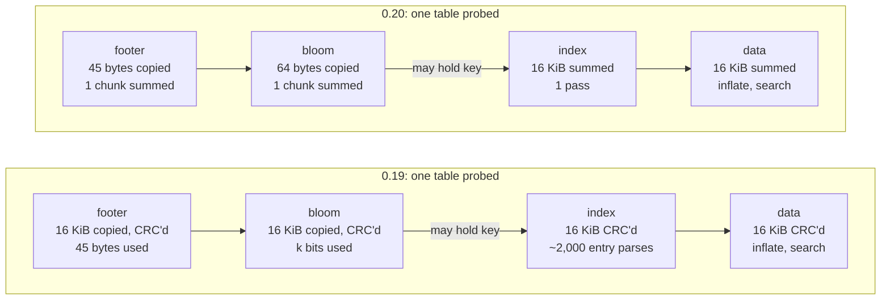
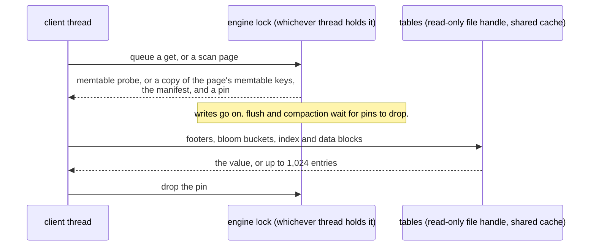

# Throughput: horton's key-value store against RocksDB

horton is a firmware store: one owner, no threads, no allocator, memory
fixed at compile time. `examples/kvstore` puts it on a host in the role
RocksDB fills. This document measures the two on db_bench's workloads,
says where horton's time went, records what v0.20 changed because of
it, and says what the remaining gap is made of.

It is a comparison of a 20,000-line `no_std` library, run outside its
design point, with the engine that defines the field. The useful result
is not who wins. It is which costs belong to horton's design and which
were just costs.

## Summary

v0.20 was done in passes. The first made one read cheaper. The second
let reads, scans and seeks run on every client thread at once. The
third gave every table a bloom filter sized to it. The fourth and
fifth took the footer and the cache's locks out of a reader's way.

| db_bench workload, 1 M keys, 4 threads, ops/s | horton 0.19 | horton 0.20 | against 0.19 | RocksDB, same memory | RocksDB, as shipped | 0.20 / RocksDB, same memory |
|---|---:|---:|---:|---:|---:|---:|
| `fillseq` | 90,389 | 196,483 | 2.2× | 242,325 | 489,667 | 0.81× |
| `fillrandom` | 47,054 | 66,504 | 1.4× | 176,859 | 378,268 | 0.38× |
| `overwrite` | 44,143 | 62,400 | 1.4× | 157,644 | 337,718 | 0.40× |
| `readrandom` | 7,190 | 185,377 | 26× | 359,730 | 515,254 | 0.52× |
| `readmissing` | 7,995 | 668,400 | 84× | 4,023,217 | 2,172,823 | 0.17× |
| `readseq` | 209,822 | 7,712,270 | 37× | 20,217,533 | 9,954,557 | 0.38× |
| `readreverse` | 186,400 | 4,535,430 | 24× | 15,202,293 | 8,192,756 | 0.30× |
| `seekrandom` | 1,964 | 92,540 | 47× | 331,186 | 247,043 | 0.28× |
| `deleterandom` | 55,882 | 85,055 | 1.5× | 400,319 | 361,487 | 0.21× |

Every column but the first is one run. The 0.19 column is from an
earlier run on the same kind of machine. **The read rows move from run
to run** (see [Run to run](#run-to-run)): what a read costs depends on
how many level-0 tables the fills happened to leave, between none and
five, and `seekrandom` has been anywhere from 45 K to 120 K for that
reason alone. The comparisons between builds in
[What changed in v0.20](#what-changed-in-v020) are made on identical
tables instead. The `readseq` and `readreverse` figures for 0.19 are
one thread scanning (that benchmark ignored the thread count); in 0.20
four threads each scan the whole store, as db_bench's do, and one
thread alone scans at 1.9 M entries/s forwards and 1.1 M backwards.

- **Reads were the problem, and most of it was not design.** In 0.19 a
  point read cost 100 to 140 µs, and 53% of all CPU went to re-running
  CRC-32 over blocks that were already in the cache and had already
  passed. One read is now 5 times cheaper, and readers run in parallel
  on top of that.
- **A read of an absent key is 80 times cheaper on one thread**: 125 µs
  in 0.19, 12 µs after the first two passes, 1.5 µs now. Most of the
  last step is the bloom filter. A table's filter was one block whatever the
  table held, so the large tables that hold most of a store had 1.3
  bits a key and stopped almost nothing. It is now sized to the table,
  ten bits a key. Against RocksDB with the same memory that row went
  from 0.05× to 0.17×, and is now held there by the store's request
  queue, not by the tables.
- **Scans and seeks were three costs, one of them threads.** A scan
  re-decoded a block every time its merge changed table, a seek read
  every table in range before yielding anything, and both held the
  engine for their whole length. A scanning thread is now 3.6 times
  faster by itself and four of them do 3.7 times one's work.
- **Unsynced writes were bound by thread hand-offs**, two per
  operation. Sequential fills are 2.2 times faster and within 20% of
  RocksDB given the same memory; random fills are 1.4 times faster and
  still 2.7 times behind it.
- **Synced writes did not change**, and all three engines are within
  a quarter of each other there: each waits for the same `fdatasync`.
- **What remains.** One thread at a time writes, and flush and
  compaction run on the writers' time. Every point read queues for
  its memtable probe, and the queue serves four threads no faster
  than one, so absent-key reads do not scale at all. A block is
  16 KiB, CRC'd in software and cached compressed. Most of that is
  what makes horton fit in 112 KiB on an ESP32-S3; the queue is the
  host store's own, and is the next thing to take out.

## Method

```sh
apt install rocksdb-tools                 # db_bench 8.9.1
examples/kvstore/vs-rocksdb.sh 1000000    # the table above
examples/kvstore/vs-rocksdb.sh 100000 --sync
KVSTORE_BASELINE=path/to/an/older/kvstore examples/kvstore/vs-rocksdb.sh   # adds a "before" column
```

[`vs-rocksdb.sh`](../examples/kvstore/vs-rocksdb.sh) runs the same
benchmark list on three configurations and prints ops/s side by side:

| | memtable | block cache | block | flush and compaction |
|---|---|---|---|---|
| **RocksDB, as shipped** | 64 MiB | 32 MiB, uncompressed blocks | 4 KiB, Snappy | background threads |
| **RocksDB, same memory** | 1 MiB | 16 MiB, uncompressed blocks | 16 KiB, Snappy | background threads |
| **horton** (`examples/kvstore`) | 1 MiB, 4096 entries | 16 MiB, compressed images, read without locks (ADR-0022); 32 decoded blocks (512 KiB) per scanning thread | 16 KiB, LZ77 | on the calling thread, each holding a 255 KiB bloom filter while it writes a table |

All three: 16-byte keys, 100-byte values that compress to half, 10
bloom bits per key, a write-ahead log, 4 client threads, one file
system (ext4 on a virtio disk). The machine
is a 4-vCPU Xeon at 2.3 GHz with 15 GiB of RAM; rustc 1.97, fat LTO.

Read the numbers with these in mind:

- **They are single runs on a shared virtual machine.** horton's
  write numbers moved by up to 20% between runs, and its read numbers
  by more ([Run to run](#run-to-run)). RocksDB's moved by up to
  60% between two runs an hour apart (its background threads compete
  with whatever else the host is doing), so a ratio to RocksDB is good
  to a factor of 1.5 at best.
- **Operation counts differ.** db_bench gives each of its 4 threads NUM
  operations; the kvstore splits NUM over its threads, except in
  `readseq` and `readreverse`, where each thread scans the whole store
  as db_bench's do. Rates compare; totals do not. Both hold NUM
  distinct keys once filled.
- **`readrandom` after `compact` is not comparable.** db_bench's
  `deleterandom` has by then deleted almost every key (four passes over
  the key space), so RocksDB answers from bloom filters. The kvstore
  deletes one pass's worth and still finds 37%.
- **"Same memory" is not "same work".** RocksDB flushes and compacts on
  background threads, on cores horton leaves idle.
- **A 1 M-key store is 116 MB of data.** Everything fits in the page
  cache, so no engine waits for a disk on a read. On flash, horton's
  device reads would dominate and this comparison would say little.

## Results

"horton (before)" in these tables is v0.20 with its reader cache
behind locks (commit `05a9308`); "horton" is v0.20. For the earlier
steps see [What changed in v0.20](#what-changed-in-v020).

### No fsync (`--no-sync`; db_bench's default)

1 M keys:

```text
benchmark                           rocksdb  rocksdb (small)  horton (before)           horton  horton / rocksdb (small)
fillseq                              489667           242325           181578           196483                     0.81x
fillrandom                           378268           176859            62895            66504                     0.38x
overwrite                            337718           157644            60316            62400                     0.40x
readrandom                           515254           359730           141984           185377                     0.52x
readmissing                         2172823          4023217           570590           668400                     0.17x
readseq                             9954557         20217533          6665603          7712270                     0.38x
readreverse                         8192756         15202293          3983059          4535430                     0.30x
seekrandom                           247043           331186            47187            92540                     0.28x
deleterandom                         361487           400319            81198            85055                     0.21x
readrandom (after compact)         11472593         13128226           264433           273848                     0.02x
```

The two horton columns are not a like-for-like pair: each fills its
own store on four threads, and they ended with different numbers of
level-0 tables. `seekrandom` doubling between them is that, not the
cache. See the next section, and step 12 of
[What changed](#what-changed-in-v020) for the pair on equal tables.

100 K keys (11 MB: RocksDB as shipped never leaves its memtable):

```text
benchmark                           rocksdb  rocksdb (small)  horton (before)           horton  horton / rocksdb (small)
fillseq                              490508           385940           239448           249365                     0.65x
fillrandom                           450422           355385           150808           151355                     0.43x
overwrite                            437914           351679           168828           169461                     0.48x
readrandom                          2152250          1306156           253613           337529                     0.26x
readmissing                         2162279          4089268           639972           637060                     0.16x
readseq                             6728615         23747906         11153993         11086984                     0.47x
readreverse                         1139830         15320789          6551137          6539903                     0.43x
seekrandom                           933576           694516            67431            73852                     0.11x
deleterandom                         446693           446040           196761           194830                     0.44x
readrandom (after compact)         13327558         13574967           614992           727339                     0.05x
```

### Run to run

The kvstore's background compaction stops when the fills do, and the
reads then run over whatever is left: between zero and five tables in
level 0, on top of some twenty below. Every level-0 table is one more
table a point read probes and a seek positions. With four writer
threads, how many are left changes from run to run.

Three pairs of runs at 1 M keys and 4 threads, taken when the bloom
filters were sized (step 10 below: "one bloom block" is the build
before it, "sized filters" the build after), show the size of it.
"Tables" is the count per level when the reads ran:

| run | build | tables per level | `readrandom` | `readmissing` | `seekrandom` | `fillrandom` |
|---|---|---|---:|---:|---:|---:|
| 1 | one bloom block | 4, 6, 1, 13 | 128,201 | 207,958 | 51,072 | 71,333 |
| 1 | sized filters | 4, 6, 1, 13 | 131,004 | 450,104 | 51,176 | 69,538 |
| 2 | one bloom block | 5, 6, 1, 13 | 118,989 | 187,588 | 44,161 | 69,927 |
| 2 | sized filters | 5, 6, 1, 13 | 128,910 | 414,717 | 44,227 | 69,214 |
| 3 | one bloom block | 0, 6, 0, 13 | 141,264 | 265,889 | 117,058 | 70,038 |
| 3 | sized filters | 2, 6, 0, 14 | 157,528 | 722,663 | 73,251 | 68,530 |

Within a build, `seekrandom` runs from 44 K to 117 K on the level-0
count alone. Runs 1 and 2 happened to pair equal layouts; run 3 did
not, and says nothing about the two builds.

Fills on **one** thread leave the same tables every time (4, 5, 0 and
14 per level). `bench --threads 1 --read-threads N` fills that way and
reads on N threads, and every comparison between builds from step 11
on is made like that.

### Every write synced

100 K keys. A synced commit is one `fdatasync`, about 150 µs on this
disk, so the engines converge: each is waiting for the same device.

```text
benchmark                           rocksdb  rocksdb (small)  horton (before)           horton  horton / rocksdb (small)
fillseq                               16717            17749            14860            15787                     0.89x
fillrandom                            15960            16202            16562            14602                     0.90x
overwrite                             14389            16429            15243            14780                     0.90x
```

Both group commits. horton averaged 2.6 client writes per
`fdatasync` with 4 writers.

### Reader threads

1 M keys, no fsync, the same tables in every column (fills on one
thread); ops/s (entries/s for the two scans). The machine has four
cores, so eight threads show what oversubscribing costs, not more
scaling. `readoutside` reads keys past every table: it consults no
table and no cache, and is what a read costs in the store's own queue.

| reader threads | 1 | 2 | 4 | 8 |
|---|---:|---:|---:|---:|
| `readrandom` | 49,861 | 99,759 | 184,891 | 188,426 |
| `seekrandom` | 17,843 | 33,845 | 66,339 | 67,213 |
| `readseq`, a scan per thread | 1,900,971 | 3,574,009 | 6,964,663 | 7,925,228 |
| `readreverse`, a scan per thread | 1,101,244 | 2,151,603 | 4,269,029 | 4,796,213 |
| `readmissing` | 675,395 | 819,222 | 701,478 | 671,982 |
| `readoutside` | 1,618,663 | 847,974 | 662,834 | 671,085 |

For comparison, at the start of v0.20's second pass (commit `75063ad`,
one reader at a time) `readrandom` was 43,594 on one thread and 38,581
on four, and `seekrandom` 6,956 and 7,962.

Four threads give 3.7 times one thread's present-key reads, seeks and
forward scans, and 3.9 times its reverse scans. Absent-key reads do
not scale: 675 K on one thread, 701 K on four. `readoutside` shows
what they wait on. Through the request queue alone, one thread does
1.6 M reads a second, two threads do half that between them, and four
do 0.66 M. An absent-key read's table work is under a microsecond now,
so from two threads up it runs at the queue's rate. See
[the remaining gap](#what-the-remaining-gap-is-made-of).

## Where horton's time went

`perf` on the 0.19 kvstore running fills, point reads, seeks and a scan
(100 K keys, 4 threads):

| share of CPU | where | what it is |
|---:|---|---|
| 52.6% | `check_block_crc` | CRC-32 of a whole block, on every read of it, cache hit or not |
| 21.4% | futex wake and wait (kernel) | a request and a reply crossing between a client thread and the store thread |
| 4.0% | `memmove` | 16 KiB block images copied out of the cache |
| 2.4% | index search | re-parsing the index from its start for each step of a binary search |
| 1.7% | LZ77 decompress | |

A point read probes every table whose key range covers the key: each
level-0 table and one per deeper level. Per table it read the footer
and the bloom block, and for the table holding the key the index and a
data block. Every one of those was copied out of the cache and CRC'd
again (ADR-0014 required it, to catch a bit flipping in cached RAM).
At 16 KiB a CRC costs 8.3 µs:



## What changed in v0.20

Each row adds one change to the rows above it. 100 K keys, no fsync, 4
threads, ops/s; single runs taken while the work was done, with the
store in whatever state the fills left it, so read them as the size of
each step and not as a benchmark.

| | `readrandom` | `readmissing` | `seekrandom` | `fillrandom` |
|---|---:|---:|---:|---:|
| 0.19 | 7,500 | 8,300 | 4,200 | 76,000 |
| cache hits checked by a RAM checksum, not CRC-32 (ADR-0016) | 25,400 | 37,800 | 11,100 | 83,000 |
| bucketed bloom; footer and bloom read as ranges (ADR-0017) | 30,900 | 56,800 | 12,600 | 78,000 |
| callers run the engine under a lock; no store thread | 37,400 | 89,700 | 22,800 | 131,000 |
| one-pass index search; 8 MiB hashed cache | 43,100 | 102,000 | 19,600 | 139,000 |
| the lock holder serves every queued request (flat combining) | 64,400 | 207,000 | 44,000 | 178,000 |

1. **Cache hits are checked by a RAM checksum** (library, ADR-0016).
   The cache needs to know that a hit is the bytes it was given, not
   that they are a valid block. Only CRC-verified blocks are inserted;
   each slot keeps a four-lane multiply-rotate sum of its image, and a
   hit must match it. That runs at 11 to 14 GB/s where table-driven
   CRC-32 runs at 2.0, and it detects every single-bit flip, which is
   what the CRC was there for. A mismatch re-reads the device.
2. **A probe reads what it uses** (library, ADR-0017). The sum is kept
   per sixteenth of a block, so the cache can hand out a byte range
   after checking only its chunk. The bloom filter's probes for a key
   now fall in one 64-byte bucket (a format change: `hrtsst03`). A
   table that does not hold the key is ruled out in well under a
   microsecond.
3. **No store thread** (kvstore). The store thread gave every call two
   thread switches. Callers now take a lock and run horton themselves.
4. **Index search and a larger cache** (library and kvstore). The index
   has no offset table, and the binary search re-parsed it from the
   start for every probe. One pass with a key comparison every 16
   entries replaces it. Caches above 8 slots hash a block to a window
   of 8, so the kvstore can hold 512 blocks without scanning 512 tags.
5. **Flat combining** (kvstore). With a bare lock, four threads read
   more slowly (43 K/s) than one thread alone (73 K/s): the database is
   megabytes of state, and each thread dragged it into its own CPU's
   cache. Now a read or a write is queued, and whichever thread holds
   the lock serves the whole queue. Group commit is the write half of
   the same mechanism.

### Then: readers, scans and seeks on every thread

After the five steps above a read was cheap enough that the engine
lock was what bound it: four reader threads got one core's worth. The
second pass moved the table work of every read, scan and seek out of
the lock. The measurements are in [Reader threads](#reader-threads).



6. **Detached point reads** (library, ADR-0018). A point read is a
   search of the memtable and then of the tables, and only the first
   needs the `Db`. `Db::probe_memtable` returns what the memtable held
   as plain data; `TableView::resolve` finishes the read over a copy
   of the manifest, any handle to the device, and the caller's own
   buffers. The kvstore serves the probe under the lock and runs the
   table phase on the calling thread, through a second file handle and
   a cache in eight locked shards. Flush and compaction, the only
   calls that change the tables, wait for readers to leave them.
7. **Detached scans** (library, ADR-0019). A scan merges the memtable
   all the way through, so it cannot take one probe and go.
   `Db::copy_memtable_range` copies one page's worth of memtable keys
   and returns the horizon the page must stop at; `Scan::detached`
   runs over that copy. A kvstore scan takes the lock for about 30 µs
   per 1,024 entries and does the rest on its own thread.
8. **A block pool for scans** (library, ADR-0019). A `Scan` had one
   decoded block for all its table cursors, and fetched, checked and
   inflated a block again each time the merge came back to a table:
   nearly every entry, over tables that overlap. `use_block_pool`
   lends it buffers, so each table's block stays decoded. With this
   and step 7, one thread's `readseq` went from 0.50 to 1.80 M
   entries/s. Firmware lends none and keeps its 10.9 KiB scan.
9. **A forward seek reads the tables it reaches** (library, ADR-0019).
   `seek` used to position a cursor in every table that overlapped the
   range: a footer, an index block and a data block from each of over
   twenty tables, to yield one entry. A table that starts after the seek
   key now waits at its lower bound, which is in the manifest, and is
   read when the merge gets there. Over steps 7 to 9, one thread's
   `seekrandom` went from 144 to 67 µs.

### Then: a bloom filter sized to its table

10. **A filter may span blocks, and is folded to fit** (library,
    ADR-0020). A table's bloom filter was one block: 131,000 bits here,
    which is 32 bits a key for the 4,096 entries of a flush and 1.3 for
    the 100,000 of a full table. At 1.3 bits a filter passes more than
    half of what it is asked, so an absent key read an index block and
    a data block in most of the deep tables. The filter can now be up
    to sixteen blocks. The table writer builds it at that length and,
    when the table ends and its entry count is known, folds it (ORs
    runs of neighbouring buckets together) down to the fewest blocks
    that give each entry 10 bits. A flush still writes one bloom block;
    a 70,000-entry table at the bottom of this store writes eight. A
    lookup still reads one
    64-byte bucket. One thread's `readmissing` went from 11.8 to
    2.3 µs.

    The first measurement of it showed random fills 6% slower. A
    well-fed filter takes 6 to 13 probes a key where a starved one took
    1, and each probe ended in a 64-bit division. A bucket is 512 bits,
    so the remainder is now a mask, and the fills are back within
    noise.

### Then: readers that do not read footers

11. **The manifest record describes a table in full** (library,
    ADR-0021). With the filters doing their work, a table that does
    not hold the key cost two small reads from the cache: the footer's
    fields, to learn where the filter is and how to probe it, and then
    one bloom bucket. The manifest record already had most of what the
    footer says, and the rest follows from the table's layout. It now
    carries the two facts that were missing (the probe count and the
    filter's length), a reader is built from it with no I/O, and
    nothing on a read, scan or compaction path reads a footer. A probe
    the filter turns away is one read of one bucket; a seek reads one
    block fewer per table it positions.

    Measured on identical tables (fills on one thread, which leaves the
    same layout every time: 4, 5, 0 and 14 tables per level), 1 M keys,
    each figure the mean of two or three runs:

    | | reader threads | footer and bucket | bucket only | change |
    |---|---:|---:|---:|---:|
    | `readmissing` | 1 | 419,150 | 516,329 | +23% |
    | `readmissing` | 4 | 431,268 | 587,948 | +36% |
    | `readrandom` | 1 | 48,377 | 49,453 | +2% |
    | `readrandom` | 4 | 136,152 | 150,612 | +11% |
    | `seekrandom` | 1 | 17,121 | 16,872 | -1% |
    | `seekrandom` | 4 | 51,313 | 55,827 | +9% |
    | `readseq` | 4 | 7,114,846 | 7,305,777 | +3% |

    An absent-key read on one thread is 1.9 µs, from 2.4. The gains
    are larger at four threads than at one because what was removed
    was a read of the shared cache, and the cache is what the threads
    contend on. The one-thread seek figure is inside the noise of
    these runs (three pairs: 17,073, 17,179 and 17,110 before; 16,896,
    16,814 and 16,905 after), and nothing in the change would make a
    seek cost more: it reads one block fewer.

### Then: a cache whose hits write nothing shared

12. **The readers' cache takes no lock on a hit** (kvstore, ADR-0022).
    The cache the readers shared was the library's `BlockCache` in
    eight shards, each behind a lock. Every hit wrote shared memory:
    the lock, a reference bit, a counter. A cached block is named by
    its table and block ids, and a table id is never reused, so an
    entry is never wrong, only evicted. The kvstore's own cache uses
    that: entries are immutable, each reader thread keeps a view of the
    slots it uses and compares one atomic epoch per slot, and only an
    insert or an eviction takes a lock. The RAM checksum on every hit
    (ADR-0016) is kept, per 256 bytes.

    On identical tables (fills on one thread), 1 M keys, means of two
    runs at one reader thread and three at four:

    | | reader threads | locked shards | lock-free hits | change |
    |---|---:|---:|---:|---:|
    | `readrandom` | 1 | 51,051 | 51,194 | 0% |
    | `readrandom` | 4 | 152,974 | 182,986 | +20% |
    | `seekrandom` | 1 | 17,403 | 17,192 | -1% |
    | `seekrandom` | 4 | 55,966 | 66,003 | +18% |
    | `readmissing` | 1 | 535,932 | 658,564 | +23% |
    | `readmissing` | 4 | 570,496 | 635,650 | +11% |
    | `readoutside` | 1 | 1,670,505 | 1,638,345 | -2% |
    | `readoutside` | 4 | 577,800 | 635,836 | +10% |
    | `readseq` | 1 | 1,935,718 | 1,898,063 | -2% |
    | `readseq` | 4 | 7,290,771 | 7,124,246 | -2% |
    | `readreverse` | 1 | 1,092,332 | 1,092,159 | 0% |
    | `readreverse` | 4 | 4,162,125 | 4,288,337 | +3% |

    Where the tables are what a read waits on, four threads gain a
    fifth: present-key reads and seeks. An absent-key read gains a
    quarter on one thread (1.87 µs to 1.52 µs).

    On four threads absent-key reads did not gain, and `readoutside`
    says why. It reads keys past every table, so it consults no table
    and no cache: it is the request queue and the memtable probe and
    nothing else. One thread does 1.65 M of those a second. Four
    threads do 0.6 M between them. Absent-key reads at four threads
    run at exactly that rate, in both builds. They were bound by the
    queue before this change and they are bound by it after. (The 10%
    between the two builds on `readoutside`, which neither build's
    cache touches, is how far apart two four-thread runs land.)

    Forward scans are 2% slower in both rows. The first version of
    this cache lost 3% to 5%: a scan evicting a block it had itself
    read a page earlier still held a reference to it, so the entry
    could not be reused and each such eviction allocated 17 KiB. The
    inserting thread now lets go of its own reference first. The 2%
    that is left is the size of the spread between runs here
    (`readoutside` on one thread, which this change does not touch,
    also moved by 2%), and is not explained.

## What the remaining gap is made of

| workload, 1 M keys | horton / RocksDB (same memory) | why |
|---|---:|---|
| `fillseq` | 0.81× | one writer at a time commits in about 5 µs; nothing to compact when keys arrive in order |
| `fillrandom` | 0.38× | flush and compaction run on the writers' time; RocksDB's run on other cores |
| `overwrite` | 0.40× | the same |
| `readrandom` | 0.52× | a read is 20 µs of one core: an index block summed whole, a data block summed and inflated, and for a block that misses the cache a 16 KiB software CRC |
| `readmissing` | 0.17× | 1.5 µs on one thread, and four threads do no more than one: every read queues for its memtable probe, and the queue serves four threads at well under half the rate it serves one |
| `readseq` | 0.38× | 0.53 µs an entry on one thread: the merge compares every cursor's head for each entry, every entry is copied out, and every block is inflated |
| `readreverse` | 0.30× | the same, and stepping backwards through a block's version runs costs more than forwards |
| `seekrandom` | 0.28× | a seek still positions a cursor in every table that could hold the key (each level-0 table, one per deeper level), and each costs a whole index block and an inflated data block |
| `deleterandom` | 0.21× | as `fillrandom` |

**One thread at a time writes.** `Db` is a single-owner value with
`&mut self` writes; that is ADR-0002's point, and firmware has one
core. Reads no longer wait for it, but `fillrandom` at 1 M keys is
bound by flush and compaction, which RocksDB runs on other cores and
horton runs between the writes, and while one runs, new readers wait.
A horton commit of a sequential write takes about 5 µs, which is why
`fillseq`, with nothing to compact, keeps up.

**A read still passes through the lock once.** The memtable probe and
the page copy are served from the request queue. That is the serial
part. Present-key reads, which spend 20 µs in the tables for every
pass through the queue, scale by 3.7 on four cores; scans, which take
the lock once per 1,024 entries, by 3.7 to 3.9.

**The request queue is what four reader threads wait on.** A read's
memtable probe is served through the queue, by whichever thread holds
the engine lock. `readoutside`, which does that and nothing else, runs
at 1.6 M reads a second on one thread, 0.85 M on two and 0.66 M on
four: the queue serves several threads at about half the rate it
serves one. Every kind of point read pays it. Absent-key reads, whose
table work is now under a microsecond, are bound by it outright: four
threads do 0.7 M a second, where one does 0.68 M.

An earlier profile of four threads reading absent keys put 60% of
their time in the old cache's ranged read and 14% in the queue, and
that was read as the cache being the limit. It was where the time
went, not what the rate waited on: with the cache's locks gone
(ADR-0022) the four-thread rate did not move. RocksDB takes no lock
and joins no queue on this path.

**A point read that misses the cache is expensive.** It reads a 16 KiB
block, CRCs it in software (8.3 µs; `unsafe` is forbidden, so no
CRC instruction) and inflates it (3 µs). RocksDB reads 4 KiB, checks
it with a hardware CRC32C or XXH3 and caches the block uncompressed.
horton's cache holds the compressed image, so even a hit inflates the
block again (3 µs) after summing it (1.4 µs), and the whole index
block is summed for every lookup that passes the filter.

**A scan's merge is linear in its cursors.** Each `next` compares the
head of every table cursor, one per table in range, where a heap or
one iterator per level would compare a few. Each entry's key and value
are then copied to the caller. Reverse scans cost nearly twice a
forward scan, and a reverse seek still positions every table in range: the
reverse cursor resolves version runs backwards across blocks and was
left as it was.

**Compression is 554 MB/s.** Sealing a 16 KiB table block costs 30 µs
of LZ77, 8 µs of CRC and a write. It is the largest single item in
`fillrandom` at 1 M keys, about a third of the engine's time.

## Levers not pulled

Measured or scoped while doing this, and left:

- **A memtable probe that does not queue.** This is what a point read
  waits on at four threads (`readoutside` above). The probe itself is
  a search of RAM; what it queues for is the engine lock, which it
  shares with every write. Letting readers probe side by side needs
  either a lock readers can share or a memtable a reader can search
  while a writer appends.
- **Compaction off the writers' thread.** A compaction job reads
  tables and writes new ones. If its merge ran detached, the way reads
  now do, with only its commit under the lock, it would use the cores
  RocksDB uses. It is the largest remaining gain for random writes on
  a host, and none for firmware. Not scoped further than that.
- **A decoded-block cache for hosts.** The cache keeps compressed
  images, so every hit inflates a block. Caching what the pool holds
  would take 3 µs off a point read, at twice the RAM per block for
  data that compresses by half.
- **A heap or per-level iterators in the scan merge**, and lazy seeks
  for `RevScan`.
- **Slicing-by-16 CRC-32**: 2.0 → 2.7 GB/s on this machine, for 8 KiB
  more constant tables. It would take 2 µs off every cache miss and
  every block written. A modest gain, and the firmware targets would
  pay the table.
- **Index blocks verified by the entry.** Needs checksums inside the
  index block, which costs index capacity, and a table's index is one
  block (ADR-0017).
- **LZ77 with skip acceleration and word-wide match counting.** The
  stream format would not change; the compressed bytes would.
- **A check that a detached reader's tables are still its own.** The
  rule that keeps compaction away from readers is the caller's to
  keep (ADR-0018). A table generation stamped in every block would let
  the library catch a caller that breaks it, at four bytes a block and
  a format change.
