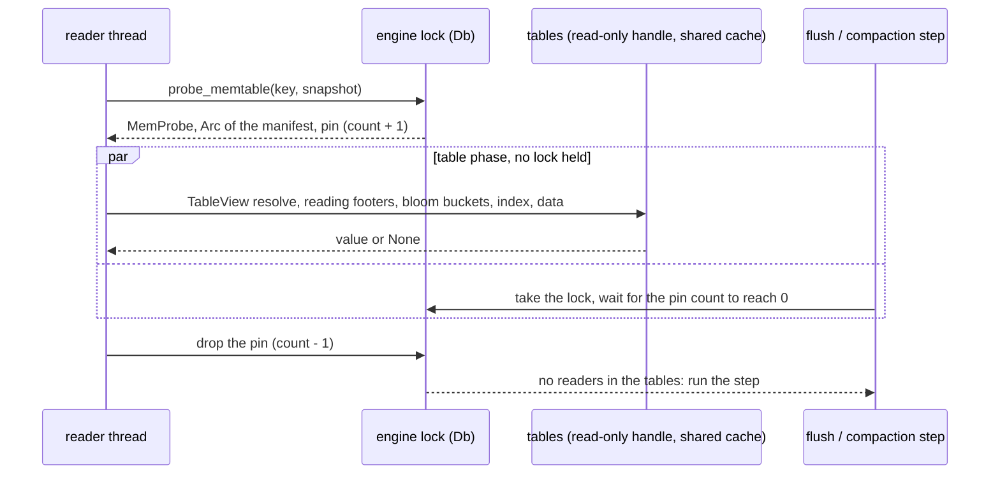

# ADR-0018: Detached point reads: the table phase runs without the `Db`

Status: Accepted (unreleased, 2026-11-21). The kvstore's reader cache
described below was replaced by ADR-0022; the protocol stands.

## Context

`Db` is a single-owner value (ADR-0002). `get` takes `&self`, but it
reads through block buffers and a cache that sit in `RefCell`s inside
the `Db`, so a `Db` is not `Sync`, two `get`s cannot run at once
(`Error::Busy`), and a host that shares a `Db` between threads has to
put all of it behind one lock. `docs/THROUGHPUT.md` measured what that
costs: on four cores, four reader threads got one core's worth of
reads, and it named concurrent readers as the largest gain left for a
host.

Making `Db` itself `Sync` is not available. The library forbids
`unsafe`, and `core` has no lock: the only interior mutability that is
`Sync` is an atomic, and block buffers are not atomics. Taking the
buffers out of `Db` would make it `Sync`, but then `get` could not keep
its signature, and every firmware caller would pay for a host's need.

A point read does not need the whole `Db`, though. It has two phases:

1. **The memtable.** A search of RAM. Needs the `Db`. No I/O.
2. **The tables.** For each table that could hold a newer version: a
   footer, a bloom bucket, an index block, a data block. All the I/O,
   and nearly all the time. Needs to know which tables exist (the
   manifest), a way to read blocks (a device), and two block buffers.
   It needs nothing else from the `Db`.

The manifest is plain data and `Copy` (9 KiB in the host store's
shape, under 1 KiB in the ESP32-S3 profile). Tables are immutable once
written.

## Decision

**The two phases are separate public calls.**

- `Db::probe_memtable(key, max_seq)` runs phase 1 and returns a
  `MemProbe`: the key, the snapshot, and what the memtable held (the
  newest visible version with its value, and the newest covering range
  tombstone). It is plain data and borrows nothing.
- `TableView::new(device, manifest, cache).resolve(&probe, scratch,
  val_buf, now)` runs phase 2 over any manifest, any device handle and
  caller-owned buffers (`ReadScratch`), and returns what
  `get_at_with_time` would have.
- `Db::manifest()` exposes the committed manifest, to copy.

`Db::get` and its variants are the same two calls over the `Db`'s own
manifest, device, buffers and cache: there is one implementation of the
point-read rule (`TableView::finish`), not two.

A probe carries its key, so a table phase cannot be given a different
one. `MemProbe::is_settled` says when the memtable held a version of
the key: a memtable version is newer than any table's, so the table
phase then reads nothing.

**The caller keeps table writes away from detached readers.** The `Db`
cannot see a reader that does not borrow it. A table that compaction
retires gives its slot back and a later table is written there; a
reader still using an older manifest copy would read the new table's
blocks, which pass their CRC. So the rule, stated on `TableView`: from
taking the probe and the manifest copy until `resolve` returns, do not
run `flush`, `compact_step`, `ingest_table` or `archive_commit`. Those
are the calls that write the table region or change which tables
exist. Everything that only reaches the WAL and the memtable (`put`,
`delete`, `write`, `delete_range`) may run meanwhile.

**The kvstore shows the protocol** (`examples/kvstore/store.rs`):

- A read's memtable probe goes through the request queue and is served
  under the engine lock. If the memtable does not settle it, the reply
  is the probe, an `Arc` of the current manifest (replaced when
  `Manifest::seq` has moved), and a *pin*: a count of readers in their
  table phase, raised under the engine lock.
- The caller runs the table phase on its own thread, with thread-local
  buffers, through a second, read-only handle to the file and a block
  cache shared by all readers (the library's `BlockCache` in eight
  shards, each behind a lock; 16 MiB). The pin drops when the read is
  done.
- Flush and compaction steps, which run under the engine lock, first
  wait for the pin count to reach zero. No new pin can appear while
  they wait or run, because pins are only made under that lock.
- A thread that has been handed a pin for its own read stops serving
  the queue and never waits for the pins to drain: it would wait for
  itself.

## Consequences

- **Point reads scale with threads on a host.** In the kvstore, at 1 M
  keys on four cores, `readrandom` went from 38 K to 116 K ops/s and
  `readmissing` from 81 K to 194 K; four threads do 3.0 times one
  thread's reads, where they did 0.9 times before
  (`docs/THROUGHPUT.md`). Writes proceed while table phases run; only
  flush and compaction wait, for tens of microseconds.
- **Firmware pays 152 bytes** in the `get()` future (the read's
  accumulator is now handed to the shared table phase) and nothing
  else: the peak in BUDGET.md is unchanged. An async firmware can use
  the split too: a detached read does not hold a borrow of the `Db`
  while it waits for flash, so the owner can take writes meanwhile.
- **The safety of a detached read is the caller's.** Nothing in the
  types stops a caller from compacting under a reader. The failure is
  a wrong answer or a `CorruptBlock`, not memory unsafety (the library
  is still `forbid(unsafe_code)`), but it is silent in the first case,
  and nothing on the device would catch it. The kvstore's tests hold a
  reader inside its table phase and assert that compaction cannot
  finish; a caller writing its own protocol needs the same test.
- **Scans need more than a probe.** A scan merges the memtable all the
  way through, so it cannot take one probe and leave.
  [ADR-0019](0019-detached-scans-block-pool-lazy-seek.md) detaches
  scans by copying the memtable a page at a time.
- **The `Db`'s cache is not shared with detached readers** (it is in a
  `RefCell`). A host runs its own cache for them, and with every read
  detached it needs no other: the kvstore's `Db` has none.
- **Not done:** a way for the library to detect a broken protocol (a
  table generation stamped in every block would do it, at a format
  change and four bytes a block), and parallel table phases inside one
  compaction.

## References

- [ADR-0002](0002-no-std-no-alloc-caller-owned-memory.md) (single
  owner, caller-owned memory), [ADR-0007](0007-clock-block-cache.md),
  [ADR-0016](0016-cache-hits-reverify-with-a-ram-checksum.md)
- SPEC.md §4.8 (read path)
- `src/db/read.rs` (`MemProbe`, `TableView`, `ReadScratch`,
  `Db::probe_memtable`), `tests/detached_read.rs`
- `examples/kvstore/store.rs` (`Pin`, `Room::quiesce`, `SharedCache`,
  `Shared::read`)
- [`docs/THROUGHPUT.md`](../THROUGHPUT.md)
