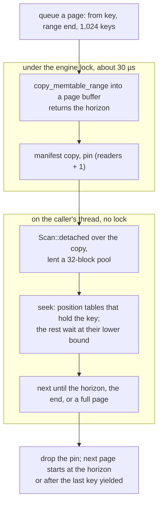

# ADR-0019: Detached scans, a lent block pool, and seeks that read what they reach

Status: Accepted (unreleased, 2026-11-21)

## Context

After ADR-0018 the host store's point reads ran in parallel, and its
scans were where it stood furthest from RocksDB: at 1 M keys a full
scan ran at 0.6 M entries/s and a seek took 126 µs, against 20 M
entries/s and 3.2 µs. `docs/THROUGHPUT.md` put the cost in three
places, and only one of them is about threads:

1. **A scan borrows the `Db`.** So a host scan holds the engine lock
   for each page, and scans and seeks from several threads take turns.
2. **A scan has one decoded block for all its table cursors.** It
   keeps a cursor per table (the head key, a position) and a single
   block buffer. Whenever the merge turns to another table's cursor,
   that table's block is fetched from the cache, checked and inflated
   again. With tables that overlap, that is nearly every entry: about
   5 µs each time, and most of a scan's time. The single buffer is
   deliberate (ADR-0002): it is what keeps a scan at 10.8 KiB on the
   ESP32-S3 profile.
3. **A seek positions every table in range.** For each table that
   overlaps `[start, end)` it read a footer, an index block and a data
   block before yielding anything: 25 tables' worth for a seek that
   then reads one entry.

## Decision

**A scan reads from parts, and they need not be the `Db`'s.** `Scan`
and `RevScan` hold a memtable, a manifest, a device and a cache
instead of a `&Db`. `Scan::new(&db)` takes all four from the `Db`, as
before. `Scan::detached(memtable, manifest, device, cache, node_id)`
is handed them, and borrows no `Db`: the scan counterpart of
ADR-0018's detached point read, under the same rule (no `flush`,
`compact_step`, `ingest_table` or `archive_commit` while it is alive). A caller
that scans often can keep the scan's buffers and cursors between
scans and build each one in them (`Scan::detached_in`, ADR-0037).

**The memtable's share is copied a page at a time.** A scan merges the
memtable all the way through, so unlike a point read it cannot take
one probe and go. Copying the whole memtable for every page would cost
more than the page. `Db::copy_memtable_range(start, end, max_keys,
page)` copies the at most `max_keys` keys from `start` on, each with
all its versions, and every range tombstone that can cover them, into
a caller-owned `MemTable`, and returns the **horizon**: the first key
it did not copy. The copy is exact below the horizon and knows nothing
at or above it, so the page scans `[start, horizon)` and the next page
starts at the horizon. `copy_memtable_range_rev` is the mirror image
for `RevScan`. A copy that would not fit stops early at a key
boundary; one that cannot hold a single key is an error, not a stalled
scan.

**A scan can be lent block buffers.** `Scan::use_block_pool(&mut
[ScanBlock])` gives a scan caller-owned buffers beside its own. A
block then stays decoded while the merge is at another table, up to
the pool's size, least recently used first. A scan with no pool
behaves as it always did, and is 80 bytes larger (10,904 on the
ESP32-S3 profile; the RAM budget holds, with 856 bytes to spare).

**A forward seek reads the tables that hold its key.** A table whose
first key is past `start` cannot supply the scan's first entry. Its
cursor now waits at the table's lower bound (which is in the manifest,
so no I/O), takes part in the merge with that bound as its key, and is
positioned for real only when it reaches the front. Nothing already
compared is disturbed, because the table's first entry sorts at or
after its bound.

One page of a host scan, as the kvstore runs it:

## Consequences

- **Host scans and seeks run in parallel, and each is faster.** In the
  kvstore at 1 M keys, one thread's forward scan went from 0.50 to
  1.80 M entries/s, its reverse scan from 0.42 to 1.06 M, and its seek
  from 144 to 67 µs. Four threads scale each by four: 7.6 M entries/s
  forwards, 4.1 M backwards, 60 K seeks/s where there were 8 K.
  Against RocksDB with the same memory that is 0.38× for `readseq`
  (from 0.03×), 0.26× for `readreverse` and 0.20× for `seekrandom`
  (from 0.03×). `docs/THROUGHPUT.md` has the tables.
- **An error in a table the scan has not reached is reported when it
  gets there**, by `next`, not by `seek`. It is still reported before
  anything from that table is yielded, and before the scan passes it:
  a corrupt block is never a silent gap. The regression test for
  review finding F13 asserted the error at `seek`; it now asserts it
  at the seek or the first `next`, and that a seek into the damaged
  table fails at once.
- **Reverse seeks still position every table in range.** The reverse
  cursor resolves version runs backwards across blocks and was left
  alone; reverse scans gain from the pool and from detachment only.
- **A page's worth of memtable is copied under the owner's lock** in a
  host: about 30 µs for 1,024 keys. That bounds how often pages can
  start, not how fast they run.
- **The caller's rule is ADR-0018's**, with the same weakness: the
  types do not enforce it. The kvstore holds a scan in its table phase
  and asserts that compaction cannot finish.
- **Memory is the caller's choice.** The kvstore lends each scan 32
  buffers (512 KiB per scanning thread) and keeps eight page buffers
  (1.2 MiB each) for all scanners.
- **Not done:** the per-entry merge still compares every cursor's head
  (a heap, or a level iterator that keeps one cursor per level, would
  cut that); the index block is still read whole per table (done
  since: ADR-0034, which checks only what a seek's search reads); a scan's
  values are copied out one entry at a time.

## References

- [ADR-0018](0018-detached-point-reads.md) (the rule, and the
  protocol the kvstore follows), [ADR-0002](0002-no-std-no-alloc-caller-owned-memory.md),
  [ADR-0007](0007-clock-block-cache.md)
- SPEC.md §4.8 (read path)
- `src/scan.rs` (`Source`, `Blocks`, `ScanBlock`, `Scan::detached`,
  `use_block_pool`, `add_pending`, `position_pending`),
  `src/memtable.rs` (`copy_range`, `copy_range_rev`),
  `tests/detached_scan.rs`, `tests/review_findings.rs` (F13)
- `examples/kvstore/store.rs` (`Shared::page`, `Engine::begin_page`,
  `PageLease`)
- [`docs/THROUGHPUT.md`](../THROUGHPUT.md)
