# ADR-0020: A bloom filter may span blocks, and is folded to fit its table

Status: Accepted (unreleased, 2026-11-21)

## Context

A table's bloom filter was one block: `BLOOM_BYTES`, at most `BLOCK - 4`,
whatever the table held. That suits firmware, where a table is a few
hundred entries. It does not suit a table that fills its slot.

In the host store (`examples/kvstore`, 16 KiB blocks) a block is
131,000 bits. A level-0 table, 4,096 entries, gets 32 bits a key. A
full bottom-level table, about 100,000 entries, gets 1.3, and such
tables hold nearly all of a store. A filter at 1.3 bits a key passes
more than half of the keys it is asked about, so a read of an absent
key went on to an index block and a data block in every deep table.
`docs/THROUGHPUT.md` measured it: `readmissing` at 0.05× of RocksDB
with the same memory, the widest gap in the comparison, and it named
the cause.

What a larger filter has to contend with:

- **The table writer streams.** Compaction pushes entries until an
  output fills its slot. The writer does not know the entry count
  until the table ends, and it has no allocator (ADR-0002). The filter
  has to be in RAM while the table is written, because every key sets
  bits anywhere in it.
- **Tables differ by a factor of 25 or more.** A filter sized for the
  largest table would have every flush write sixteen blocks of filter
  for half a megabyte of data.
- **A lookup must still read one bucket** (ADR-0017), and now has to
  know which block it is in without reading anything to find out.

## Decision

**`BLOOM_BYTES` is the most filter a table can have, and may exceed a
block.** A filter longer than a block fills consecutive bloom blocks,
`(BLOCK - 4) / 64` buckets each, between the range-tombstone section
and the index:

```text
[data]* [rdel]* [bloom]+ [index] [footer]
```

A bucket never straddles blocks. A key's bucket number gives its block
(`bucket / buckets_per_block`) and its place in it, so a lookup still
reads 64 bytes of one block (`BloomShape::locate`).

**The writer builds the filter at full length and folds it when the
table ends.** `TableWriter` holds `BLOOM_BYTES` of filter and sets each
key's bits in it as before. At `finish_meta` it knows the entry count
and picks the stored size (`BloomShape::for_entries`): the fewest
blocks that give every entry `BLOOM_BITS_PER_KEY` (10) bits, and the
longest filter that fits those blocks. It then folds the full filter
down to that size in place, and writes it.

Folding by `f` ORs each run of `f` neighbouring buckets into one. A
key's bucket is its hash scaled to the bucket count
(`(h × buckets) >> 32`), so its bucket in a filter `f` times smaller is
its full-size bucket divided by `f`: exactly the bucket the fold moved
its bits to. The bits inside a bucket do not depend on the bucket
count. So the folded filter is, bit for bit, the filter that would
have been built at the smaller size, and a reader probes it like any
other.

```mermaid
flowchart LR
    subgraph full["built in RAM: BLOOM_BYTES, 16 blocks of buckets"]
        direction LR
        b0["bucket 0"] --- b1["bucket 1"] --- b2["bucket 2"] --- b3["bucket 3"] --- more["..."]
    end
    subgraph stored["stored for a table of 20,000 entries: folded by 8, 2 blocks"]
        direction LR
        s0["bucket 0 = OR of 0..8"] --- s1["bucket 1 = OR of 8..16"] --- smore["..."]
    end
    full -- "finish: entry count known, fold by f" --> stored
    stored -- "footer: bloom_len; manifest: bloom_blocks" --> reader["reader: bucket = (h × stored buckets) >> 32<br/>block = bucket / buckets per block"]
```



Folding needs the full bucket count to be a multiple of the folded
one, so only such sizes are candidates. A configuration should be a
whole number of blocks with many divisors; the kvstore uses sixteen.

**A filter that fits one block is never folded.** The block is written
anyway, and more bits filter better. Every firmware profile is in this
case, and its filters are bit for bit what they were.

**The table says how much filter it has.** The footer gains
`bloom_len u32` (`hrtsst04`). A reader takes the filter's length from
it, not from its own `BLOOM_BYTES`, and requires the bloom section
`[bloom_block, index_block)` to be exactly the blocks that length
fills: a footer whose length and block ids disagree is `CorruptBlock`,
so a probe can never read an index or data block as filter.

**The manifest says how many blocks that is.** `TableRef` gains
`bloom_blocks` (`hrtman08`), and `data_blocks()` is
`block_count - rdel_blocks - bloom_blocks - 2`. Scans and compaction
find a table's sections from the manifest without reading its footer.
`SealedTable`, the descriptor an archive carries, is unchanged:
`ingest_table` takes the count from the copied table's verified
footer, and `relocate_table` checks it against the table's length.

**Sizing rules that assumed three trailing blocks follow.** A flush
knows its entry count, so its slot request is exact. A compaction
output does not, so its data budget leaves room for the full filter.
`Db::open`'s smallest-slot check counts the bloom blocks of a full
memtable.

## Consequences

- **Absent keys stop at the filter.** In the kvstore at 1 M keys, a
  read of an absent key on one thread went from 11.8 µs to 2.3 µs. On
  four threads, with the same tables in place, `readmissing` went from
  188 K to 208 K ops/s to 415 K to 450 K, and `readrandom` gained 2%
  to 8% (`docs/THROUGHPUT.md`). Four threads do no more absent-key
  reads than one: what is left of such a read is the host store's
  queue and cache locks, not the filter.
- **Writes are unchanged** once the probe arithmetic was fixed: a
  well-fed filter takes 6 to 13 probes a key where a starved one took
  1, each ended in a 64-bit division, and random fills measured 6%
  slower. A whole bucket's bit count is a power of two, so the
  remainder is now a mask.
- **The writer's RAM is `BLOOM_BYTES`**, as it always was, and that is
  now the only cost of a large filter: 255 KiB in the kvstore's
  compaction scratch and in each flush. A flush builds its writer in
  its future, so a host with a large filter should box that future;
  the kvstore does. `TableWriter::restart` starts a writer over in
  place, so compaction does not build a second one on the stack for
  each output.
- **Firmware pays 4 bytes of manifest per table on the device and 8
  in RAM** (a `TableRef` grows from 120 to 128 bytes in the ESP32-S3
  profile), and nothing else: 200 bytes of the profile's peak, which
  stays inside its 112 KiB with 656 to spare (BUDGET.md).
- **Device space follows the table.** A flush in the kvstore still
  writes one bloom block. A full table writes up to sixteen, 256 KiB
  beside 7 MiB of data.
- **Sizes come in steps.** Fold factors must divide the full bucket
  count, and a fold is only taken when it saves a block. A table gets
  at least 10 bits a key, and under 20 once its filter is past one
  block; it gets less than 10 only when it holds more than the full
  filter serves (209,000 entries in the kvstore).
- **The probe count is chosen before the size is known.** `k` is set
  when the writer starts, from the expected entry count
  (`TableWriter::probes_for`): exact for a flush, an estimate for a
  compaction output. An estimate that is off costs some false
  positives, never a wrong answer.
- **One bad bloom block is a local loss.** A bloom block that fails its
  CRC disables the filter for the keys whose bucket it holds, and for
  no others.
- **Old images are rejected.** `hrtsst03` and `hrtman07` were never
  released; images and archives written by v0.19, or by a build of
  `main` between ADR-0017 and this one, are refused when opened.
- **Not done:** a filter per index partition, which would need no
  writer RAM but puts an index lookup in front of every probe; and
  taking the footer out of the point-read path. A probe still reads
  the footer's fields and then the bucket, two ranged cache reads,
  where the manifest could carry what the footer says.

## References

- [ADR-0017](0017-bucketed-bloom-and-ranged-reads.md) (buckets, ranged
  reads), [ADR-0002](0002-no-std-no-alloc-caller-owned-memory.md),
  [ADR-0009](0009-fixed-slot-table-allocator.md) (slots)
- SPEC.md §4.4 (table format), §4.5 (manifest)
- `src/sstable.rs` (`BloomShape`, `BLOOM_BITS_PER_KEY`, `bloom_fold`,
  `TableWriter::probes_for`, `finish_meta`, `restart`,
  `TableReader::lookup_at`, `relocate_table`), `src/manifest.rs`
  (`TableRef::bloom_blocks`), `tests/sstable.rs` (`spanning`),
  `tests/bloom_blocks.rs`
- [`docs/THROUGHPUT.md`](../THROUGHPUT.md)
