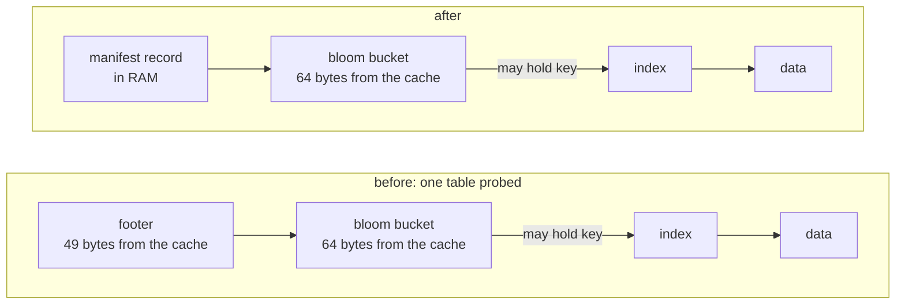

# ADR-0021: The manifest record describes a table in full; readers do not read footers

Status: Accepted (unreleased, 2026-11-22)

## Context

Every reader of a table began at its footer. A point read fetched the
footer's fields to learn where the bloom filter and the index were and
how many probes a key takes. A scan cursor and a compaction cursor
fetched it for one number, the index block's id.

After ADR-0020 a table that does not hold a key is turned away at its
filter, so for most tables a point read touches, the footer was half
the work: two ranged reads from the cache (ADR-0017), the footer's
fields and then one bloom bucket. `docs/THROUGHPUT.md` put 60% of an
absent-key read's time in those ranged reads and named the footer as
the half that could go.

The footer says seven things: the index block, the first bloom block,
the entry count, the probe count `k`, the range-tombstone block count,
the lowest sequence number, and the filter's length. The manifest
record (`TableRef`) already held the entry count, the tombstone and
bloom block counts and the lowest sequence number, and the table's
block range. The index and bloom positions follow from those, because
the layout is fixed:

```text
[data]* [rdel]* [bloom]+ [index] [footer]
```

Only `k` and the filter's length were missing.

## Decision

**The record carries the two missing facts.** `TableRef` gains
`bloom_k` and `bloom_len`, written from what the table's writer put in
its footer (`FinishedTable`). `bloom_blocks` narrows to `u16` so the
record stays the size it was: 128 bytes in the ESP32-S3 profile. The
manifest magic becomes `hrtman09`. The table format does not change.

**The record names every section.** `TableRef::bloom_first` and
`index_block` join `data_first`, `rdel_first` and `footer_block`.

**A reader is built from the record, with no I/O.**
`TableReader::from_ref(device, cache, &tref)` replaces the footer read
in `Db` point reads (`TableView`). `Scan`, `RevScan` and compaction
cursors take the index block from `tref.index_block()`. Nothing on a
`Db`'s read, scan or compaction path reads a footer block.



**The record is checked before it is followed.** `from_ref` refuses,
with `CorruptManifest`, a record whose counts do not fit its block
range or whose filter length does not fill exactly its bloom blocks. A
probe computed from a wrong length could land in an index or data
block, whose CRC would pass.

**A record may decline to describe its filter.** `bloom_k == 0` means
"not described". The reader then skips the filter and looks every key
up in the index. Hand-built records (tests, tools) use it; a table
horton writes always has `k >= 1`.

**The footer stays, for tables no manifest describes.** It is still
written, and it is still what makes a table self-describing off the
device. `ingest_table` reads and verifies the footer of the copy it is
attaching and fills the record's bloom fields from it (the archive
descriptor, `SealedTable`, is unchanged). `relocate_table` rewrites
it. `TableReader::open` reads it, for tools and tests.

## Consequences

- **A probe the filter turns away is one ranged read**, and a seek
  reads one block fewer per table it positions. The kvstore's
  measurements are in `docs/THROUGHPUT.md`.
- **A damaged footer no longer fails a read.** Nothing reads it. A
  store whose footers are all destroyed opens, reads, scans and
  compacts as before (`tests/table_records.rs` does exactly that), and
  compaction rewrites the tables with good footers. The damage
  surfaces where the footer is still used: re-attaching a copy of such
  a table is refused with `CorruptBlock`. Damage to the blocks a read
  does use is reported as it always was.
- **What vouches for a table is now the manifest alone**: its CRCs,
  and its magic, which names the table format. That is why the magic
  moved with the table format in ADR-0017 and ADR-0020, and moves here.
- **A stale manifest copy has one check fewer.** A detached reader
  (ADR-0018) that outlives a compaction reads blocks that now belong
  to another table. The footer's magic used to catch some of those
  cases by accident, when the block at the old footer position was no
  longer a footer. It caught nothing when the new table had the same
  length. The rule is unchanged (the caller keeps table writes away
  from detached readers), and so is what enforces it in the kvstore
  (its pins, and the tests that hold a reader in its table phase). The
  generation stamp ADR-0018 names as not done would close this
  properly.
- **The record and the footer must agree**, and only a bug could make
  them differ. `tests/bloom_blocks.rs` and `tests/table_records.rs`
  compare them for every table a flush, a compaction and an ingest
  produce.
- **Firmware RAM is where it was.** The record is the size it was, the
  `get()` future is 56 bytes smaller, and the ESP32-S3 profile's peak
  moves by 8 bytes: 114,040 of 114,688 (BUDGET.md). On the device a
  record is three bytes longer.
- **Old images are rejected.** `hrtman08` was never released.
- **Not done:** the block cache still takes a lock and writes shared
  state on every hit, and a point read still queues for its memtable
  probe in the kvstore. Those are what an absent-key read waits on now.

## References

- [ADR-0020](0020-bloom-filters-span-blocks-and-fold.md) (which left
  this as not done), [ADR-0017](0017-bucketed-bloom-and-ranged-reads.md),
  [ADR-0018](0018-detached-point-reads.md) (the caller's rule),
  [ADR-0003](0003-double-buffered-manifest-commit.md)
- SPEC.md §4.4 (table format), §4.5 (manifest), §4.8 (read path)
- `src/manifest.rs` (`TableRef::bloom_k`, `bloom_len`, `bloom_first`,
  `index_block`), `src/sstable.rs` (`TableReader::from_ref`),
  `src/db/read.rs` (`TableView::consider_table`), `src/scan.rs`
  (`position_cursor`), `src/compact.rs` (`init_cursor`),
  `src/db/archive.rs` (`ingest_table`), `tests/table_records.rs`
- [`docs/THROUGHPUT.md`](../THROUGHPUT.md)
