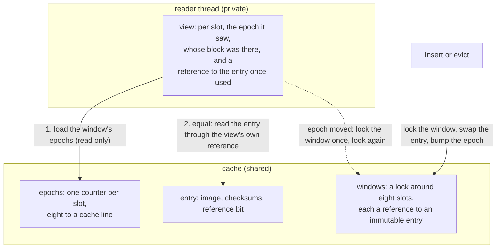

# ADR-0022: The host store's cache: a hit takes no lock and writes nothing shared

Status: Accepted (unreleased, 2026-11-22)

## Context

This record is about `examples/kvstore`, the host store, not the
library. The library's `BlockCache` is a single-owner value behind
`&mut self`, which is right for firmware and is unchanged.

The kvstore's readers run their table work on their own threads
(ADR-0018, ADR-0019) and share one block cache through the library's
`CachePort` trait. That cache was the library's `BlockCache` in eight
shards, each behind a mutex.

Every reader asks it for the same few blocks: the bloom and index
blocks of the tables a key could be in. Each hit wrote shared memory
three times: the shard's lock (taken and released), the slot's
reference bit, and the shard's hit counter. With four threads doing
that to the same slots, the cache lines holding those words travel
between the cores on every hit. `docs/THROUGHPUT.md` measured the
result once the bloom filters (ADR-0020) and the manifest record
(ADR-0021) had made everything else about an absent-key read cheap:
one thread read 516 K absent keys a second and four threads 588 K. A
profile put 60% of the four threads' time in the cache's ranged read.

What the cache holds makes a better design possible. A block image is
named by `(table id, block id)`, and horton never reuses a table id.
So a cached image is never *wrong*; it is only ever evicted. A reader
that still holds an image the cache has dropped can keep using it.

## Decision

**The kvstore has its own cache** (`examples/kvstore/cache.rs`,
`SharedCache`), 1,024 slots of 16 KiB, implementing `CachePort`. A hit
in it only reads.

- **Entries are immutable.** A cached block is an `Arc<Entry>`: the
  image and the checksums of the image never change after the entry is
  made.
- **Each reader thread keeps a view.** For each slot it has looked at
  it remembers the slot's *epoch*, whose block was there, and, once it
  has used that block, its own reference to the entry.
- **A lookup loads epochs and compares.** A block can be in one of
  eight slots (its window), whose eight epochs share a cache line.
  That line is written only when one of those slots changes. Epochs
  equal to the view's mean the view is current, and the thread reads
  the entry through its own reference: no lock, no reference count.
- **Only a change takes a lock.** Inserting or evicting locks the
  block's window, swaps the entry, and bumps the slot's epoch under
  that lock. A reader whose view of the window is stale locks it once
  to look again.
- **The reference bit is tested before it is set.** CLOCK needs to
  know which entries are in use. A hit loads the bit and stores only
  if it finds it clear: once per sweep of the hand, not once per hit.
- **Counters are per thread**, added to the shared totals every 1,024
  lookups and when the thread ends.
- **Inserts into a window take turns** behind that lock, which also
  holds the window's CLOCK hand, so a block is never cached twice.
- **An evicted entry nobody holds is made over in place** for the
  block that takes its slot. A scan streams cold blocks through the
  cache that no one reads again; it does not go to the allocator for
  each.

**ADR-0016 holds unchanged.** Only verified images are inserted (the
library's read path does that), and every hit is checked against a RAM
checksum of the image before its bytes are used; an image that fails
is dropped and the lookup is a miss. The checksum is kept per 256
bytes here, where the library keeps one per sixteenth of a block, so
the 64 bytes of a bloom bucket cost the summing of 256 bytes, not
1,024.

**No `unsafe`.** The view is a `thread_local`, the entries are `Arc`s,
the epochs are `AtomicU64`s. A reader never looks at memory another
thread may be writing: it reads either its own view or an immutable
entry it holds a reference to.

## Consequences

- **Where a read waits on the tables, four threads gain a fifth.** On
  identical tables at 1 M keys, four reader threads do 20% more
  present-key reads and 18% more seeks. One thread does 23% more
  absent-key reads (1.87 µs to 1.52 µs each): no lock, and a checksum
  over 256 bytes of a bloom block where it was 1,024.
- **Absent-key reads at four threads did not gain, because the cache
  was not what they waited on.** The Context above gives the reading
  of the profile that led here; it was wrong about the limit. Reads
  of keys past every table, which touch no table and no cache, run at
  1.65 M a second on one thread and 0.6 M on four: the request queue
  caps four threads below what one does alone, and absent-key reads
  run at that cap before this change and after it
  (`docs/THROUGHPUT.md`). The cache's locks were where the time went,
  not what the rate waited on.
- **Forward scans are 2% slower**, at one thread and at four, which is
  the size of the spread between runs and is not explained.
- **Memory can outlive its use.** An entry is freed when the cache and
  every view have let go of it. A thread drops its reference to an
  entry when it next looks at that slot and finds it changed, and
  drops all of them when it ends. A thread that stops reading but
  stays alive keeps the blocks it had used, even after the cache has
  replaced them: at most one cache's worth (16 MiB), and usually the
  bloom and index blocks it was reading, a few megabytes. A
  view takes a reference only to entries the thread has actually hit,
  not to its whole window, to keep that small. The cache has no way to
  reach into another thread's view; a bound would need the views
  registered with the cache and a lock on each, which is the write
  this design exists to remove.
- **A view costs 40 KiB a reader thread**, and one cache at a time: a
  thread that alternates between two stores rebuilds its view at each
  switch.
- **Hit counts lag.** `stats` sees a thread's last lookups (under
  1,024) when the thread next flushes or ends.
- **A miss costs what it did**: one lock, a copy of the image and its
  checksums. An entry is allocated only while the cache fills, and
  when the entry it replaces is still held by a view.
- **Workloads that miss often still write shared state often.** Every
  insert bumps an epoch, and each reader that looks in that window
  next locks it once. That is one lock per change a reader notices,
  where the old cache took one per lookup.
- **Not done:** the same for the request queue. A point read still
  queues for its memtable probe, under the engine lock. (Done since:
  ADR-0023.)

## References

- [ADR-0016](0016-cache-hits-reverify-with-a-ram-checksum.md) (the
  rule for cached images), [ADR-0007](0007-clock-block-cache.md) (the
  library's cache and `CachePort`),
  [ADR-0018](0018-detached-point-reads.md) (readers on their own
  threads), [ADR-0021](0021-the-manifest-record-describes-a-table.md)
- `examples/kvstore/cache.rs` (`SharedCache`, `Entry`, `View`,
  `lookup`, `find`, `insert`, and its tests)
- [`docs/THROUGHPUT.md`](../THROUGHPUT.md)
