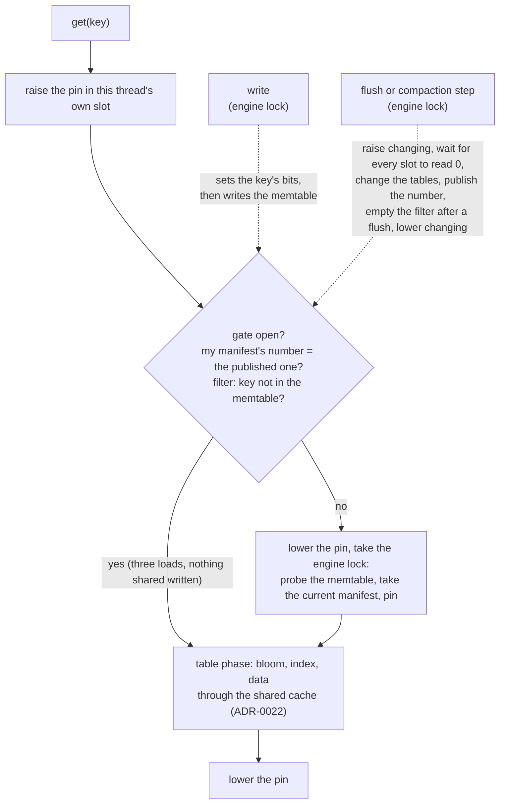

# ADR-0023: The host store's point reads: no queue, and no lock when the memtable cannot hold the key

Status: Accepted (unreleased, 2026-11-22)

## Context

This record is about `examples/kvstore`, the host store. The library
gains three small calls for it (`MemProbe::new`,
`Db::probe_memtable_into`, `MemProbe::set_absent`) and is otherwise
unchanged.

A point read has two phases (ADR-0018): what the memtable holds for
the key, which needs the `Db`, and then the tables, which do not. The
kvstore ran the second on the caller's thread and the first through
its request queue: the read was queued like a write, some thread
holding the engine lock served it, and the caller was handed the probe
and the manifest.

The queue is flat combining. It is right for writes, which have to be
serialized anyway and are cheaper committed together. For reads it
was the limit. ADR-0022 measured reads of keys past every table, which
touch no table and no cache: 1.6 M a second on one thread, 0.7 M on
four. Four threads did less than half of what one did alone, and
every other read was capped by the same thing.

Two separate costs were in there:

1. **The queue.** Each read allocated a request, a copy of its key
   and a 4 KiB probe, took the queue's lock, took a reference to the
   manifest, and usually waited for another thread to serve it.
2. **The lock.** Whatever a read does under an exclusive lock, taking
   the lock writes a cache line every reader writes. Four threads
   taking a lock for 100 ns each spend longer passing that line around
   than under the lock.

Removing the first leaves the second. And what a read asks the
database is nearly always answered the same way: the memtable holds
*nothing* for the key (it holds at most 4,096 keys, of a million), and
the tables are *the same as last time*.

## Decision

### 1. A read does not queue

A read takes the engine lock itself, probes the memtable into a probe
its thread keeps (`Db::probe_memtable_into`: nothing is allocated),
compares the engine's manifest with the thread's copy by address and
takes a reference only when it has changed, pins the tables if it will
read them, and releases the lock without running a compaction step. A scan page does the same for its copy of the
memtable. The queue carries only writes.

### 2. A read whose key the memtable cannot hold takes no lock

`examples/kvstore/gate.rs` (`Gate`) holds what a reader needs to know,
in words that are written only when the answer changes:

- **A filter over the memtable.** One 64-bit word for each entry the
  memtable can hold (32 KiB). A write sets two bits of one word for
  each key, under the engine lock, *before* it writes the memtable. A
  key whose two bits are not both set is not in the memtable. A flush
  empties the filter.
- **A flag for what the filter cannot say**: records replayed from the
  WAL at open, and range tombstones. While it is up, every read asks
  the memtable. A flush lowers it.
- **The manifest's sequence number**, published after every change to
  the tables. A reader whose own copy carries the same number has the
  current tables.
- **A pin slot for each reader thread**, on a cache line of its own,
  registered with the gate. A thread in its table phase has its slot
  raised.
- **A `changing` flag**, raised by a flush or a compaction step before
  it touches the tables.

The read's memtable probe is then known without the `Db`: nothing.
`MemProbe::set_absent(key, max_seq)` writes exactly the probe
`probe_memtable` returns when the memtable has neither a version of
the key nor a range tombstone over it, and the table phase runs from
it. The claim is the caller's; the method's documentation says what a
false one costs.

**Why a reader and a table change cannot overlap.** The reader stores
(its pin) and then loads (`changing`). The table change stores
(`changing`) and then loads (every slot). All four are sequentially
consistent, so at least one side sees the other's store. If the reader
sees `changing`, it lowers its pin, has read nothing, and takes the
engine lock, which the change holds until it is done. If it does not,
the change sees the pin and waits. This is the pin-and-wait of
ADR-0018 with the lock taken out of the reader's side.

**Why the answer is right.** With its pin up and the gate open, no
flush can empty the filter and no table can change until the reader
lowers the pin. So the manifest it holds stays current, and every key
written to the memtable before it looked at the filter has its bits
set. A write whose bits it did not see had not returned when the read
began: the two are concurrent, and the read answering without it is a
correct order. A read that begins after a write returns finds the bits
and asks the memtable.

**Every table change is bracketed by itself.** Each `flush` call and
each `compact_step` call shuts the gate, runs, publishes and opens.
(The pins used to be waited for once per operation. That was sound
only because no pin could be made without the engine lock.)

**A write notes its keys on every try.** A write that finds the
memtable or the WAL full flushes and tries again; the flush empties
the filter, so the keys are noted again before the second try. The
same for a range delete and the flag.

**Closing shuts the gate for good**, under the engine lock, then waits
for the pins. A thread that was reading without the lock is refused
like any other caller.

**A thread's manifest copy belongs to one store.** Two stores'
manifests can carry the same sequence number. A thread that reads
another store first forgets the copy it has.

### What still takes the engine lock

- A read of a key written since the last flush. That is how a thread
  reads its own writes.
- Every read while the flag is up: after a `delete_range`, or after an
  open that replayed WAL records, until the next flush.
- A thread's first read of a store, and its first after each flush or
  compaction commit: it has to take the new manifest.
- A read while a flush or a compaction step is running.
- A key the filter wrongly reports: under 1% of absent keys with the
  memtable full.
- Every scan page. A scan needs a copy of part of the memtable, not a
  yes or no.

## Consequences

Measured on identical tables (fills on one thread), 1 M keys, four
cores, against the build before this change with the same benchmark
fix (below); means of three runs, reads a second.
`docs/THROUGHPUT.md` has the method and the full table.

| | reader threads | queued probe | this change | |
|---|---:|---:|---:|---:|
| `readoutside` (keys past every table: no table, no cache) | 1 | 1,618,525 | 5,268,530 | 3.3× |
| | 2 | 890,113 | 10,114,028 | 11× |
| | 4 | 641,223 | 20,840,502 | 33× |
| `readmissing` | 1 | 738,739 | 1,153,940 | 1.6× |
| | 2 | 859,277 | 2,071,064 | 2.4× |
| | 4 | 645,098 | 4,259,914 | 6.6× |
| `readrandom` | 1 | 50,945 | 53,775 | +6% |
| | 4 | 188,246 | 204,933 | +9% |
| `seekrandom` | 4 | 63,468 | 63,429 | 0% |
| `readseq` | 4 | 7,380,259 | 7,352,198 | 0% |

- **What a read costs in the store itself is now 0.19 µs, and scales
  with the cores**: four threads do 3.96 times one thread's
  `readoutside`, where they did 0.4 times.
- **Absent-key reads scale.** One thread's went from 1.35 µs to
  0.87 µs, and four threads do 3.7 times one thread's rate, where they
  did 0.9 times.
- **Present-key reads gain 6% to 9%.** One was 19.6 µs and is 18.6:
  the queue was a microsecond of it, and the rest is the tables.
- **Seeks and scans are where they were.** A page still takes the
  engine lock once.
- **Writes are where they were**: `fillseq` +2%, `fillrandom` -1%,
  `overwrite` +1%, over nine pairs, inside the spread between runs.
- **Leaving the queue was half of it, and not the half that scales.**
  With step 1 alone (single runs, not paired), `readoutside` did 3.2 M
  on one thread and 1.2 M on four: twice the queue's rate at both, and
  still fewer on four threads than on one. That is the lock.

- **The benchmark was part of the limit.** `readmissing` built each
  key with an allocation. Once a read took half a microsecond, four
  threads spent a third of their time waiting on the allocator's lock,
  and absent-key reads on four threads ran *slower* than on one. The
  key is now built on the stack. The baseline above has the same fix,
  so the figures compare the store, not the benchmark.
- **Writers pay two bits a key**: a load, and a store if the bits are
  not there. A flush clears 32 KiB. Neither shows in the write rows
  above.
- **`delete_range` turns the lock-free path off until the next flush.**
  Reads are then what they were after step 1: the engine lock, no
  queue.
- **A read during compaction is as before.** Each step shuts the gate,
  and a reader that finds it shut waits for the engine lock. (Changed
  since: ADR-0024 takes the merge out of the engine lock, and the gate
  is shut only for a job's short steps with the database.)
- **A reader that is descheduled while pinned delays a flush**, as it
  did.
- **The order "filter, then memtable" is load-bearing**, and so is
  noting keys on every try. Both are one line each in
  `Engine::commit_group`; `store.rs` has a test for each that fails
  when the line moves.
- **32 KiB for the filter, 64 bytes for each reader thread.** A thread
  that alternates between two stores registers again at each switch,
  and takes the lock for its first read after each.
- **`stats` counts both kinds of read**, from counters each thread
  keeps in its own slot.
- **Not done:** scans still take the engine lock once a page. Range
  tombstones could be filtered by range, not by a flag. Writes are
  unchanged: one engine lock, group commit.

## References

- [ADR-0018](0018-detached-point-reads.md) (the two phases, and the
  rule that the caller keeps table writes away from readers),
  [ADR-0019](0019-detached-scans-block-pool-lazy-seek.md),
  [ADR-0022](0022-host-cache-hits-write-nothing-shared.md) (which
  measured the queue as the limit)
- `examples/kvstore/gate.rs` (`Gate::enter`, `note`, `shut`, `open`,
  `close`, `Slot`, `Pin`, and its tests)
- `examples/kvstore/store.rs` (`Shared::read`, `Shared::begin`,
  `Reader::attach`, `Engine::commit_group`, `Room::flush`,
  `Room::step`, `Store::drop`; tests
  `a_read_the_memtable_cannot_settle_waits_for_no_lock`,
  `flush_and_compaction_wait_for_a_reader_that_took_no_lock`,
  `a_compaction_step_and_a_flush_each_wait_for_a_reader`,
  `a_read_sees_every_write_before_it_whichever_way_it_goes`,
  `a_memtable_recovered_from_the_wal_is_asked_until_it_is_flushed`,
  `a_thread_reading_two_stores_keeps_their_tables_apart`,
  `a_write_that_had_to_make_room_is_still_seen`,
  `a_closed_store_answers_no_read_from_its_tables`)
- `src/db/read.rs` (`MemProbe::set_absent`, `MemProbe::new`,
  `Db::probe_memtable_into`), `tests/detached_read.rs`
- [`docs/THROUGHPUT.md`](../THROUGHPUT.md)
