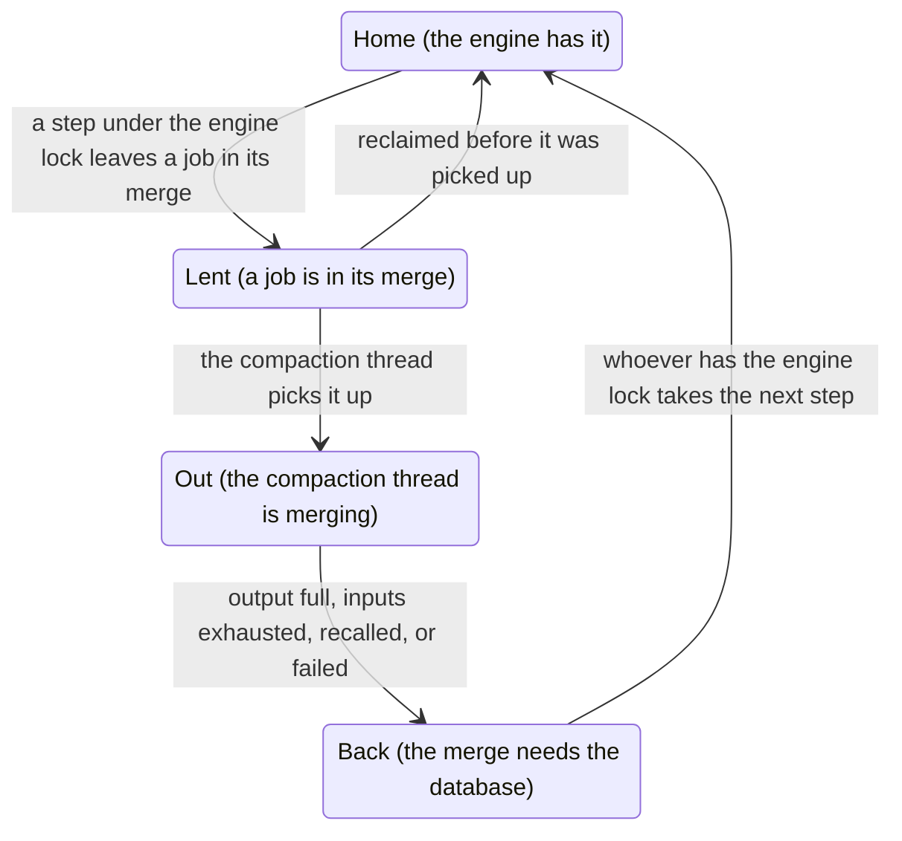

# ADR-0024: A compaction job's merge runs without the `Db`; the host store merges outside its lock, and a write that waits for room gives the lock up

Status: Accepted (unreleased, 2026-11-22). The host store now has a
compaction thread and a scratch for each of two lanes
([ADR-0025](0025-two-compaction-jobs-at-a-time.md)); what is said here
of "the compaction thread" holds for each.

## Context

`Db::compact_step` runs a compaction job a bounded piece at a time. On
firmware that is the whole design: one owner, one thread, and the idle
loop calls it. The host store (`examples/kvstore`) shares its `Db`
between threads behind one lock, the engine lock, and every
`compact_step` ran under it: at the end of each write while a job was
pending, on a compaction thread when no client was waiting, and all at
once, job after job, by whichever writer found level 0 full.

`docs/THROUGHPUT.md` named "compaction off the writers' thread" as the
largest gain left for random writes. After ADR-0023 took point reads
out of the lock it was also the last thing that put them back: each
step shut the readers' gate, so while a job ran, reads were turned away
from the tables for a step at a time, back to back.

A job is almost all merge. Selecting it, sealing an output, committing
it and opening the next need the `Db`: the manifest, the slot map, the
snapshots. The merge between those points reads the input tables and
writes blocks of a slot the `Db` has reserved, which nothing points at
until the commit. One output is up to 2,047 blocks in the host store's
shape, and each block is one step. The merge engine
(`Compaction::merge_step`) already took what it needs as arguments: a
device and the target level's table list.

## Decision

### Library: the merge quantum is a public call that does not take the `Db`

`Compaction::merge_detached(device, manifest)` runs one merge quantum
of the scratch's job: merged entries are read from the job's inputs and
written to its output through `device`, any handle to the storage the
`Db` is on, until one output block seals. It returns
`Detached::More`, or `Detached::NeedsDb` when the output is full at a
key boundary or the inputs are exhausted. The scratch remembers which
(it is a state of the scratch, at no cost in bytes), and the next
`Db::compact_step` with that scratch seals, commits and opens the next
output, or ends the job, without repeating the quantum.

- `Compaction::wants_merge()` is true when the job's next step is a
  merge quantum: after a `compact_step` that returned `Progress::More`.
- A quantum that fails returns the error to its caller and loses the
  job: the next `compact_step` abandons it, as it does when a step of
  its own fails, and returns `Progress::Done`. `Compaction::abandon()`
  does the same for a caller whose own part failed outside a quantum.
- **The caller keeps the job in place**, as it keeps table writes away
  from detached readers (ADR-0018). The `Db` cannot see a merge that
  does not borrow it. Between the `compact_step` that returned `More`
  and the next `compact_step` with that scratch, the caller must not
  run what abandons the job or changes its tables: `compact_step` with
  another scratch, `request_compaction`, `ingest_table`,
  `archive_commit`, `open`. Reads, scans, writes, `flush` and snapshots
  may run, as they may between two `compact_step`s.

That last sentence is why this is sound without new machinery. A job's
inputs, its drop rules and its snapshot watermarks are fixed when it is
selected, and `compact_step` has always allowed writes, flushes and
snapshots between two of its calls. A detached quantum is the quantum
`compact_step` would have run. `tests/detached_compaction.rs` holds it
to that: two stores are given the same history, one compacted by
`compact_step` alone and one with every quantum detached through a
second handle, and their device images must be equal byte for byte.

Firmware changes nothing and pays nothing: `compact_step` is the same
call, and the scratch is the size it was.

### Host store: the scratch is handed back and forth

The compaction scratch is in one place at a time
(`examples/kvstore/handoff.rs`):

- **Steps with the database run under the engine lock, and are short.**
  Whichever thread has the lock takes them: a writer ending its turn,
  or the compaction thread. A step selects a job and positions its
  cursors, or seals and commits the output a merge filled.
- **The merge runs on the compaction thread, with no lock.** It has a
  handle of its own to the file, opened and not duplicated, and the
  manifest copy the lending step took. It checks between quanta
  whether the engine has recalled the scratch.
- **The compaction thread never waits for the engine lock.** It tries
  it. The holder may be waiting, lock in hand, for this very thread to
  merge.
- **The readers' gate is not shut for a merge.** A merge writes only
  into a slot that was free when the job reserved it, and a slot is
  freed by a commit that shut the gate and waited for every reader
  (ADR-0023). No reader can hold a manifest that points there.
- **`compact` recalls the scratch** before it asks for a new request,
  which ends the job in flight and frees the slot it is writing.
- **Closing stops the merge** after the quantum in hand. What it wrote
  is blocks nothing points at.

### Host store: a write that waits for compaction gives the lock up

A write that finds the memtable full flushes it, under the engine
lock. When the flush is refused because level 0 or the table region is
full, room takes a compaction job. The writer used to run that job
there and then. With the merge elsewhere it has nothing to do but
wait, and it must not wait with the lock: the group it was committing
stays at the head of the queue (`Engine::stalled`), its thread
releases the engine lock, sleeps 200 µs, and looks again. Each look
takes the lock for a moment, gives compaction a step if one is due,
and tries the group again once the manifest has changed (until then no
table has, and no room was made).

Calls that are not queued (`delete_range`, `flush`, `compact`) still
see the job through with the lock in hand, lending the scratch for
each merge and waiting for it. So does a queued write when background
compaction has failed: the job is then run for that write, and what
stops it is the write's answer.

## Consequences

Measured at 1 M keys on four cores, no fsync, on a 1 GiB file, against
the build before this change; means of three pairs. `docs/THROUGHPUT.md` has the method
and the full table.

| | before | after | |
|---|---:|---:|---:|
| `readwhilewriting`, one reader and a writer, reads/s | 8,404 | 50,033 | 6.0× |
| `readwhilewriting`, four readers and a writer | 28,234 | 132,910 | 4.7× |
| `fillseq`, one writer, writes/s | 181,782 | 239,937 | +32% |
| `fillrandom`, one writer | 52,199 | 61,548 | +18% |
| `overwrite`, one writer | 50,988 | 58,248 | +14% |
| `fillseq`, four writers | 121,122 | 158,950 | +31% |
| `fillrandom`, four writers | 57,942 | 68,155 | +18% |
| `overwrite`, four writers | 57,518 | 65,930 | +15% |

- **A reader no longer waits behind a write.** One reader got 55 K
  reads a second from a quiet store and 8 K from one being written to.
  It gets 50 K now, with the writer at 59 K writes a second (53 K
  before). Nearly all of that is the write stall, not the merge: one
  or two reads in a hundred needed the engine lock (their key was in
  the memtable, or the manifest had just changed), and each of those
  waited behind a writer that held the lock for as long as its
  compaction job took.
- **Writes gain 14% to 32%**, and 99.7% of merge steps run outside the
  engine lock (442,106 of 443,340 in the one-writer run). The same
  jobs run in the same steps and leave the same tables as before.

- **Random writes are bound by the merge, and there is one merge.**
  During `fillrandom` the compaction thread uses all of one core and
  the writer a tenth of another: the writers wait for the merge, as
  they did when they ran it themselves. What the change bought for
  writes is the overlap of a writer's own work (commits, flushes)
  with the merge, not a faster merge. On the comparison's 256 MiB
  file the gain is smaller: 12% for one writer's random fills, and
  nothing for four writers'.
- **Reads of a quiet store did not change.**
- **The host store has two more moving parts**: a scratch that changes
  hands, and a head-of-queue group that can be parked. Each is one
  value in one place at a time, which is what makes it tractable, and
  `handoff.rs` and `store.rs` have tests that hold each transition
  still (a hook holds the compaction thread at a merge) and check what
  may and may not happen meanwhile.
- **A detached merge is the caller's to keep safe.** Nothing in the
  types stops a caller from requesting a compaction under a running
  merge. The merge would then write into a slot the `Db` has given
  away. As with ADR-0018, the failure would be a damaged table found
  by its CRC or, worse, a table that reads wrong; not memory unsafety.
- **Durability is the file's.** The `Db` syncs its own handle before
  it commits an output. On POSIX that syncs the file, whichever handle
  wrote the blocks. The compaction thread also syncs its handle before
  it gives the scratch back, and gives the job up if that fails.
- **A failed merge stops background compaction until the next flush.**
  The write path, which has a caller to tell, runs the job then and
  reports what stops it.
- **Not done:** flush still runs on the writer's thread, under the
  engine lock, for a few milliseconds every 4,096 entries. More than
  one job at a time, or a merge split across threads, would be what
  lifts random writes further; both are the library's to offer.
  (Changed since: ADR-0025 runs two jobs at a time, each merging on a
  thread of its own.)

## References

- [ADR-0002](0002-no-std-no-alloc-caller-owned-memory.md) (single
  owner), [ADR-0015](0015-tight-jobs-and-requested-compaction.md),
  [ADR-0018](0018-detached-point-reads.md) (the same split for reads,
  and the same kind of rule for the caller),
  [ADR-0023](0023-host-point-reads-take-no-lock.md) (the readers' gate)
- `src/compact.rs` (`Compaction::merge_detached`, `wants_merge`,
  `abandon`, `Detached`, `State`), `src/db/compaction.rs`
  (`compact_step`, `compact_advance`),
  `tests/detached_compaction.rs`
- `examples/kvstore/handoff.rs` (`Handoff`), `examples/kvstore/store.rs`
  (`Shared::background`, `Shared::merge`, `Room::step`,
  `Room::background_step`, `Room::job`, `Engine::commit_group`,
  `Engine::serve`, `Shared::submit`; tests
  `the_merge_runs_while_the_engine_lock_is_held`,
  `a_write_waiting_for_compaction_holds_no_lock`,
  `compact_recalls_a_merge_in_flight`,
  `a_failed_merge_gives_its_job_up_and_the_store_goes_on`,
  `closing_stops_a_merge_and_loses_nothing`)
- [`docs/THROUGHPUT.md`](../THROUGHPUT.md)
