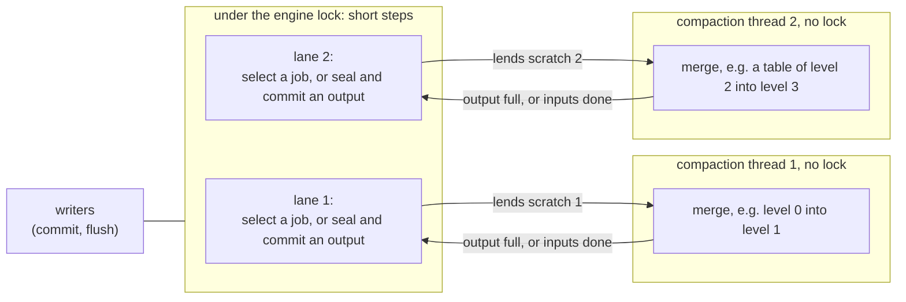

# ADR-0025: Two compaction jobs at a time, a reserve for each, and level 0 first under pressure

Status: Accepted (unreleased, 2026-11-22)

## Context

ADR-0024 took a compaction job's merge out of the host store's engine
lock. It left one job at a time, on one thread, and random writes
waiting for it: at 1 M keys the compaction thread used all of a core
and the writer a tenth of another. "More than one job at a time" was
the next thing named.

Where the one job's time went, in merge quanta of a random fill of the
host store (`examples/kvstore`, four levels of seven tables) at 1 M
keys: 70% wrote level 1 (level 0 draining), 28% wrote the bottom level
and 3% the level above it. Those are different tables. A second job
could have run beside the first for a quarter of the work.

The first version of this change did that, and nothing more: two
lanes, and rules for what may run side by side. It changed nothing at
1 M keys. In one random fill a second job passed those rules 866
times and was refused 865 times, for slots:

- The region has `LEVELS × TABLES` slots, 28 here. At 1 M keys the
  bottom level holds 17 tables.
- Flush fills whatever is left down to the compaction reserve, two
  slots, and the job in flight holds those two (the output it is
  writing, and room for one more).
- So a second job has work exactly when the region is under pressure,
  and that is exactly when it has no slot to write to.

That store is also near its capacity (it holds about 1.35 M such
keys), and there every job is one that pressure asked for. Which job
pressure asks for first turned out to matter more than how many run.

## Decision

### 1. Two lanes

`Db::compact_step_in(lane, scratch)` steps the job of one of two lanes
(`Lane::First`, `Lane::Second`; `COMPACTION_LANES` is 2). Each lane has
a scratch of its own and at most one job. A lane selects a job as
`compact_step` does, and beside a job in the other lane only one that
can run with it:

1. **The two share no table**, as source or as target. A job's inputs
   are fixed when it is selected (ADR-0024 rests on the same fact).
2. **They write to different levels.** Two jobs writing one level
   could give it overlapping tables: an output of one in a gap between
   the other's targets. One job a level also means level 0, which
   drains oldest first, has one job at a time.
3. **Neither is tight, and neither serves a request.** A tight job
   commits only when that does not grow the region, and a request
   walks the tree in an order of its own. Each runs alone.

A lane that finds no such job returns `Progress::Done` and waits for
the other. `Error::RegionFull` is returned only when no job is in
flight in the other lane: beside one, "nothing fits" means wait.
`Db::lane_target(lane)` says what level a lane's job writes to.

A job is admitted into the free slots the other job was not admitted
for. Each then has what it would have had alone.

`compact_step` is unchanged. It is one job at a time: when it selects
a job it abandons whatever any lane has in flight. A caller uses one
call or the other.

### 2. Flush keeps a reserve for each lane that is stepped

The `Db` notes which lanes its caller steps (`compact_step` leaves
one; `compact_step_in` adds its lane), and the reserve flush leaves is
kept for that many jobs:

- **Both lanes' reserves, four slots, while the region has room for a
  second job to be of use**: seven slots or more above the bottom
  level. That is both reserves, two tables in level 0 (the fewest a
  level 0 job takes under pressure), and one slot for what that job
  leaves.
- **In a fuller region, the reserve of one job more than is in
  flight.** While compaction is idle that is one job's, so flush can
  fill level 0 as it does for a one-job caller. Once a job runs, the
  second lane's is kept off.

A second lane costs no capacity. A region is full for its caller when
flush has no slot and compaction has no work; such a region has
nothing between level 0 and the bottom, so it is one of the fuller
kind, compaction is idle in it, and the reserve is one job's.

### 3. With two lanes, pressure merges level 0 first

Under region pressure `compact_step` pushes the deepest table above
the bottom level down first, then the next, then level 0. A caller
that steps two lanes gets level 0 first.

A table of level 0 is one flush: here 4,096 entries in a slot that
could hold some fifteen times that. Merging level 0's tables frees the most
slots for the least rewriting, and it is the job that can go on beside
a long merge into the bottom level. Pushing a small table at the
bottom level rewrites every table there it overlaps, and with random
keys that is all of them.

The order is by caller, not for everyone, because it was measured both
ways (below): for one job at a time, level 0 first is slower.

### 4. Host store: a thread, a scratch and a file handle for each lane

- Each lane has the hand-off of ADR-0024 to itself: its scratch is with
  the engine, or lent, or out merging, or back. Whichever thread has
  the engine lock takes one step for each lane whose scratch is there.
- **A lane that looked and found no job is not asked again** until the
  tables change or the other lane's job does. Asking shuts the
  readers' gate (ADR-0023), and horton would give the same answer. A
  write that is about to wait for compaction asks every lane once
  more.
- **A failed merge stops both lanes' background work** until the next
  flush, as one lane's did: the failed lane takes the step that gives
  its job up, and no lane starts another.
- `compact` brings both scratches home before it asks for its request.
  Closing stops both threads.

## Consequences

Random fills of a store already filled in order, one writer, no fsync,
on the host store's default 256 MiB file; writes a second, before and
after (the build before is ADR-0024's). The 1 M row is the mean of
three pairs; the others are one pair each.

| keys | `fillrandom` before | after | | `overwrite` before | after | |
|---:|---:|---:|---:|---:|---:|---:|
| 300,000 | 70,244 | 69,326 | 1.0× | 73,909 | 72,082 | 1.0× |
| 600,000 | 67,825 | 75,399 | 1.1× | 67,096 | 74,856 | 1.1× |
| 1,000,000 | 54,936 | 141,377 | 2.6× | 54,010 | 135,558 | 2.5× |
| 1,100,000 | 23,291 | 112,521 | 4.8× | 22,565 | 103,523 | 4.6× |
| 1,200,000 | 15,273 | 58,697 | 3.8× | 15,003 | 59,811 | 4.0× |
| 1,300,000 | 11,398 | 58,351 | 5.1× | 11,403 | 55,480 | 4.9× |

With four writers at 1 M keys (two pairs): `fillrandom` 65,596 to
139,818 and `overwrite` 61,571 to 133,139, 2.1 and 2.2 times.
`docs/THROUGHPUT.md` has the method and the comparison with RocksDB.

- **Random writes at the benchmark's size are 2.6 times faster, and it
  is two effects.** For the same million writes the merge did 27% less
  work (227,990 quanta before, 166,010 after), and it did it on two
  threads: 12.3 s of CPU in 7.0 s, where it was 16.7 s in 17.9 s. So
  about 1.4 times from less rewriting and 1.9 times from two merges at
  once.
- **A store with slots to spare gains nothing.** Up to 600,000 keys
  nearly all the work is level 0 draining into level 1, which is one
  job whatever the lanes. The gain is where the store was slowest.
- **The store no longer falls off as it fills.** Between 600,000 keys
  and 1.3 M it used to lose five sixths of its write rate. It now
  loses a quarter.
- **Capacity is what it was.** Both builds hold 1.3 M of these keys and
  refuse 1.4 M with `RegionFull`.

- **Reads of a quiet store did not get slower.** Pairs at one and four
  reader threads: `readrandom` 190,783 before and 194,878 after with
  four; `readmissing`, `seekrandom` and scans are up, because the
  fills leave fewer tables above the bottom level.
- **Reads while writing gave way to the writes.** With four readers and
  a writer on four cores, the readers got 133,200 reads a second while
  the writer did 43,000 writes; they get 100,134 while it does 90,000.
  There are now three busy threads besides the readers, not two.
- **One-job callers are untouched.** `compact_step` has the reserve it
  had and the order it had; `tests/compaction_lanes.rs` holds it to
  both. Firmware pays 40 bytes of `Db` for the second lane's
  bookkeeping and 160 bytes of `compact_step`'s future.
- **A host pays for the second lane**: a thread, a compaction scratch
  (497 KiB in the host store's shape) and a file handle.

- **The rules in 2 and 3 are measured, not derived.** Each was tried
  against its alternatives on this store, `fillrandom` at four sizes,
  single runs:

  | reserve | order under pressure | 1.0 M | 1.1 M | 1.2 M | 1.3 M |
  |---|---|---:|---:|---:|---:|
  | one job's (before) | deepest first | 52,959 | 22,569 | 15,484 | 11,373 |
  | both lanes', always | deepest first | 163,564 | 125,013 | 6,430 | 5,840 |
  | both lanes', always | level 0 first | 136,738 | 106,110 | 58,860 | 5,910 |
  | one job more than in flight | deepest first | 85,535 | 23,235 | 15,648 | |
  | one job more than in flight | level 0 first | 27,549 | 48,891 | 61,546 | 58,826 |
  | **both with room, else one more** | **level 0 first** | 138,949 | 107,333 | 58,734 | 58,571 |

  The chosen row is the only one that is never below the first. Every
  other rule is the best somewhere and collapses somewhere else: a
  fixed second reserve is most of what flush has to batch in once the
  region is nearly full, and without it a second job has nowhere to
  run. One lane with level 0 first did 29,954 at 1.0 M, against
  52,959 deepest first, which is why the order follows the caller.
- **The threshold is this shape's.** Seven slots above the bottom level
  was reasoned from what a second job needs and it sits where the
  measurements put it (the store has seven at 1.2 M keys and six at
  1.3 M). It has not been tried on another shape or another workload.
  The test's 7-level shape exercises both sides of it.
- **What a detached merge asks of its caller (ADR-0024) now holds for
  two.** Nothing in the types stops a caller from requesting a
  compaction under either lane's running merge.
- **Not done:** level 0 draining into level 1 is still one job, and
  with slots to spare it is nearly all the work. Splitting that merge
  by key range across threads is what would lift the unpressured
  store. Flush still runs on the writer's thread. The pressure order
  for a one-job caller was left alone; on a store this full it pushes
  small tables at the bottom level one at a time, and that is most of
  why the old rates fell as the store filled.

## References

- [ADR-0010](0010-per-node-leveled-compaction.md) (selection),
  [ADR-0015](0015-tight-jobs-and-requested-compaction.md) (tight jobs,
  requests, the reserve),
  [ADR-0023](0023-host-point-reads-take-no-lock.md) (the readers'
  gate), [ADR-0024](0024-detached-compaction-merges.md) (the detached
  merge and the hand-off)
- `src/db/compaction.rs` (`compact_step_in`, `compact_select`,
  `try_select_group`, `pick_sources`, `other_jobs`, `lane_target`),
  `src/db/mod.rs` (`Lane`, `Job`, `jobs_reserved`,
  `compaction_reserve`, `free_slot_for`), `src/db/invariants.rs`
- `tests/compaction_lanes.rs` (two lanes stepped at random against a
  model, with snapshots and power cuts;
  `a_second_lane_changes_the_reserve_and_the_order_under_pressure`,
  `under_pressure_one_job_goes_deepest_first_and_two_lanes_take_level_0`,
  `a_region_too_full_for_two_reserves_keeps_one_while_compaction_is_idle`,
  `a_second_lane_costs_no_capacity`)
- `examples/kvstore/store.rs` (`Shared::background`, `Room::background`,
  `Room::step`, `Room::job`, `Engine::background_step`; tests
  `two_merges_run_at_once_and_change_no_read`,
  `an_idle_lane_is_not_stepped_until_something_changes`,
  `compact_brings_every_scratch_home`,
  `a_failed_merge_gives_its_job_up_and_the_store_goes_on`)
- [`docs/THROUGHPUT.md`](../THROUGHPUT.md)
